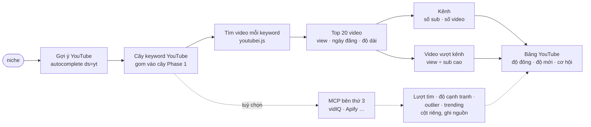

# Phase 51 · YouTube Search

> Gõ một niche → biết **người ta tìm gì trên YouTube**, video nào đang hút view, kênh nhỏ nào thắng kênh to —
> **không dùng AI**, chỉ cào số. Thêm tuỳ chọn lấy số từ **MCP bên thứ 3** (vidIQ…) để có lượt tìm + độ cạnh tranh
> mà tự cào không có.

Chưa làm · sau MVP (Phase 1–45)

## Chạy thế nào

## Chọn thư viện (kiểm lại lúc làm)

| Cách | Là gì | Ưu | Nhược |
|---|---|---|---|
| **`youtubei.js`** (đề xuất) | thư viện Node gọi API nội bộ của YouTube (InnerTube) — không cần key | đủ: tìm, chi tiết video, kênh, comment, phụ đề | không chính thức, YouTube đổi là gãy |
| YouTube Data API v3 | API chính thức, key miễn phí | ổn định | quota 10.000 đơn vị/ngày, 1 lần tìm = 100 → ~100 lần tìm/ngày |
| `yt-dlp` | công cụ dòng lệnh (Python) | rất bền, cộng đồng sửa nhanh | phải cài thêm Python + yt-dlp trên máy |

Đề xuất: `youtubei.js` làm chính; Data API là **dự phòng tuỳ chọn** khi có key. Đo endpoint còn chạy trước khi code
(như Phase 2).

## MCP bên thứ 3 (tuỳ chọn)

**MCP** (Model Context Protocol) = cổng chuẩn để Claude / app gọi dữ liệu của dịch vụ khác. Một số tool YouTube đã có
MCP, cho số mà tự cào **không có**: lượt tìm ước tính, độ cạnh tranh keyword, video outlier, video đang trending.
Tắt hết MCP thì Phase 51 vẫn chạy đủ bằng `youtubei.js`.

Các MCP đã tìm được (2026-10-24, tiền và giới hạn kiểm lại lúc làm):

- **vidIQ** (đề xuất thử trước)
    - Cho gì: `keyword_research` (lượt tìm + độ cạnh tranh), `outliers`, `trending_videos`, `video_transcript`, so kênh đối thủ
    - Cách nối: remote MCP `https://mcp.vidiq.com/mcp`. Trong Claude: thêm từ Connector Directory. App gọi thẳng: **API key chỉ đọc**
    - Tiền: có cả gói Free; mỗi lần gọi trừ credit trong gói (đa số tool ~5 credit)
- **Apify YouTube MCP**
    - Cho gì: metadata video, số liệu kênh, comment, phụ đề, tìm theo từ
    - Cách nối: remote MCP + `APIFY_TOKEN`
    - Tiền: trả theo lượt gọi / theo actor
- **MCP cộng đồng dùng YouTube Data API**
    - Cho gì: tìm video, số liệu kênh
    - Cách nối: chạy trên máy, key Google miễn phí
    - Tiền: 0 đ, nhưng dùng chung quota 10.000 đơn vị/ngày với Data API ở trên
- **TubeBuddy:** chưa thấy MCP

**Hai tuyến dùng MCP** (giống tuyến A / B của [Phase 4](phase-4-feature-gap.md)):

- **Tuyến job (đề xuất, không cần key trong app):** tool xuất file job `.json` (Top 10 keyword YouTube + câu hỏi) →
  Claude Code / Claude Desktop đã nối vidIQ chạy job → ghi kết quả `.json` → nhập lại vào tool.
- **Tuyến gọi thẳng:** app dùng MCP client gọi `mcp.vidiq.com` bằng API key chỉ đọc (lưu `.env.local`)
  — chỉ làm nếu tuyến job chạy ổn và cần tự động.

**Bài thử trước khi chọn:** 1 niche × Top 10 keyword, so lượt tìm vidIQ với độ đông tự cào + Google Trends
(cùng chiều không?), ghi credit đã tốn và thời gian vào bảng thử ở trang này.

## Làm gì

| | |
|---|---|
| :material-magnify: **Gợi ý YouTube** | autocomplete riêng của YouTube làm nguồn keyword thứ 4 — gắn nhãn `YT` trong cây keyword |
| :material-video: **Top video mỗi keyword** | view · ngày đăng · độ dài · kênh — chỉ cho Top 10 keyword (như Trends) |
| :material-account-group: **Độ đông YouTube** | tổng view top 20 + số kênh lớn (> 100k sub) → thang 0–1 |
| :material-clock-fast: **Độ mới** | bao nhiêu video top đăng trong 12 tháng — niche đang sống hay đã nguội |
| :material-rocket-launch: **Video vượt kênh** | view ÷ sub cao (kênh nhỏ mà video to) → dấu hiệu nhu cầu thật, nội dung còn thiếu |
| :material-chart-bar: **Lượt tìm + cạnh tranh (MCP, tuỳ chọn)** | cột riêng `vidIQ` cạnh cột tự cào: lượt tìm ước tính, điểm cạnh tranh, outlier, trending — mỗi số ghi nguồn + ngày |
| :material-download: **CSV** | như Phase 1 (cột MCP có tiền tố `vidiq_`) |

**Luật cào**

- Gọi thưa (≥ 2 giây / request), cache 24 giờ, chỉ Top 10 keyword
- Bị chặn → dừng nguồn đó, báo trên UI, các nguồn khác vẫn chạy — không vượt captcha, không dùng proxy xoay
- Số view / sub ghi kèm **ngày lấy**

**Luật MCP**

- Số của MCP là **ước tính của bên thứ 3**: để cột riêng, ghi tên nguồn, không trộn vào điểm cơ hội Phase 1
- Có **trần credit mỗi niche**, hết thì dừng và báo; mặc định tắt
- Chỉ dùng quyền **đọc** (API key chỉ đọc). Không dùng quyền sửa video của vidIQ
- Claude không tạo tài khoản, không trả phí gói vidIQ / Apify. Anh tự tạo key, Claude nối code

**Xong khi**

- 3 niche thật có cây keyword YouTube + bảng top video + cột "video vượt kênh"
- Một lần chạy không bị chặn; test xanh; screenshot đã Read
- Bảng thử MCP điền đủ (vidIQ + ít nhất 1 MCP khác hoặc lý do bỏ); nếu dùng: 1 niche có cột vidIQ qua tuyến job, dưới trần credit

**Không làm ở phase này**

- Đọc nội dung video / comment bằng AI — [Phase 52](phase-52-youtube-ai.md)
- Tải video về máy
- Ước doanh thu kênh từ view
- Mua gói trả phí vidIQ / TubeBuddy chỉ để có số — chỉ xét khi bảng thử cho thấy cần
- Dùng tool tạo nội dung của MCP (`generate_titles`, `generate_thumbnail`, `generate_clips`) — ngoài việc chọn niche

Plan code chi tiết: [Phase 51](../superpowers/plans/2026-10-25-niche-radar-phase31-youtube-search.md)
