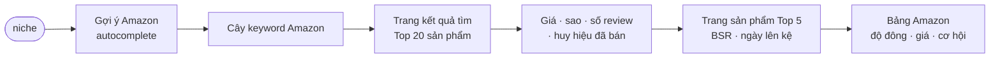

# Phase 52 · Amazon Search

> Gõ một niche → biết **người ta tìm gì trên Amazon**, sản phẩm nào bán chạy, đông tới đâu, giá bao nhiêu —
> **không dùng AI**, chỉ cào số. Hợp niche sản phẩm số / vật lý đi kèm app (planner, template, journal…).

Chưa làm · sau Phase 51

## Chạy thế nào

## Chọn cách lấy (kiểm lại lúc làm)

| Cách | Là gì | Ưu | Nhược |
|---|---|---|---|
| **Gợi ý Amazon** (autocomplete) | endpoint gợi ý tìm kiếm công khai | nhẹ, ít bị chặn | chỉ có keyword |
| **Cào trang tìm + trang sản phẩm** (đề xuất) | `fetch` + `cheerio` đọc HTML | 0 đ, đủ giá / sao / review / BSR | Amazon chặn rất nhanh, hay hiện captcha |
| Amazon Product Advertising API | API chính thức | ổn định | cần tài khoản Associates có doanh số — không hợp tool nội bộ |

**Luật cào** (chặt hơn các nguồn khác)

- Gọi rất thưa (≥ 5 giây / request), cache 7 ngày, chỉ Top 5 keyword × Top 20 sản phẩm
- Gặp captcha / trang chặn → **dừng nguồn Amazon**, báo trên UI; **không vượt captcha**, không proxy xoay
- Không đăng nhập Amazon, không đọc trang cần đăng nhập

## Làm gì

| | |
|---|---|
| :material-magnify: **Gợi ý Amazon** | nguồn keyword riêng, nhãn `AMZ` trong cây |
| :material-cart: **Top 20 sản phẩm** | giá · sao · số review · huy hiệu "bought in past month" (khi có) |
| :material-account-group: **Độ đông Amazon** | tổng review top 20 (thang log) |
| :material-trophy: **BSR top 5** | hạng bán chạy theo danh mục — số Amazon tự công khai |
| :material-cash: **Khoảng giá** | thấp · trung vị · cao |
| :material-clock-fast: **Lính mới thắng** | sản phẩm lên kệ < 12 tháng mà vào top → còn chỗ chen |

**Xong khi**

- 3 niche thật có cây keyword Amazon + bảng top sản phẩm + khoảng giá
- Chạy 3 niche liền không chạm captcha (hoặc chạm thì UI báo đúng, nguồn khác vẫn chạy)
- Test xanh; screenshot đã Read

**Không làm ở phase này**

- Đọc review bằng AI — [Phase 53](phase-53-amazon-ai.md)
- Ước doanh số từ BSR (chỉ ghi BSR, không quy ra tiền)
- Dịch vụ trả phí (Jungle Scout, Helium 10, Keepa)

Plan code chi tiết: [Phase 52](../superpowers/plans/2026-10-25-niche-radar-phase33-amazon-search.md)
