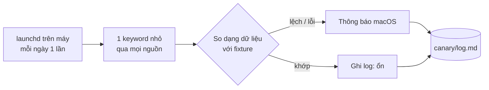

# Phase 52 · Canary nguồn thật

> Google, Apple hay đổi trang mà không báo trước. Mỗi ngày tool **tự gọi thật một lượt nhỏ** tới từng nguồn (canary —
> con chim báo động sớm). Nguồn đổi dạng hay bị chặn thì biết trong 1 ngày, không phải lúc đang chọn niche.

Chưa làm · sau Phase 50

## Chạy thế nào

## Làm gì

| | |
|---|---|
| :material-calendar-clock: **Lịch chạy** | launchd (bộ hẹn giờ có sẵn của macOS) chạy mỗi ngày trên máy |
| :material-magnify: **Gọi thật, gọi thưa** | 1 keyword nhỏ qua mọi nguồn, giữ giới hạn gọi của từng nguồn |
| :material-file-compare: **So dạng dữ liệu** | so với fixture của Phase 50: thiếu trường, đổi tên trường, kết quả rỗng |
| :material-bell-alert: **Báo lỗi** | lỗi → thông báo macOS + ghi `canary/log.md` |

**Xong khi**

- Chạy 7 ngày liền có log trong `canary/log.md`
- Cố tình đổi fixture → canary báo "nguồn đổi dạng"
- Một nguồn bị chặn / rỗng → có thông báo macOS ghi rõ nguồn nào

**Không làm ở phase này**

- Gọi dày, gọi nhiều keyword
- Chạy trên server hay trên CI
- Tự sửa collector khi nguồn đổi (chỉ báo, người sửa)

[Tổng quan Version 6](version-6.md)
