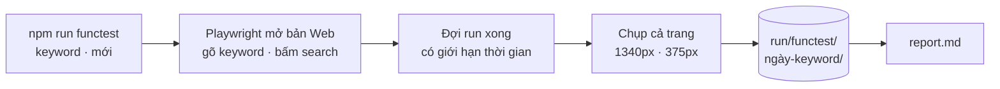

# Phase 53b · Test chức năng thật + chụp màn kết quả

> Phase 51 chạy trên dữ liệu giả nên không biết **search thật** ra màn hình thế nào. Phase này gõ keyword thật, đợi
> tool chạy xong, rồi **chụp lại màn kết quả** để anh mở ra xem ngay, không phải tự bấm lại.

Tùy chọn · chạy tay khi cần

## Chạy thế nào

## Làm gì

| | |
|---|---|
| :material-console: **Lệnh** | `npm run functest -- "<keyword>"` (mới). Bỏ trống thì lấy 1 keyword trong bộ niche chuẩn Phase 53 |
| :material-magnify: **Search thật** | Playwright mở bản Web, gõ keyword → bấm search → đợi run xong (có giới hạn thời gian) |
| :material-camera: **Chụp màn** | chụp cả trang từng màn kết quả: tóm tắt run, bảng keyword, đối thủ, chủ đề than, so sánh niche — ở 1340px và 375px |
| :material-folder-image: **Lưu** | `run/functest/<ngày>-<keyword>/` |
| :material-file-document-outline: **report.md** | bước nào qua / hỏng, thời gian từng bước, nguồn nào rỗng, link tới ảnh |
| :material-check-circle-outline: **Kiểm tối thiểu** | bảng keyword có ≥ 1 dòng · không có ô "lỗi" / trang trắng · console không có lỗi đỏ. Không so ảnh với ảnh chuẩn (dữ liệu thật đổi mỗi ngày) — ảnh là để người xem |

**Xong khi**

- Một lệnh ra đủ thư mục ảnh + `report.md`
- Cố tình tắt 1 nguồn → `report.md` ghi rõ nguồn đó rỗng, ảnh vẫn chụp được phần còn lại

**Không làm ở phase này**

- Chạy tự động hằng ngày (việc của canary Phase 52)
- Đưa vào `npm test`
- Chạy trên CI

[Tổng quan Version 6](version-6.md)

Plan code chi tiết: [Phase 53b](../superpowers/plans/2026-10-25-niche-radar-phase53b-functest-screenshots.md)
