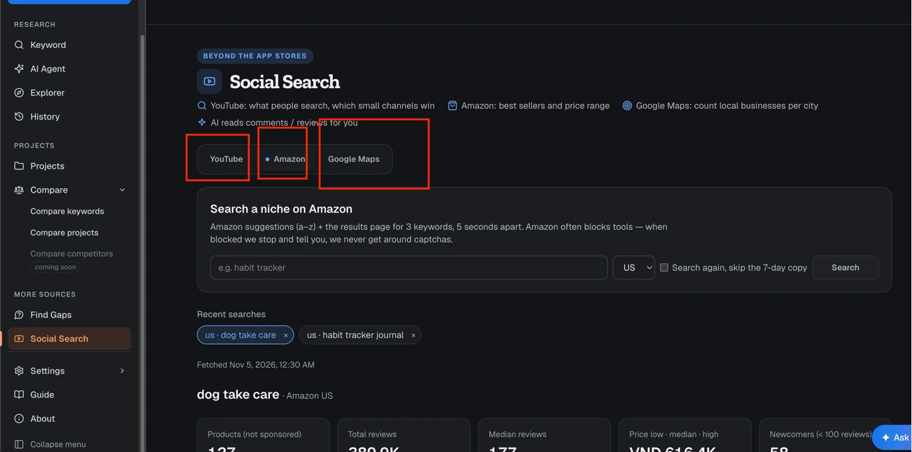
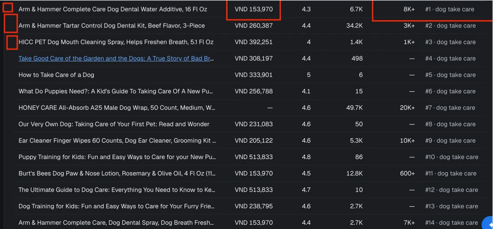

# 4.2 · YouTube · Amazon · Google Maps: tách trang riêng + có hình (Phase 55.1)

> Hiện tại 3 nguồn ngoài store nằm chung trang **Social Search**, chia bằng 3 tab. Bảng kết quả chỉ có chữ: không có
> thumbnail video, không có ảnh sản phẩm. Amazon US còn hiện giá bằng **VND**. Phase này tách mỗi nguồn ra một trang riêng
> trên sidebar, thêm **thumbnail thật** (YouTube, Amazon) và sửa các lỗi soát được. Cách cào và nút AI giữ nguyên.

<span class="chip chip--doing">M1–M3 code xong 2026-11-05 · M4, M5 chưa làm</span>

<div class="box box--star" markdown>
**Đã làm (2026-11-05)** — anh chốt tách 3 trang

- Sidebar **More sources**: Find Gaps · YouTube · Amazon · Google Maps; route `/youtube`, `/amazon`, `/maps` + `/<nguồn>/<id>`; link cũ `/social?tab=…&id=…` tự chuyển
- YouTube: thumbnail 96×54 ở bảng Top video (viền xanh khi view ≥ 3× sub), tên 2 dòng + kênh · sub dòng dưới; comment có thumbnail nhỏ của video
- Amazon: đọc ảnh `img.s-image` (chỉ nhận link CDN Amazon), gửi cookie tiền theo chợ; bảng có `#` · ảnh 48×48 · tên 2 dòng · nhãn lính mới; cột Keyword chỉ khi > 1 keyword; ô giá báo khi tiền không khớp chợ
- Chạy thật 2026-11-05: tra lại `dog take care` chợ US → không bị chặn, 132/132 sản phẩm có ảnh, giá `$5.99`… (trước: `VND 153,970`)
</div>

## 1 · Hiện trạng — soát ngày 2026-11-05





| # | Lỗi | Ở đâu trong code |
|---|---|---|
| 1 | Tab đang mở chỉ có 1 chấm nhỏ, trông như 3 nút ngang hàng. Không biết mình đang ở nguồn nào | `SocialPage.tsx` (dùng `Tabs` chung) |
| 2 | Tên "Social Search" sai với 2/3 nguồn: Amazon là chợ bán hàng, Google Maps là cửa hàng địa phương, không phải mạng xã hội | `SideNav.tsx`, `SocialPage.tsx` |
| 3 | Bảng **Top video** và **Top sản phẩm** không có hình. Phải bấm link mới biết video / sản phẩm trông ra sao (ô đỏ bên trái ảnh 2) | `YoutubeResult`, `AmazonResult` |
| 4 | Amazon **US** hiện giá `VND 153,970`. Amazon đổi tiền theo IP của máy (máy ở Việt Nam), số không so được với chợ Mỹ | `collectors/amazon.ts` (header gửi đi) |
| 5 | Cột cuối `#1 · dog take care` lặp keyword ở mọi dòng khi chỉ tra 1 keyword; hạng nằm cuối hàng thay vì đầu hàng | `AmazonResult` |
| 6 | Lịch sử tra 3 nguồn trộn chung một kiểu chip; link kết quả là `/social?tab=amazon&id=5`, khó gửi, khó đánh dấu | `History` trong `SocialPage.tsx` |

## 2 · Tách trang riêng hay giữ tab?

| | Giữ 1 trang, 3 tab (như nay) | **Tách 3 trang riêng (đề xuất)** |
|---|---|---|
| Người dùng | Phải biết "Social Search" chứa Amazon + Maps mới tìm thấy | Thấy thẳng **YouTube · Amazon · Google Maps** trên sidebar |
| Việc cần làm | Mỗi nguồn trả lời một câu khác nhau (người xem than gì · sản phẩm bán chạy · cửa hàng ở thành phố nào) nhưng dùng chung một khung | Mỗi trang có ô tra, ô số, bảng hợp với nguồn đó |
| Link | `/social?tab=amazon&id=5` | `/amazon/5` — gửi được, F5 vẫn đúng, giống trang Keyword `/r/:id` |
| Lịch sử | Trộn 3 nguồn | Mỗi trang lịch sử riêng, có cột hợp nguồn (Amazon: chợ · Maps: thành phố) |
| Lớn thêm về sau | Thêm thumbnail, biểu đồ, so sánh → 1 file `SocialPage.tsx` (412 dòng) phình to | Mỗi nguồn một file trang, dùng chung khung (ô tra, ô số, bảng, phân trang) |
| Công sức | 0 | Vừa phải: 3 route + sidebar + chuyển link cũ. Không đụng collector, API, DB |

**Đề xuất: tách 3 trang**, nhóm trên sidebar là **More sources** (đang có Find Gaps):

```text
MORE SOURCES
  Find Gaps
  YouTube          /youtube        /youtube/:id
  Amazon           /amazon         /amazon/:id
  Google Maps      /maps           /maps/:id
```

- Link cũ `/social`, `/social?tab=amazon&id=5` → tự chuyển sang trang mới (không gãy bookmark, không gãy link trong export).
- Phần dùng chung tách ra `SourceSearchShell` (tiêu đề · ô tra · lịch sử · ô số), mỗi trang chỉ viết phần kết quả riêng.
- Ở trang Keyword search (`/r/:id`), khối **Đi tiếp** thêm 2 nút "Tra trên YouTube" · "Tra trên Amazon", điền sẵn keyword + nước.

## 3 · Thumbnail lấy từ đâu — đã đo thật

**YouTube.** Mỗi video đã có `id` trong dữ liệu đang lưu. Ảnh là `https://i.ytimg.com/vi/<id>/mqdefault.jpg` (320×180),
không cần gọi thêm API, không tốn lượt. Đo 2026-11-05: trả `200`, có `access-control-allow-origin: *`.

**Amazon.** Trang kết quả có sẵn ảnh trong thẻ `img.s-image` (`m.media-amazon.com/images/I/…_AC_UL320_.jpg`), collector
hiện bỏ qua. Chỉ cần đọc thêm trường này lúc cào và lưu vào từng sản phẩm. Lượt tra cũ chưa có ảnh: hiện ô xám, tra lại là có.

**Giá đúng tiền chợ.** Đo 2026-11-05, cùng 1 trang `amazon.com/s?k=dog+dental`, mỗi kiểu chỉ thử **1 lần** (chưa đủ để kết luận về chuyện bị chặn):

| Gửi kèm | Kết quả |
|---|---|
| Không cookie (như code hiện tại) | `503`, bị chặn |
| Cookie `i18n-prefs=USD; lc-main=en_US` | `200`, 48 sản phẩm, có ảnh `s-image`, giá `$18.95` |

Mỗi chợ gửi đúng tiền của chợ đó (US → USD, UK → GBP, DE → EUR, JP → JPY…). Nếu vẫn bị trả tiền khác thì ô giá ghi rõ
"tiền theo IP máy bạn", không tự đổi tỷ giá.

**Ảnh hiện thế nào trong app.** Ảnh tải thẳng từ YouTube / Amazon về máy người dùng lúc xem (app không tải về, không lưu
file ảnh). CSP của app Mac đang tắt (`csp: null`) nên không cần sửa cấu hình. Ảnh lỗi → ô xám cùng kích thước để hàng không nhảy.

### Mẫu: dữ liệu thật, ảnh thật

Top video YouTube cho keyword `zombie stickman` (lượt tra lưu ngày 2026-11-04):

<table>
<thead><tr><th>Thumbnail</th><th>Video · kênh</th><th>View</th><th>View ÷ sub</th></tr></thead>
<tbody>
<tr><td></td><td>Stickman Sniper : Scary Zombies Android Gameplay HD<br><small>Pryszard Android iOS Gameplays · 1.75M sub</small></td><td>22.4M</td><td>12.8×</td></tr>
<tr><td></td><td>Stickman mentalist. Zombie Apocalypse and Post Apocalypse.<br><small>SVSstudio · 633K sub</small></td><td>18.8M</td><td>29.6×</td></tr>
<tr><td></td><td>Counter-Strike 1.6 - cs_italy (Zombie Server) - Animation<br><small>Sora Animation · 178K sub</small></td><td>15.9M</td><td>89.4×</td></tr>
</tbody>
</table>

Top sản phẩm Amazon US cho keyword `dog dental` (trang tải ngày 2026-11-05, đã bỏ sản phẩm tài trợ):

<table>
<thead><tr><th>Ảnh</th><th>Sản phẩm</th><th>Giá</th><th>Review</th></tr></thead>
<tbody>
<tr><td></td><td>Oxyfresh Premium Pet Dental Care Solution Pet Water Additive</td><td>$18.95</td><td>40,870</td></tr>
<tr><td></td><td>Vet's Best Dog Toothpaste & Toothbrush Dental Care Kit</td><td>$15.13</td><td>50,183</td></tr>
<tr><td></td><td>Dog Dental Powder, Dog Teeth Cleaning Powder</td><td>$16.99</td><td>29 · <b>lính mới</b></td></tr>
</tbody>
</table>

Nhìn ảnh là thấy ngay: 2 sản phẩm đầu là hàng lâu năm (hàng chục nghìn review), sản phẩm thứ 3 mới vào (29 review) mà
đã lên trang 1. Đây là tín hiệu "còn chỗ chen" mà bảng chữ hiện tại khó thấy.

**Google Maps** không có thumbnail: OpenStreetMap không có ảnh cửa hàng, ảnh của Google Maps không cào được bằng code. Trang Maps
không thêm ảnh, chỉ sửa chữ và bố cục (M4).

## 4 · Làm gì

### M1 · Tách 3 trang + sidebar

- Route `/youtube`, `/amazon`, `/maps` và `/…/:id` cho từng lượt tra. API `/api/social/*` giữ nguyên.
- Sidebar nhóm **More sources**: Find Gaps · YouTube · Amazon · Google Maps (icon riêng từng nguồn, mục đang mở tô màu như các mục khác).
- `/social` và `/social?tab=…&id=…` chuyển sang trang mới.
- Tách khung chung `SourceSearchShell`: tiêu đề + 1 câu mô tả · ô tra (keyword + nước / chợ đặt trước nút) · lịch sử của nguồn đó · ô số.
- Ô số dùng lại kiểu gọn của trang Keyword (4 cột khi khung đủ rộng, theo `@container`), ô cuối không còn sát mép phải, bị nút Ask AI che như ảnh 1.

### M2 · YouTube: thumbnail + bảng dễ đọc

- Cột đầu bảng **Top video**: thumbnail 96×54 (16:9), bo góc, bấm mở video. Cột này dính trái cùng tên video khi cuộn ngang.
- Tên video 2 dòng (`line-clamp-2`) thay vì 1 dòng bị cắt. Kênh + số sub nằm dòng nhỏ dưới tên, bỏ cột Kênh riêng → bảng hẹp lại.
- Video "kênh nhỏ thắng" (view ≥ 3× sub) có viền xanh quanh thumbnail, cùng màu với số `12.8×`.
- Khối comment: mỗi comment có thumbnail nhỏ (48×27) của video nó thuộc về.

### M3 · Amazon: ảnh sản phẩm + giá đúng chợ

- Collector đọc thêm `img.s-image` → trường `image` của mỗi sản phẩm (sửa ở `parseSerpHtml` + extension ShotMatic Scout dùng chung khuôn).
- Gửi cookie tiền tệ theo chợ (bảng mục 3). Có test: HTML mẫu có `s-image` → đọc đúng link; chợ US → header có `i18n-prefs=USD`.
- Bảng **Top sản phẩm**: cột `#` hạng ở đầu → ảnh 48×48 → tên 2 dòng → giá · ★ · review · bán/tháng. Cột Keyword chỉ hiện khi lượt tra có > 1 keyword.
- Nhãn **lính mới** (< 100 review) và **tài trợ** ngay dưới tên, để nhìn ảnh + nhãn là biết sản phẩm nào mới chen vào.
- Ô giá: nếu Amazon vẫn trả tiền khác tiền của chợ → ghi "tiền theo IP máy bạn" (đang có trong tooltip, đưa ra ngoài cho thấy).

### M4 · Google Maps: chỉ bố cục

- Bảng thành phố giữ nguyên số; thêm thanh ngang nhỏ trong ô % (có website / điện thoại / giờ / đặt lịch) để so nhanh giữa thành phố.
- Mẫu 20 chỗ mỗi thành phố: xếp 1 cột, mỗi dòng có link Google Maps (như nay), không thêm ảnh.

### M5 · Nối với trang Keyword search

- Khối **Đi tiếp** ở `/r/:id`: nút "Tra trên YouTube", "Tra trên Amazon" mở trang mới với keyword + nước điền sẵn (chưa tự chạy, người dùng bấm tra).
- Nếu keyword đó đã tra trên YouTube / Amazon trong 7 ngày → nút ghi "Xem kết quả YouTube (2 ngày trước)" mở thẳng lượt tra cũ.

## 5 · Không làm

- Không tải ảnh về máy, không lưu file ảnh vào DB (chỉ lưu link).
- Không vượt captcha / trang thử thách của Amazon, không proxy, không đăng nhập (giữ luật của Phase 53).
- Không cào ảnh Google Maps.
- Không đổi tỷ giá tự động (không có nguồn tỷ giá đáng tin trong app).
- Không đổi cách tính ô số, nhãn Còn chỗ / Đông, nút AI.

## 6 · Xong khi

- Sidebar có 3 mục YouTube · Amazon · Google Maps; link cũ `/social…` vẫn mở đúng lượt tra.
- Bảng Top video và Top sản phẩm có ảnh thật; ảnh lỗi ra ô xám, hàng không nhảy.
- Tra lại `dog take care` chợ US: giá hiện `$`, không còn `VND`.
- Soát ở 960px và 1340px, sáng + tối, tiếng Việt + English: không cuộn ngang cả trang, chỉ bảng cuộn ngang.
- `npm run check` xanh, có test mới cho đọc ảnh Amazon + header tiền tệ.

## 7 · Cần anh chốt

1. Tách 3 trang (đề xuất) hay giữ 1 trang 3 tab, chỉ thêm ảnh + sửa lỗi?
2. Tên nhóm trên sidebar: giữ **More sources**, hay đổi thành **Ngoài store** / **Beyond app stores**?
3. M5 (nút từ trang Keyword sang YouTube / Amazon) làm luôn trong phase này hay để sau?
