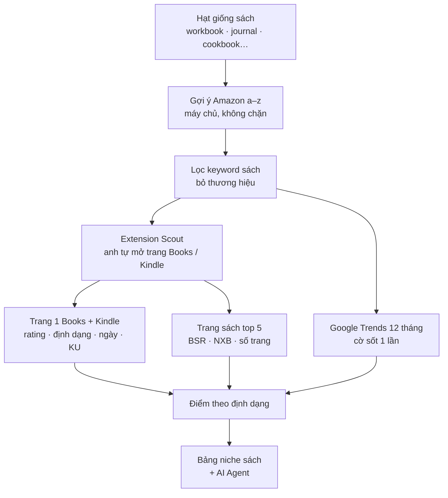

# 4.3 · Amazon Books: research sách Kindle · Paperback · Hardcover (Phase 55.2)

> Trang Amazon hiện tại tìm **mọi loại hàng**, nên chưa dùng được cho người viết hoặc làm sách: gõ `journal for men` thì ra
> sổ da và nhật ký có khoá chứ không ra sách. Phase này thêm chế độ **Books** chỉ tìm sách. Mỗi keyword trả lời 3 câu:
> có người mua không, người mới có chen vào được không, và nên ra định dạng nào (Kindle, paperback hay hardcover).
> Đầu ra là danh sách niche sách đã chấm điểm, mỗi điểm có số đo đi kèm.

M1–M7 có code, xong 2026-11-07 · còn đo trên Amazon thật bằng Chrome của anh (mục 9)

**Đã làm (2026-11-05)**

1. **M1:** trang `/amazon` có nút gạt *Mọi sản phẩm / Sách · Kindle · Hardcover*. Chế độ sách chỉ gọi gợi ý Amazon a–z
   (giữ keyword dáng sách, gắn cờ thương hiệu) + Google Trends 12 tháng. Máy chủ **không mở trang tìm Amazon** (test kiểm 0 lượt).
2. **M2:** khối *Dán trang Amazon*: 2 nút mở mục Books và Kindle Store trên Amazon, anh dán JSON của Scout hoặc HTML trang.
   Extension Scout (bản 0.2.0) có nút **Copy for Niche Radar** trên trang tìm mục Books / Kindle và trên trang 1 cuốn sách.
3. **M3:** dán trang sách (tối đa 10 cuốn) → BSR + hạng mục con, NXB (nhận *tự xuất bản*), ngày, số trang hiện ngay trong bảng.
4. **M4:** điểm 0–100 theo [mục 6](#6-iem-co-hoi-sach), cờ thương hiệu / sốt 1 lần / không phải sách chặn nhãn *Nên làm*.
   Kiểm trên chuỗi Trends thật: `anxiety workbook` không cờ, `systematic theology` có cờ.
5. **M5 (một phần):** câu hỏi cho AI (gắn mã [B1] / [K1]) + việc soát bằng Chrome. *Bảng niche sách gộp nhiều keyword chưa làm.*
6. Chưa đo trên Amazon thật: nút Scout (AI không được mở trang Amazon, xem [mục 7](#7-rui-ro-luat)) — anh bấm thử 1 lần trên Chrome của anh.

**Đã làm (2026-11-07): chuẩn hoá phần research**

1. **Kết luận từng định dạng (M4):** điểm riêng Kindle và Paperback, Hardcover chỉ đếm. Chỉ dán trang Kindle vẫn có kết luận.
2. **Bảng niche sách (M5):** thay hàng chip ở chế độ Sách. Mỗi keyword đã tra 1 hàng, sắp được theo điểm, định dạng, rating giữa.
3. **Brief sách + 7 ô KDP (M5, M7 mục 6):** nháp 7 ô từ bảng keyword, nút ✦ viết Brief.
4. **Chữ hay gặp trong tên sách (M7 mục 4)** và **theo dõi BSR theo ngày (M7 mục 5, bảng `book_bsr_log`)**.
5. **Nối sang app / project (M6):** link *Tra trên App Store* điền sẵn keyword, nút *+ Collect*.
6. **Sửa lỗi cờ sốt 1 lần** ([mục 6](#6-iem-co-hoi-sach)): `adhd workbook for adults` (2/53 tuần khác 0) và `dog food` bị chặn nhãn sai.
7. **Lịch sử:** mỗi câu tra 1 dòng, tách theo chế độ. Tra lại giữ các trang đã dán.
8. **Cờ các nước:** cờ SVG trong app ở mọi nhãn nước. Không dùng emoji vì Windows chỉ hiện 2 chữ cái.

Soát giao diện bằng số rating và tên sách đo 2026-11-05; giá, ngày, BSR lúc soát là số giả chỉ để xem layout, không phải số đo.

**Tóm tắt (đo 2026-11-05, chợ US)**

- Thu **4.845 keyword sách** từ gợi ý Amazon (30 hạt giống × a–z), chấm trang 1 mục **Books** + **Kindle Store** cho
  **30 keyword**. Dữ liệu thô: [data/amazon-books-2026-11-05/](data/amazon-books-2026-11-05/amazon-suggest-books.csv)
- Niche sách đáng làm nhất lúc này: **ADHD planner / workbook cho người lớn**, **Mediterranean cookbook for seniors**
  (Kindle), **monochrome / dot-by-letter coloring book**, **sách thiếu nhi về chủ đề khó** (mất thú cưng, tự kiểm soát,
  ADHD, ly hôn)
- Amazon **chặn sau 61 trang tìm liên tiếp** (gọi từ máy chủ, mỗi trang cách nhau 5,5–8 giây). Mở bằng trình duyệt có AI
  điều khiển thì Amazon hiện ngay trang *"Access restricted… unauthorized AI agent"*. Vì vậy phần đọc trang tìm của Books
  phải chạy trong **extension (anh tự mở trang)**, máy chủ chỉ gọi gợi ý ([mục 7](#7-rui-ro-luat))
- Đối thủ: **Publisher Rocket** ($199 trả 1 lần), **Book Bolt** (~$10–24 / tháng), **BookBeam** ($47–119 / tháng), **KDSPY**
  ($79), **Titans Pro**, hơn 10 extension miễn phí. Không tool nào ghép **Google Trends + Reddit + app store + sách** vào
  một bảng như Niche Radar ([mục 4](#4-oi-thu))

## 1 · Hiện trạng: tab Amazon chưa dùng được cho sách

1. Tìm trên **toàn sàn** (`/s?k=`), không lọc mục Books
    - Đo thật: `journal for men`: 5/6 kết quả đầu là sổ da, nhật ký có khoá (Biuwory 8.321 rating, PAPERAGE 33.416 rating), không phải sách
2. Không đọc **định dạng** (Kindle, paperback, hardcover, spiral-bound)
    - Đo thật: Trang tìm mục Books có chữ `Paperback`, `Hardcover`, `Other formats: Kindle, Spiral-bound` trong từng ô
3. Không có **ngày xuất bản** nên "lính mới" chỉ tính theo số review
    - Đo thật: Kindle Store có ngày trên trang tìm, mục Books thì không. Trang sản phẩm có đủ
4. Giá Kindle `$0.00` bị hiểu là giá thật
    - Đo thật: `$0.00` là sách có trong **Kindle Unlimited**. Ví dụ `mediterranean diet cookbook for seniors`: 8/10 sách Kindle đầu ở mức `$0.00`
5. Không có **BSR**, NXB, số trang
    - Đo thật: Trang `/dp/<ASIN>` đọc được: `#51,928 in Books`, 3 hạng danh mục con, `Publisher Callisto`, `Print length 228 pages`, ngày xuất bản, kích thước
6. Không có badge "bought in past month" cho sách
    - Đo thật: Từ IP ở Việt Nam, 25/30 keyword không có badge nào. 5 keyword có badge đều là hàng gần với văn phòng phẩm (journal, planner, sticker, watercolor)
7. Gợi ý Amazon theo mục (`alias=stripbooks`, `alias=digital-text`) gần như rỗng
    - Đo thật: `anxiety workbook`: mục Books / Kindle trả 1 gợi ý, toàn sàn (`aps`) trả 10 → **giữ `aps`** rồi lọc keyword sách

## 2 · Đo thật 2026-11-05: lấy được gì, lấy bằng cách nào

- **Gợi ý Amazon**
    - Cách gọi: `completion.amazon.com/api/2017/suggestions`, `alias=aps`, keyword gốc + a–z, cách nhau 0,4 giây
    - Kết quả: 30 hạt giống → **4.845 keyword không trùng**, ~1 phút / hạt giống, **không bị chặn**
    - Dùng cho: Cây keyword sách, đo độ phổ biến bằng số lần một keyword xuất hiện ở nhiều tiền tố
- **Trang tìm **Books****
    - Cách gọi: `/s?k=<kw>&i=stripbooks`
    - Kết quả: Đọc được ASIN, tên, sao, số rating, giá, định dạng. Không có ngày, gần như không có badge
    - Dùng cho: Cạnh tranh, lính mới, giá
- **Trang tìm **Kindle Store****
    - Cách gọi: `/s?k=<kw>&i=digital-text`
    - Kết quả: Thêm **ngày xuất bản** và giá `$0.00` (KU)
    - Dùng cho: Độ tươi của niche, tỉ lệ KU
- **Trang sản phẩm**
    - Cách gọi: `/dp/<ASIN>`
    - Kết quả: BSR + 3 danh mục con, NXB, ngày, số trang, kích thước
    - Dùng cho: Ước cầu, tách tự xuất bản / NXB lớn
- **Chặn**
    - Cách gọi: gọi từ máy chủ
    - Kết quả: Trang 62 ra **trang thử thách** (HTTP 200 + nội dung chặn). Trình duyệt có AI: *Access restricted* ngay trang đầu
    - Dùng cho: Giới hạn cứng, xem mục 7
- **Google Trends US**
    - Cách gọi: MCP `google-trends`
    - Kết quả: Có số cho keyword đủ lớn. Keyword dài thường ra 0
    - Dùng cho: Lọc trend 1 lần (sốt rồi tắt)

## 3 · Kết quả đào keyword sách (30 keyword, chợ US)

Cách đọc bảng:

- **Books** = trang 1 mục Books, 10 sách đầu không tài trợ: *trung vị* số rating · *mới* = số sách dưới 100 rating ·
  *mạnh* = số sách từ 1.000 rating · *tổng* = tổng rating top 10 (số đại diện cho cầu).
- **Kindle** = trang 1 Kindle Store: *mới* = sách dưới 100 rating · *2025+* = sách xuất bản từ 2025 · *KU* = sách giá `$0.00`
  (Kindle Unlimited). Dấu `–` là chưa đếm vì dạng sách này không hợp Kindle.
- **Điểm** theo công thức ở [mục 6](#6-iem-co-hoi-sach) (0–100, quy ước của Niche Radar, không phải số đo doanh thu).

| Điểm · keyword | Books trung vị · mới · mạnh · tổng | Kindle mới · 2025+ · KU | Nhận xét |
|---|---|---|---|
| **74** · systematic theology workbook for kids | 39 · 8 · 0 · 1.105 | 6 · 5 · 6 | ⛔ **Sốt 1 lần**: Trends US đỉnh 28/12/2025, về ~3 từ 05/2026, gắn 1 tác giả |
| **74** · dot by letter coloring book | 4 · 8 · 1 · 2.514 | 9 · 3 · – | ✅ Dạng mới, 9/10 sách in năm 2026, 1 sách 2.012 rating chứng minh có người mua |
| **69** · adhd planner for adults women | 3 · 7 · 0 · 733 | 6 · 4 · 8 | ✅ Toàn sách tự xuất bản, sách mới 10/2026 đã lên top. Cầu nhỏ |
| **62** · monochrome coloring book | 116 · 5 · 1 · 2.839 | 9 · 0 · – | ✅ Người tự xuất bản dẫn top (137–495 rating), giá $9,99–24,90 |
| **61** · mediterranean diet cookbook for seniors | 110 · 4 · 1 · 3.122 | 9 · 10 · 8 | ✅ **Kindle**: 10/10 sách 2025+, 8/10 nằm trong KU. Hợp ebook |
| **58** · bible study workbook for kids | 201 · 4 · 3 · 19.473 | 7 · 6 · 8 | 🟡 Cầu lớn, 1 sách 2026 đã có 297 rating |
| **57** · books for kids about autism | 403 · 4 · 2 · 9.996 | 5 · 4 · 3 | 🟡 Cần người viết hiểu chủ đề |
| **57** · picture book about self control | 93 · 5 · 2 · 4.578 | 5 · 2 · 6 | ✅ Có series tự xuất bản (*My Spectacular Self*, *Behavior Buddies*) |
| **56** · books for kids about divorce | 316 · 4 · 3 · 27.438 | 7 · 2 · 5 | 🟡 Cầu lớn, top cũ |
| **56** · books for kids about losing a dog | 70 · 6 · 3 · 10.156 | 3 · 1 · 5 | ✅ 2 sách đứng đầu cũ (1995, 2021), sách 2026 đã vào top 6 |
| **54** · adhd workbook for adults | 135 · 4 · 0 · 1.523 | 3 · 5 · 4 | ✅ Không có sách nào ≥ 1.000 rating, giá cao $17–25 |
| **54** · books for kids about adhd | 166 · 5 · 2 · 4.942 | 2 · 2 · 4 | 🟡 |
| **52** · mahjong book for beginners | 185 · 3 · 2 · 7.028 | 4 · 6 · 3 | 🟡 Mahjong đang lên ở Mỹ, sách 06/2026 có 117 rating |
| **50** · ocd workbook | 193 · 4 · 2 · 3.978 | 2 · 2 · 3 | 🟡 NXB lớn (New Harbinger, Guilford) chiếm top |
| **48** · mystery coloring book | 324 · 2 · 3 · 7.675 | 6 · 4 · – | ⛔ Disney / Pokémon chiếm top, dính bản quyền |
| **47** · large print word search | 813 · 3 · 5 · 22.345 | 10 · 2 · 0 | 🟡 Đông, Kindle không hợp |
| **45** · cursive workbook for kids ages 8-12 | 913 · 2 · 5 · 37.911 | 9 · 6 · 7 | 🟡 Cầu rất lớn, top vững |
| **42** · canning book for beginners | 279 · 2 · 4 · 43.179 | 3 · 3 · 4 | 🟡 |
| **41** · sourdough cookbook for beginners | 381 · 1 · 4 · 13.689 | 4 · 6 · 6 | 🟡 |
| **37** · cozy coloring book | 1.756 · 2 · 6 · 30.107 | 9 · 4 · – | 🔴 Đông, nhưng Trends tăng đều + đỉnh Q4 |
| **34** · asl book for beginners | 564 · 2 · 4 · 12.244 | 4 · 1 · 9 | 🔴 |
| **33** · dbt workbook | 658 · 2 · 4 · 29.013 | 2 · 3 · 3 | 🔴 |
| **33** · cbt workbook for adults | 879 · 2 · 4 · 27.214 | 2 · 2 · 5 | 🔴 |
| **32** · handwriting workbook | 533 · 1 · 4 · 36.105 | 3 · 6 · 3 | 🔴 |
| **31** · guided journal for mental health | 1.965 · 1 · 6 · 116.263 | 8 · 3 · 4 | 🔴 Paperback đông; Kindle còn chỗ (trung vị 30) |
| **28** · activity book for adults | 973 · 0 · 5 · 22.988 | 5 · 1 · 2 | 🔴 |
| **28** · sticker activity book | 781 · 0 · 5 · 11.167 | 4 · 3 · 0 | 🔴 |
| **27** · books for kids about body safety | 1.323 · 2 · 6 · 13.280 | 4 · 0 · 6 | 🔴 |
| **26** · watercolor workbook for adults | 1.474 · 2 · 6 · 19.323 | 2 · 3 · 3 | 🔴 |
| **22** · journal for men | 2.031 · 0 · 8 · 58.100 | 5 · 4 · 6 | ⛔ Toàn sổ trắng, không phải sách |

**Bài học từ bảng (đưa vào thiết kế tính năng)**

1. **Điểm cao chưa chắc là cơ hội.** `systematic theology workbook for kids` đứng đầu bảng điểm nhưng là trend sốt 1 lần.
   Cần cổng **Trends 12 tháng** trước khi gắn nhãn ✅.
2. **Lọc hàng không phải sách.** `journal for men` ra sổ da vì tìm toàn sàn. Chế độ Books phải dùng `i=stripbooks` và
   bỏ ô không có định dạng sách.
3. **Mỗi định dạng có kết luận riêng.** `guided journal for mental health`: Books trung vị 1.965 (đông), Kindle trung
   vị 30 (còn chỗ). Một điểm chung cho cả keyword sẽ che mất điều này.
4. **KU là tín hiệu Kindle.** Niche Kindle "tươi" (`mediterranean … seniors`: 10/10 sách 2025+, 8/10 KU) khác hẳn niche
   chỉ hợp sách in (coloring, word search: KU = 0).
5. **Thương hiệu / bản quyền** (Disney, Pokémon, Bobbie Goods, KPop Demon Hunters…) phải bị gắn cờ ⛔ tự động. Google
   Trends có nhiều keyword đang lên thuộc loại này.

### Top niche sách đề xuất (đọc từ trên xuống)

**1. ADHD cho người lớn — planner + workbook (paperback, Kindle phụ).** Hai keyword (`adhd planner for adults women`,
`adhd workbook for adults`) không có sách nào ≥ 1.000 rating. Sách tự xuất bản ra 10/2026 đã lên trang 1. Giá
$10–25, workbook bán giá cao. Rủi ro: nội dung sức khoẻ, không được hứa chữa bệnh.

**2. Mediterranean / DASH cookbook for seniors (Kindle + KU, paperback large print).** 10/10 sách Kindle ra từ 2025,
8/10 trong KU, trung vị chỉ 24 rating, nhưng có 1 sách 1.724 rating chứng minh có cầu. Hợp ebook ra nhanh. Rủi ro:
nhiều người làm bằng AI nên phải khác biệt bằng chữ to, ảnh thật, kế hoạch ăn.

**3. Coloring book kiểu mới: monochrome (1 màu) + dot-by-letter (paperback).** Hai dạng mới nổi trên Trends (dot by
letter từ 09/2026, monochrome từ 07/2025). Người tự xuất bản dẫn top. Kindle không hợp. Ra theo mùa (Halloween,
Christmas, autumn) như các sách đang ở top.

**4. Sách tranh thiếu nhi về chủ đề khó (hardcover + paperback).** `books for kids about losing a dog`,
`picture book about self control`, `books for kids about adhd`: top là sách cũ (1995–2021), sách mới 2024–2026 vẫn vào top
6. Có chỗ cho **series** (một nhân vật, nhiều chủ đề). Hardcover hợp làm quà, giá $13–18.

**5. Mahjong for beginners (paperback, hardcover quà tặng).** Sách 06/2026 đã có 117 rating. Top có sách 2007 (4.552
rating) nhưng chỉ $8,63 nên còn chỗ cho bản đẹp, giá cao.

**Loại:** `journal for men` (sổ, không phải sách), `mystery coloring book` (Disney), `systematic theology…` (sốt 1 lần),
nhóm 🔴 (trung vị > 500 rating, ≥ 4 sách mạnh).

## 4 · Đối thủ

Nguồn: trang so sánh 2026 (đa số do **chính đối thủ** viết, nên giá cần kiểm lại trên trang của họ):
[iWrity](https://www.iwrity.com/tools/best/kdp-keyword-research-tools),
[ManuscriptReport](https://manuscriptreport.com/blog/publisher-rocket-alternatives),
[Pubscout](https://pubscout.app/pages/blog/best-kdp-tools-for-self-publishers-2026),
[KDP Quick Scout](https://www.kdpquickscout.com/blog/best-free-kdp-chrome-extensions/),
[selfpublishing.com](https://selfpublishing.com/publisher-rocket/),
[RevenueGeeks](https://revenuegeeks.com/software/book-bolt/pricing),
[Lilach Bullock](https://www.lilachbullock.com/best-kdp-tools/).

### Tool trả phí

- **Publisher Rocket** (Kindlepreneur / Dave Chesson) — $199 trả 1 lần (trước đây $97) · App desktop Mac/Win
    - Làm gì: Ước lượt tìm, danh mục, keyword cho Amazon Ads, 8 chợ. 09/2026 thêm "Rocket Report" tự research
    - Yếu: Không theo dõi hạng, không trial, không đọc review
- **Book Bolt** — ~$9,99–23,99 / tháng (nguồn lệch nhau), trial 3 ngày · Web SaaS + extension KDP Spy
    - Làm gì: Keyword, Book Scout, danh mục, kho 5 triệu đầu sách, **thiết kế cover + nội dung**
    - Yếu: Thiên về sách low-content; extension 2,3★
- **BookBeam** — $47 / $69 / $119 mỗi tháng (năm: $29 / tháng) · Web + extension
    - Làm gì: Keyword, lịch sử BSR + danh mục, keyword Ads, kiểm tra trademark, 7 chợ
    - Yếu: Đắt, hợp người có nhiều đầu sách
- **KDSPY** — $79 trả 1 lần · Extension
    - Làm gì: Doanh thu ước theo danh mục, keyword, 12 chợ Kindle
    - Yếu: Chỉ trên trình duyệt, không có Ads
- **Self Publishing Titans** (Titans Pro) — Extension miễn phí; $20–60 / tháng · Extension + web
    - Làm gì: Mở rộng gợi ý, ước lượt tìm, điểm cầu
    - Yếu: Giới hạn lượt tra; extension 3,6★
- **K-lytics** — $47–97 / báo cáo thể loại · Báo cáo
    - Làm gì: Phân tích thị trường theo thể loại, mùa vụ
    - Yếu: Không làm keyword, báo cáo cũ dần
- **Helium 10 / Jungle Scout** — $29–229 / tháng · Web SaaS
    - Làm gì: Volume, doanh số ước tính
    - Yếu: Làm cho người bán hàng, không chuyên sách
- **ManuscriptReport · NovelReport** — $69 · $59,99 / cuốn · Báo cáo làm sẵn
    - Làm gì: Keyword, 10 sách so sánh, danh mục
    - Yếu: Làm 1 lần, không theo dõi
- **Pubscout · AuthorScout** — từ $26 / tháng · $9,99 / tháng · Extension + web
    - Làm gì: BSR → doanh số, niche research
    - Yếu: Mới, ít người dùng

### Tool miễn phí (extension)

KDP Quick Scout · Titans Quick View · BookBeam Lite · KDP Miner · BookBloom · KDP Metric · NicheIntel Pro (Adigy) · Kip
Scout · DS Amazon Quick View · AMZ Suggestion Expander · BKLNK (danh mục) · Kindlepreneur free tools (danh mục, máy tính
KENP). Hầu hết chỉ đọc **BSR + giá + review trên trang anh đang mở** và đổi BSR ra doanh số ước tính.

### Chỗ trống của Niche Radar

| Đối thủ làm | Niche Radar làm khác |
|---|---|
| Chỉ nhìn **trong Amazon** | Ghép Amazon Books với **Google Trends** (lọc sốt 1 lần), **Reddit / YouTube** (người đọc than gì), **App Store** (niche này có app chưa). Một cuốn ADHD planner và một app ADHD planner nằm chung một bảng |
| Một điểm chung cho keyword | **Điểm riêng từng định dạng** (Kindle · paperback · hardcover) |
| BSR → doanh số theo bảng tự đặt, không nói nguồn | Mỗi con số ghi **đo ngày nào, từ trang nào**, có nút mở lại trang gốc |
| Không có AI hoặc AI riêng | Dùng lại AI Agent + ✦ Lệnh AI đang có (Đào hẹp hơn, Lọc niche yếu, So & chọn) |
| Trả phí tháng hoặc $199 | Nằm trong gói Niche Radar, extension Scout miễn phí |
| "Lượt tìm / tháng" do tool tự ước, không nói cách tính | Chỉ hiện số đo được: keyword có ở bao nhiêu tiền tố a–z, đứng thứ mấy trong gợi ý ([M7](#m7-hoc-tu-tool-kdp-khac)) |

Học tính năng nào từ đối thủ, làm theo cách của Niche Radar ra sao: xem [M7](#m7-hoc-tu-tool-kdp-khac). Nguồn soi thêm
2026-11-05 (đa số là bài review / affiliate):
[selfpublishing.com: Publisher Rocket](https://selfpublishing.com/publisher-rocket/),
[Kindlepreneur](https://kindlepreneur.com/kdp-rocket/),
[ScribeCount: Rocket Report](https://scribecount.com/author-resource/writing-tools-for-authors/publisher-rocket),
[Niche Pursuits: KDSPY](https://www.nichepursuits.com/kdspy-vs-publisher-rocket/),
[Vappingo: Book Bolt](https://www.vappingo.com/word-blog/book-bolt-review/),
[BookBeam Niche Finder](https://bookbeam.io/niche-finder),
[BookBeam Trademark Checker](https://bookbeam.io/trademark-checker),
[Titans Pro](https://www.selfpublishingtitans.com/titans-pro-sales),
[Vappingo: tool theo dõi KDP](https://www.vappingo.com/word-blog/kdp-sales-analytics-tools/),
[KDP: keyword](https://kdp.amazon.com/en_US/help/topic/G201298500).

## 5 · Làm gì

### M1 · Chế độ Books trên trang `/amazon`

- Nút gạt **Tất cả · Books · Kindle** cạnh ô chợ. Books dùng `i=stripbooks`, Kindle dùng `i=digital-text`.
- Bộ hạt giống sách có sẵn (30 hạt đã đo ở mục 2) + ô tự gõ. Gợi ý vẫn gọi `alias=aps` rồi giữ keyword có chữ sách
  (book, workbook, journal, planner, cookbook, guide, coloring, puzzle, devotional, large print, picture book…).
- Gắn cờ ⛔ tự động khi keyword có tên thương hiệu (danh sách đã dùng: Disney, Pokémon, Minecraft, Bluey, Bobbie Goods,
  KPop Demon Hunters, Stranger Things…), sửa được trong Cài đặt.

### M2 · Đọc trang tìm sách (extension Scout + bản dán HTML)

- `extension-amazon/lib/parse.js` thêm: **định dạng** (Paperback · Hardcover · Kindle · Spiral-bound · Board book),
  **ngày** (Kindle Store), **KU** (giá `$0.00` + nhãn Kindle Unlimited), **Other formats**.
- Bỏ ô không có định dạng sách (sổ trắng, bút…), báo số ô đã bỏ.
- Máy chủ **không** tự mở trang tìm ở chế độ Books (xem mục 7). Có 2 đường vào: extension gửi trang anh đang mở, hoặc anh
  bấm "Mở trên Amazon" rồi extension tự đọc.

### M3 · Trang sách top 5

- Extension mở `/dp/<ASIN>` của 5 sách đầu, mỗi trang cách nhau ≥ 8 giây, chỉ khi anh bấm.
- Đọc: BSR Books + 3 danh mục con, NXB (`Independently published` = tự xuất bản), ngày xuất bản, số trang, kích thước,
  định dạng khác của cùng sách.
- Cột **Tự xuất bản / NXB** trong bảng. Niche mà top 5 toàn NXB lớn thì trừ điểm.
- BSR → doanh số **không** tự quy đổi khi chưa có nguồn đo. Chỉ hiện BSR và hạng danh mục; nếu sau này dùng bảng quy đổi
  thì ghi rõ nguồn và ngày.

### M4 · Điểm cơ hội theo định dạng + cổng Trends

- Tính điểm [mục 6](#6-iem-co-hoi-sach) **riêng** cho Books và Kindle. Hardcover: đếm sách hardcover trong top 10 +
  giá hardcover trung vị.
- Gọi Google Trends 12 tháng cho keyword (hoặc keyword ngắn hơn nếu keyword dài ra 0). Đỉnh > 3× trung bình 3 tháng gần
  nhất mà đang giảm → cờ **Sốt 1 lần**, chặn nhãn ✅.

### M5 · Bảng niche sách + AI

- Bảng giống [mục 3](#3-ket-qua-ao-keyword-sach-30-keyword-cho-us): mỗi keyword một hàng, ảnh bìa 48×72, cột theo định dạng.
- Nút **✦ Đào hẹp hơn** (keyword + "for women / for seniors / for kids ages…"), **So & chọn**, **Viết Brief sách**
  (đối tượng, nỗi đau, mục lục gợi ý, định dạng, giá, 5 sách so sánh).
- Job Claude in Chrome của Phase 54 dùng được cho review 1–3★ của sách (người đọc chê gì), chạy trong phiên anh tự đăng nhập.

### M6 · Nối sang app / project

- Từ một niche sách bấm **Tra trên App Store**: cùng keyword có app chưa (ví dụ ADHD planner có cả sách lẫn app).
- Lưu niche sách vào Project như niche app, dùng Compare chung.

### M7 · Học từ tool KDP khác

Tính năng hay của Publisher Rocket, KDSPY, BookBeam, Titans Pro, làm lại theo luật của Niche Radar: chỉ hiện số đo
được, không tự mở trang Amazon ([mục 7](#7-rui-ro-luat)).

**Đã làm mục 1–3 (2026-11-06)**, tra lại `cookbook for seniors` (chợ US): 59 gợi ý → **50 keyword** trong bảng +
**4 tên sách / tác giả** + **3 rác đã bỏ** + **2 biến thể gộp** (`glp1` / `glp-1`, `air fryer` / `airfryer`).
**8 keyword có cờ thương hiệu** (7 trong bảng + 1 tên sách có `crockpot`). Keyword có nhiều tiền tố nhất:
`mediterranean diet cookbook for seniors` (5 tiền tố, vị trí 1). Nhận tên tác giả bằng `by <tên>` sau chữ sách cuối, hoặc
đuôi `<tên> <họ>` với tên nằm trong danh sách tên phổ biến (trang dán chưa đọc tên tác giả). Chưa bắt: `denise texas
cookbook for seniors` (tên đứng đầu). Lượt tra lưu trước đó hiện "—" ở cột số, tra lại để có số.

**Đo thật 2026-11-05: tra chế độ Sách, chợ US**

- `kindle cookbook for seniors` → **4 keyword sách**. Hạt giống có chữ "kindle" quá hẹp.
- `cookbook for seniors` → **59 keyword sách** từ 22 tiền tố có gợi ý, **0 keyword có cờ thương hiệu**. Soát tay thấy 4 lỗi:
    1. **Lọt thương hiệu:** 8 keyword có `ozempic`, `zepbound` (3), `noom`, `ninja crispi`, `crockpot` (2). Danh sách cờ
       hiện chỉ có đồ chơi, phim, nhân vật.
    2. **Keyword là tên tác giả / tên sách:** `… by jennifer h. fulton`, `… nora ellingsworth`, `… olivia smith`,
       `… by queenie cole`. Không phải niche để nhắm, nhưng cho biết có 1 cuốn đang bán (người đọc tìm đúng tên).
    3. **Rác:** `… paperback january 1 2019`, `free kindle books …`, `… kindle unlimited`.
    4. **Trùng biến thể:** `glp1` / `glp-1`, `air fryer` / `airfryer`.
- Code gộp gợi ý chỉ giữ **tiền tố đầu tiên** thấy keyword, không đếm keyword có ở bao nhiêu tiền tố. Vì vậy việc
  "đo độ phổ biến" ở [mục 2](#2-o-that-2026-11-05-lay-uoc-gi-lay-bang-cach-nao) chưa làm được, danh sách chỉ là chip,
  không sắp được.

1. **Bảng keyword có số thay cho chip** (học Publisher Rocket, Titans Pro)
    - Đối thủ: mỗi keyword kèm lượt tìm / tháng ước tính, số sách cạnh tranh, giá trung bình, điểm cạnh tranh 0–100 tô
      xanh / cam / đỏ. Titans cho sắp theo từng cột.
    - Niche Radar: lúc gộp gợi ý, đếm **số tiền tố có keyword** và **vị trí cao nhất** trong gợi ý (1–10). Bảng gồm:
      keyword · số tiền tố · vị trí · cờ · nút đưa lên ô tra · link mở trên Amazon. Bấm tên cột để sắp.
    - Không đổi 2 số này ra "lượt tìm / tháng". Tooltip ghi rõ đây là số lần Amazon gợi ý, đo ngày nào.
2. **Lọc keyword sạch hơn** (sửa 3 lỗi cuối trong hộp đo thật)
    - Gộp biến thể: so sau khi bỏ dấu gạch nối và dấu cách (`glp1` = `glp-1`, `airfryer` = `air fryer`), giữ bản có số
      tiền tố cao hơn.
    - Nhãn **Tên sách / tác giả**: keyword có `by <tên>`, hoặc phần đuôi trùng tên tác giả trong trang anh đã dán. Hiện
      riêng, không tính là niche, có nút mở trang tìm cuốn đó để soi.
    - Bỏ rác: chữ `free`, `kindle unlimited`, chữ định dạng đi kèm ngày tháng / năm (`paperback january 1 2019`). Báo số
      keyword đã bỏ, bấm xem được.
3. **Cờ thương hiệu rộng hơn + nút tra trademark** (học BookBeam Trademark Checker, tra USPTO và EUIPO)
    - Thêm nhóm **thuốc / ăn kiêng** (Ozempic, Wegovy, Zepbound, Mounjaro, Noom, WW) và **đồ bếp** (Ninja, Crock-Pot,
      Instant Pot) vào danh sách cờ. Tên nhóm thuốc chung (`glp-1`) không cắm cờ.
    - Nút **Tra trademark ↗** mở trang tra công khai của USPTO để anh tự xem. Không cào, không tự kết luận "an toàn".
4. **Chữ hay gặp trong tên sách top** (học word cloud của KDSPY: chữ hay gặp trong tên top 20 và số sách dùng chữ đó)
    - Niche Radar: đếm chữ và cụm 2 chữ trong tên + phụ đề sách ở trang anh đã dán (Books + Kindle), bỏ chữ của keyword
      gốc và chữ nối. Hiện thành danh sách `chữ · n/10 sách` thay vì vẽ mây chữ, dễ đọc hơn.
    - Không tốn thêm request nào. Dùng để gợi ý tên / phụ đề trong Brief sách (M5).
5. **Theo dõi BSR theo ngày** (học KDSPY theo dõi hạng 30 ngày, BookBeam Book Tracker)
    - Mỗi lần anh dán trang 1 cuốn sách, lưu `ASIN · BSR · hạng danh mục · ngày`. Dán lại thì hiện hạng lên / xuống bao
      nhiêu so với lần trước, kèm ngày của cả 2 lần.
    - Không tự mở trang để cập nhật hạng ([mục 7](#7-rui-ro-luat)). Gắn sách đang theo dõi vào Project (M6).
6. **7 ô keyword KDP trong Brief sách** (học BookBeam Keyword Filler, phần keyword Amazon Ads của Publisher Rocket)
    - Nút **Viết Brief sách** (M5) có thêm phần 7 ô keyword: KDP cho tối đa 7 keyword / cụm từ
      ([trợ giúp KDP](https://kdp.amazon.com/en_US/help/topic/G201298500)). AI chọn từ bảng ở mục 1, ưu tiên keyword có
      nhiều tiền tố, bỏ keyword có cờ hoặc là tên tác giả. Mỗi ô ghi lấy từ keyword nào.
    - Số ký tự tối đa mỗi ô: `chưa đo` (trang trợ giúp KDP không ghi số, xem bộ đếm trong form KDP trước khi làm).

**Học nhưng không làm:**

- **BSR → doanh số / royalty** (tool nào cũng có): giữ luật [mục 8](#8-khong-lam). Chính các bài review cũng nói số này
  lạc quan, và BSR đổi liên tục.
- **Lượt tìm / tháng ước tính** (Publisher Rocket, Titans): số do tool tự tính, không công bố cách tính.
- **Reverse ASIN**, tức keyword 1 cuốn sách đang lên hạng (BookBeam, Book Bolt Book Scout): cần dữ liệu Amazon Ads hoặc
  phải cào trang tìm.
- **Tìm danh mục, danh mục "ma"** (Publisher Rocket Category Search, BKLNK): để sau. Có thể gom từ 3 danh mục con trên
  trang sách anh đã dán (M3).

## 6 · Điểm cơ hội sách

Quy ước của Niche Radar, thang 0–100, tính trên 10 sách đầu không tài trợ. Đây là **thước so sánh giữa các keyword**,
không phải ước doanh thu.

| Phần | Cách tính | Tối đa |
|---|---|---|
| Cửa vào | 3,75 điểm / sách dưới 100 rating (tối đa 30) + 10 nếu không có sách ≥ 1.000 rating (5 nếu có 1–2) | 40 |
| Cầu | `7,5 × log10(tổng rating top 10 + 1)` (1.000 → 22,5 · 10.000 → 30) | 30 |
| Kindle | 1 / sách Kindle mới + 0,5 / sách Kindle 2025+ + 3 nếu trung vị Kindle < 100 | 15 |
| Phạt | trung vị Books > 1.000 rating: −15 · > 500: −8 | −15 |
| Cờ chặn ✅ | sốt 1 lần (Trends) · thương hiệu · không phải sách | — |

Thêm từ 2026-11-07:

- **NXB:** dán đủ trang sách của top 5 mà cả 5 cuốn có tên NXB, không cuốn nào ghi `Independently published` → −5. Người tự xuất bản
  dùng tên NXB riêng sẽ bị tính là NXB, nên mức trừ để nhỏ.
- **Điểm từng định dạng:** `(cửa vào + cầu − phạt) ÷ 70 × 100`, tính trên đúng trang của định dạng đó. Thang tối đa 100 (điểm chung tối
  đa 85), nên ngưỡng nhãn là ≥ 70 *Nên làm*, ≥ 50 *Cân nhắc*, tương ứng với 60 và 45 của điểm chung.
- **Sốt 1 lần:** đỉnh ≥ 5× trung vị (trước đây 3×), và chuỗi phải có ≥ 25 % tuần khác 0.
    - Đo 2026-11-07: `dog food` trung vị 32, đỉnh 100 → vẫn có nền tìm đều, không sốt.
    - Đo 2026-11-07: `adhd workbook for adults` 2/53 tuần khác 0 → quá thưa, thử keyword ngắn hơn, không kết luận.

Khi có BSR (M3) thì thay phần Cầu bằng BSR trung vị top 5, sau khi đã so 2 cách trên 30 keyword ở mục 3.

## 7 · Rủi ro + luật

**Amazon cấm AI agent truy cập**

- Ngày 2026-11-05, trình duyệt trong app có AI điều khiển mở `/s?k=…&i=stripbooks` thì Amazon trả trang **"Access
  restricted"**, ghi rõ AI agent không được phép vi phạm Conditions of Use. Đã dừng, **không bấm Continue**.
- Gọi từ máy chủ: trang 62 bị chặn (cách nhau 5,5–8 giây).
- Vì vậy: máy chủ chỉ gọi **gợi ý** (công khai, không bị chặn). Trang tìm và trang sách chỉ đọc qua **extension Scout trên
  trang anh tự mở** hoặc HTML anh dán vào. Không vượt captcha, không proxy, không đăng nhập hộ, không chạy nền hàng loạt.
- Skill `amazon-niche-research` hiện đang hướng dẫn chạy Playwright tự động trên Amazon. Đề xuất sửa skill theo luật này.

- **Thương hiệu / bản quyền:** cờ ⛔ cho tên nhân vật, thương hiệu, tên tác giả trong keyword. KDP gỡ sách vi phạm.
- **Sức khoẻ:** niche ADHD, OCD, CBT, ăn kiêng hiện nhắc "không hứa chữa bệnh, ghi nguồn".
- **Nội dung AI:** KDP bắt khai nội dung do AI tạo. Brief sách nhắc điều này.
- **IP Việt Nam:** không có badge "bought in past month", giá phải gửi cookie `i18n-prefs=USD` (đã làm ở 55.1).

## 8 · Không làm

- Không ước doanh thu từ BSR khi chưa có nguồn đo.
- Không tự động cào hàng loạt trang tìm hoặc trang sách từ máy chủ.
- Không làm thiết kế cover / nội dung sách (đó là việc của Book Bolt; dự án sách của anh có skill `ebook-publishing` riêng).
- Không làm Amazon Ads (AMS) keyword ở phase này.
- Không ước "lượt tìm / tháng" từ gợi ý Amazon, không làm Reverse ASIN ([M7](#m7-hoc-tu-tool-kdp-khac)).
- Audible / audiobook: để sau.

## 9 · Xong khi

- [ ] Gạt Books / Kindle trên `/amazon`, tra `journal for men` chế độ Books không còn sổ trắng ở top 10
- [ ] Extension đọc được định dạng, ngày (Kindle), KU trên 5 keyword ở mục 3, khớp số trong bảng
- [ ] Trang sách top 5: BSR + NXB + ngày + số trang cho 5 keyword
- [x] Điểm riêng Books / Kindle
- [ ] `systematic theology workbook for kids` bị cờ Sốt 1 lần: có test theo dáng chuỗi đã đo, chưa tra lại bằng Trends thật sau khi đổi ngưỡng
- [ ] `mystery coloring book` bị cờ thương hiệu (Disney)
- [ ] Không một lượt nào làm Amazon trả trang chặn khi dùng đúng đường extension (đo 20 keyword)
- [x] M7: tra lại `cookbook for seniors` → bảng keyword có cột số tiền tố + vị trí, sắp được; `glp1` / `glp-1` gộp 1 hàng;
  8 keyword thương hiệu có cờ; keyword `by <tên>` có nhãn Tên sách / tác giả; 3 keyword rác bị bỏ
- [x] M7: dán trang Books của 1 keyword → danh sách chữ hay gặp trong tên sách top 10
- [x] M7: dán lại trang 1 cuốn sách sau ≥ 1 ngày → hiện BSR đổi bao nhiêu, kèm ngày của 2 lần đo
- [x] M7: Brief sách có 7 ô keyword, mỗi ô ghi lấy từ keyword nào
- [x] M5: bảng niche sách so nhiều keyword; M6: link Tra trên App Store + Collect vào Project
- [x] Docs + CHANGELOG cập nhật

## 10 · Cần anh chốt

1. ~~Làm ngay sau 55.1 hay xếp vào Version 12?~~ **Chốt 2026-11-05: làm ngay sau 55.1.**
2. Bản đầu chỉ chợ **US**, hay thêm UK / DE luôn (KDP bán mạnh ở 3 chợ này)?
3. Skill `amazon-niche-research` (đang chạy Playwright tự động trên Amazon và Gemini): sửa theo luật mục 7, hay bỏ?
4. ~~Có cần nút **Viết Brief sách** ngay ở M5 không?~~ **Đã làm 2026-11-07.**
5. ~~Thứ tự làm M7?~~ **Đã làm đủ mục 1–6 (2026-11-07).**
