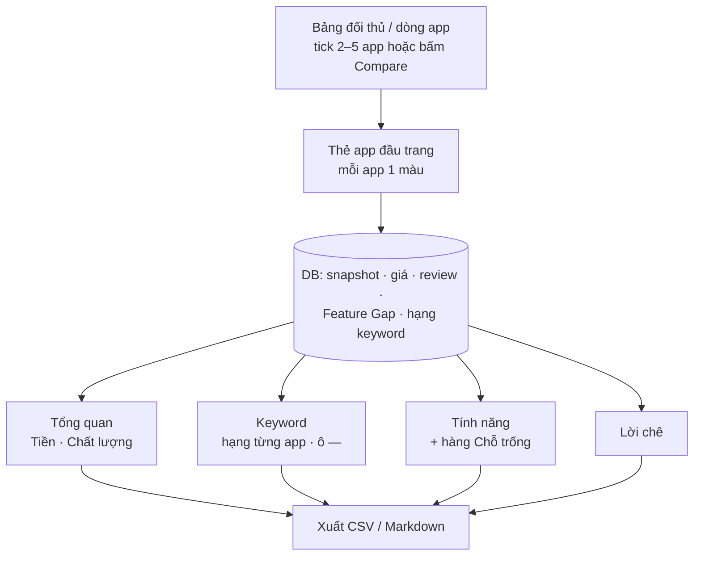

# Phase 56 · So sánh đối thủ

> Đặt **2–5 đối thủ** cạnh nhau (app Play / iOS, sản phẩm Amazon nếu có): giá, sao, tính năng, bị chê gì, ra bản mới
> lúc nào. Để biết **app mình đánh vào ai và hơn ở đâu**. **Không AI.**

Chưa làm · sau Phase 55 (so sánh niche đã dời lên Version 1 thành Phase 44)

!!! note "Cập nhật 2026-11-06 · học từ Appfigures"
    Thêm **tab Keyword** (mỗi app một cột hạng, ô "—" là keyword đối thủ có hạng mà app kia không có), **thẻ app có màu**
    ở đầu trang, nút **Compare** ngay trên dòng app. Trang chia 4 tab thay cho 1 bảng dài. Lý do + số đo:
    [Học từ Appfigures](#hoc-tu-appfigures).

## Chạy thế nào

## Làm gì

| | |
|---|---|
| :material-checkbox-multiple-marked: **Chọn đối thủ** | tick 2–5 app ở bảng đối thủ trang Research → nút "So sánh (N)", hoặc bấm **Compare** trên một dòng app (trang Research, Keyword search) để mở trang với app đó rồi thêm app khác. Gợi ý sẵn: top 3 theo lượt tải + 1–2 app bị chê nhiều nhất |
| :material-card-account-details: **Thẻ app** | đầu trang, mỗi app một thẻ: icon, tên, dev, store. Mỗi app một màu, dùng lại ở mọi tab (đầu cột, chấm trong bảng). Menu ⋮: Bỏ app này · Chỉ giữ app này · Bỏ các app bên trái / bên phải. Nút **+** thêm app (tìm trong app đã có ở DB) |
| :material-table-column: **Tab Tổng quan** | mỗi app một cột. **Tiền:** free / trả phí / có IAP · giá từng gói iOS · khoảng giá Play · gói tháng hay năm. **Chất lượng:** sao, số rating, mức lượt cài Play, tỷ lệ review 1–2★, ngày ra mắt, lần cập nhật cuối, có cả 2 store không. Dòng đầu tóm tắt số hàng Chỗ trống |
| :material-key-variant: **Tab Keyword** | mỗi keyword một hàng, mỗi app một cột hạng. Chi tiết ở [Tab Keyword](#tab-keyword) |
| :material-view-grid: **Tab Tính năng** | lấy từ Feature Gap Matrix (Phase 4): có / không / nửa vời, mỗi ô có link listing. Hàng cuối **Chỗ trống**: tính năng người dùng xin nhiều mà ≤ 1 đối thủ làm tốt |
| :material-emoticon-angry: **Tab Lời chê** | 3 chủ đề than nhiều nhất mỗi app (Phase 6, 25, 51), kèm số lần + 1 câu nguyên văn có link |
| :material-file-export: **Xuất** | CSV + Markdown của tab đang mở, dán vào phần đối thủ của `/app-research`. Tab Keyword có thêm **Copy danh sách keyword** (mỗi dòng 1 keyword) |

Tab đang mở lưu trên URL (`?tab=`), giống trang Keyword search.

### Tab Keyword

Giống Competitor Keywords của Appfigures, nhưng chỉ trên keyword ShotMatic đã tra.

- **Cột:** keyword · điểm phổ biến (của Explorer) · mức chen chúc (low / medium / high) · số app (top 30 Play / App Store)
  · mỗi app một cột hạng. Đầu mỗi cột app ghi app đó có hạng ở bao nhiêu keyword.
- **Ô "—":** app không có trong kết quả đã lưu của keyword đó. Tooltip ghi "không có trong top N" (N = số app đã lưu cho
  keyword đó). Không ghi "không có hạng", vì mình chỉ thấy top N.
- **App mốc:** chọn 1 app làm mốc (app của mình nếu đã có Hồ sơ app, hoặc đối thủ chính). Lọc **chỉ keyword app mốc là "—"
  mà ≥ 1 app khác có hạng** = keyword nên nhắm.
- **Lọc:** mức hạng 1–10 · 11–25 · 26+ · mức phổ biến · mức chen chúc · ô tìm chữ. Bấm tên cột để sắp.
- **Bấm keyword:** đưa lên ô tra Keyword search (không tự tra). Nút **+** gom keyword vào Project (Phase 21).
- **Nguồn hàng:** keyword của lượt Research (bảng `keyword_hits`, đã có) + keyword của lượt Explore mở từ lượt Research
  đó hoặc cùng seed (bảng mới `node_hits`, xem dưới). Mỗi hàng ghi đo ngày nào.

**Cần làm trước tab Keyword**

Explorer đang tải top 30 Google Play + top 30 App Store cho mỗi keyword để đếm số app, rồi bỏ id app
(`web/src/collectors/explore-metrics.ts`). Lưu lại `keyword · store · app · hạng` vào bảng mới `node_hits`:
**không thêm request nào**. Lượt Explore cũ chưa có bảng này thì tab ghi "Explore lại niche để có thêm keyword".

**Luật**

- Không ước lượt tải / doanh thu. Chỉ hiện số store công bố (mức lượt cài Play, số rating), giá công khai + TrustMRR
  verified (nếu có)
- Câu than là câu nguyên văn đã lưu, không viết lại
- Ô "—" nghĩa là "không có trong top N đã lưu", không phải "không có hạng"
- Màu app cố định theo thứ tự thẻ, đọc rõ ở cả chế độ sáng lẫn tối

**Xong khi**

- 2 niche thật × 4 đối thủ có bảng đủ hàng, ô thiếu ghi "chưa có"
- Mỗi câu than bấm mở đúng review gốc (kiểm tay 10 câu)
- Hàng "Chỗ trống" ra ≥ 1 dòng cho ít nhất 1 niche
- Tab Keyword: 1 niche đã Explore (≥ 90 keyword) × 4 app ra bảng; kiểm tay 10 ô hạng / "—" khớp trang tìm trên store đo
  cùng ngày
- Lọc "app mốc là —" ra ≥ 5 keyword cho 1 niche thật
- 5 app đọc được ở 960px và 1340px, cả trang không cuộn ngang (chỉ bảng cuộn), cả sáng lẫn tối

**Không làm ở phase này**

- Cào thêm đối thủ ngoài danh sách đã có
- Theo dõi đối thủ đổi giá / ra bản mới theo thời gian, biểu đồ theo ngày
- AI viết kết luận ([Phase 57](phase-57-ai-cite-report.md))
- Ước tính lượt tải / doanh thu, nhóm tuổi / giới tính người dùng, SDK, người dùng chung giữa các app (Cross Usage), cảnh
  báo đối thủ hằng ngày. Appfigures có, lý do không làm ở [Học từ Appfigures](#hoc-tu-appfigures)
- Tra mọi keyword một app đang có hạng (cần chỉ mục cả store như Appfigures)

## Học từ Appfigures

Đọc help center + trang sản phẩm Appfigures ngày 2026-11-06. Nút **Compare** trong app của họ cần đăng nhập nên chưa xem
màn thật, chỉ xem hình mẫu trên trang [App Intelligence](https://appfigures.com/products/app-intelligence).

**1. Competitors report** ([trợ giúp](https://help.appfigures.com/en/article/getting-started-with-the-competitors-report-i22kp7/))

- Mở từ nút Compare trên trang 1 app, hoặc menu Competitor Comparison. Chọn 1–8 app, mỗi app một thẻ có màu + menu ⋮.
- Tab: Performance · Keywords · SDKs · Creatives · Demographics · App Details.
- Performance: tóm tắt cạnh nhau (lượt tải ước tính, hạng category, rating, tính năng, nhóm người dùng, độ mới) + biểu đồ
  theo ngày, mỗi app một đường (lượt tải, doanh thu, rating mới, hạng). Di chuột vào một ngày thấy số của mọi app. Lọc
  khoảng ngày + 1 nước, số có từ 1/1/2017.
- Tính tiền theo từng app ([trợ giúp](https://help.appfigures.com/en/article/how-to-track-competitors-any-app-with-appfigures-zl1bg2/)):
  Basic $1.99/tháng mỗi app (keyword, hạng keyword, review, rating, hạng category, lần được store giới thiệu) · Premium từ
  gói Grow, tầng nhỏ nhất 10 app (thêm lượt tải + doanh thu ước tính, nhóm người dùng, SDK).

**2. Competitor Keywords** ([trợ giúp](https://help.appfigures.com/en/article/competitor-keywords-1kqm7e5/))

- 1–8 app, chọn store · nước · thiết bị.
- Bảng: Keyword · Popularity · Competitiveness 1–100 · # Apps · cột hạng từng app. Ô "—" = app không có hạng. Đầu cột ghi
  số keyword app đó có hạng.
- Lọc: đã / chưa theo dõi · hạng 1–10 / 11–25 / 25+ · mức Popularity · mức Competitiveness · tìm chữ · dịch keyword. Xuất
  CSV / JSON, copy danh sách keyword. Dữ liệu trễ 24 giờ.

**Đo thật 2026-11-06 · DB trên máy dev (chỉ đọc)**

- **195 lượt Research:** trung bình **2,4 keyword** / lượt, nhiều nhất **6**. Mỗi keyword lưu trung bình **57,6 app** có
  hạng, hạng sâu nhất **79**. Tab Keyword chỉ dùng `keyword_hits` thì quá mỏng (≤ 6 hàng).
- **16 lượt Explore có số đo:** trung bình **95 keyword**, nhiều nhất **200**. Mỗi keyword đã tải top 30 Play + top 30
  App Store nhưng chỉ giữ số đếm, không giữ app nào.
- Vì vậy lưu id app lúc Explore (`node_hits`) là cách để tab Keyword có cỡ ~100 hàng mà không tốn thêm request.

**Lấy gì:**

1. Nút **Compare** trên dòng app + thẻ app có màu, menu ⋮ → mục Chọn đối thủ, Thẻ app.
2. Chia tab thay cho 1 bảng dài → 4 tab.
3. Bảng keyword × app, ô "—" là cơ hội → Tab Keyword. Thêm **app mốc** vì người dùng ShotMatic thường chưa có app.
4. Đầu cột đếm số keyword mỗi app có hạng → Tab Keyword.
5. Lọc theo mức hạng / phổ biến / chen chúc, xuất CSV, copy keyword → Tab Keyword, Xuất.

**Học nhưng không làm:**

- **Lượt tải / doanh thu ước tính, biểu đồ theo ngày:** số do Appfigures tự tính bằng máy học. ShotMatic giữ luật không
  ước doanh thu; theo ngày thì cần chạy nền hằng ngày.
- **Nhóm người dùng (tuổi, giới tính), Cross Usage:** cần dữ liệu từ nhóm người dùng theo dõi, không có nguồn công khai.
- **SDK:** phải tải gói app về soi, ngoài phạm vi tool.
- **Tối đa 8 app:** ShotMatic giữ 5 để bảng 5 cột + cột tên đứng được ở 960px.
- **Creatives (ảnh store):** chưa lưu ảnh store, để sau.

Plan code chi tiết: [Phase 56](../superpowers/plans/2026-10-25-niche-radar-phase37-compare-competitor.md)
