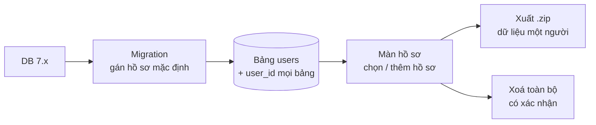

# Phase 59 · Lớp tài khoản trên máy

> Mọi dữ liệu gắn với một **hồ sơ** (`user_id`). Một máy có nhiều hồ sơ không thấy dữ liệu của nhau, mỗi người xuất
> hoặc xoá được toàn bộ dữ liệu của mình. Vẫn chạy trên máy, chưa đăng nhập mạng.

Chưa làm · sau Phase 58

## Chạy thế nào

## Làm gì

| | |
|---|---|
| :material-account-multiple: **Bảng `users`** | bảng mới trong `web/src/db/schema.ts` · thêm `user_id` vào project, lần tra, lịch sử hỏi |
| :material-account-cog: **Màn hồ sơ** | tên, thư mục dữ liệu · thêm / chọn hồ sơ · nhiều hồ sơ trên một máy |
| :material-filter-variant: **Lọc theo hồ sơ** | mọi API chỉ trả dữ liệu của hồ sơ đang chọn |
| :material-folder-zip: **Xuất dữ liệu** | toàn bộ dữ liệu một người ra file `.zip` |
| :material-delete-alert: **Xoá toàn bộ** | hỏi lại trước khi xoá, xoá thật khỏi DB |
| :material-database-arrow-up: **Migration DB** | (bước nâng cấp cấu trúc DB) dữ liệu cũ gán hết cho hồ sơ mặc định |

**Xong khi**

- 2 hồ sơ trên một máy không thấy dữ liệu của nhau
- Xoá hồ sơ → đếm bảng còn 0 dòng của hồ sơ đó
- DB 7.x lên 8.0 → đếm từng bảng trước / sau, không mất dòng
- File `.zip` xuất ra mở được, có đủ project và lần tra của hồ sơ đó

**Không làm ở phase này**

- Đăng nhập qua mạng, sync cloud (Version 9)
- Mật khẩu cho hồ sơ
- Thanh toán, quyền Pro (Version 10)
- Team, chia sẻ dữ liệu giữa hồ sơ

[Tổng quan Version 8](version-8.md)

Plan code chi tiết: [Phase 59](../superpowers/plans/2026-10-25-niche-radar-phase59-local-account.md)
