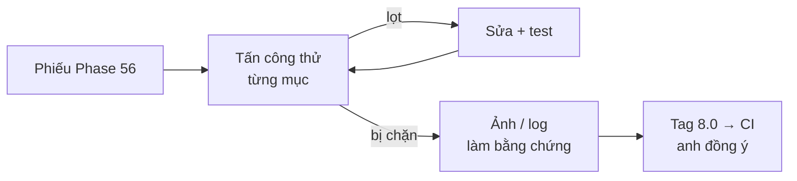

# Phase 59 · Review bảo mật + 8.0

> Tự **tấn công thử** theo phiếu Phase 56 để chắc các chỗ vá chặn được thật. Sửa chỗ hỏng, rồi ra bản 8.0 qua CI
> của Version 7.

Chưa làm · sau Phase 57 + 42

## Chạy thế nào

## Các lần thử

| Thử | Mong đợi |
|---|---|
| Trang web lạ gọi API cục bộ | bị từ chối (thiếu token / `Origin` lạ) |
| Review có `<script>` | hiện ra dạng chữ, không chạy |
| Key lọt log | log không có key |

## Làm gì

| | |
|---|---|
| :material-sword-cross: **Tấn công thử** | chạy từng lần thử trên bản build, không phải bản dev |
| :material-camera: **Bằng chứng** | mỗi lần thử có ảnh hoặc log, ghi vào `security/checklist.md` |
| :material-wrench: **Sửa** | lọt chỗ nào → sửa + test → thử lại |
| :material-tag: **Ra bản 8.0** | gắn tag `v8.0.0` sau khi CI xanh ([Version 7](version-7.md)) |

**Xong khi**

- Mọi lần thử đều bị chặn, có ảnh / log làm bằng chứng
- Bản 8.0 cài đè 7.x không mất dữ liệu (đếm từng bảng trước / sau)
- Bản 7.x tự nhận bản 8.0 qua auto-update

**Không làm ở phase này**

- Thuê pentest bên ngoài, chứng nhận bảo mật
- Tính năng mới
- Claude tự gắn tag 8.0 khi anh chưa đồng ý

[Tổng quan Version 8](version-8.md)
