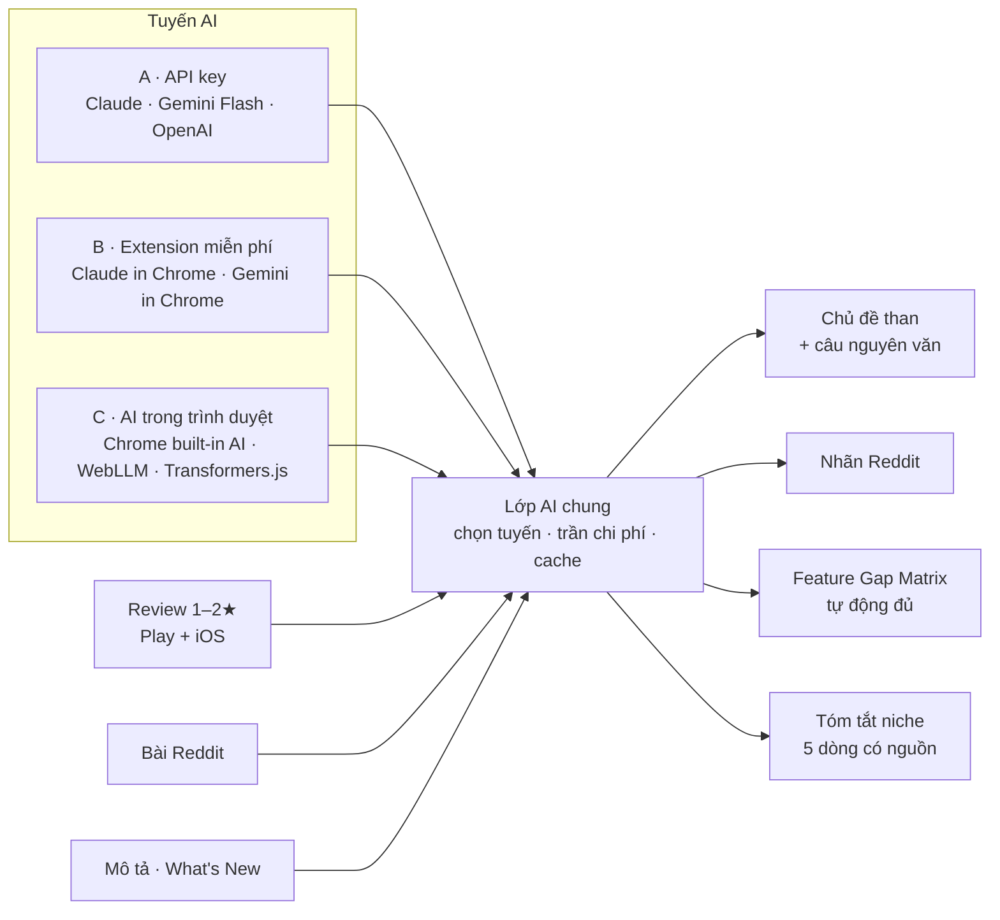

# Phase 6 · Tích hợp AI (bản Web)

> Để AI **đọc thay mình** review, Reddit, trang listing — có nguồn, tắt được, và **thử cả đường miễn phí**
> (AI chạy ngay trong trình duyệt / trên máy) trước khi bắt trả tiền theo lượt.

Xong 2026-10-24 · tuyến B (job Claude) chạy thật · tuyến A chờ key

## Kết quả Bước 0 (đo 2026-10-24, MacBook M1 Pro 16 GB)

Bài thử: 110 review 1–2★ của `budget tracker` (6 app top) → chủ đề than + câu nguyên văn, kiểm bằng cùng một hàm.

| Tuyến | Chạy được? | Chất lượng | Thời gian | Tiền | Quyết |
|---|---|---|---|---|---|
| A · Claude API | chưa chạy — máy chưa có key | — | — | ước ~$0.05/lần (5,8k token vào, Opus 5.5) | **xây** (bật ở Cài đặt khi có key) |
| B · Job cho Claude (Chrome / Code) | ✅ | 10 chủ đề, 22/22 câu khớp nguyên văn | vài phút, cần người đưa file | 0 đ thêm (gói Claude đang có) | **xây** |
| C · AI trong Chrome (Gemini Nano) | Prompt API có, model ở trạng thái `downloadable` | — | — | 0 đ | chưa thử — cần tải model, chờ anh đồng ý |

## Đã chạy thật (tuyến B)

| Niche | Chủ đề than | Câu nguồn khớp | Tóm tắt 5 câu | Tiền thật |
|---|---|---|---|---|
| budget tracker (#14) | 10 | 22/22 | 5/5 câu có trích dẫn | — |
| habit tracker (#13) | 10 | 19/19 | 5/5 | nutrIA $18,073 MRR (RevenueCat, khớp gần đúng) |
| pomodoro timer (#15) | 10 | 19/19 | 5/5 | — |

TrustMRR không có ô tìm chữ cho người dùng — job hướng dẫn lọc Category + mở trang startup theo tên đối thủ.

## Chạy thế nào

## Bước 0 — thử từng tuyến trước khi xây

Một bài thử chuẩn: **gom 200 review 1–2★ của 1 niche thành chủ đề, mỗi chủ đề có câu nguyên văn**.
Chạy bài này trên từng tuyến, ghi **chất lượng · thời gian · tiền · máy cần gì** → chọn ≤ 2 tuyến để xây.
Tuyến nào không chạy được thì ghi lý do và bỏ, không cố.

| Tuyến | Là gì | Tiền | Câu hỏi phải trả lời ở Bước 0 |
|---|---|---|---|
| **A · API key** | key riêng trong `.env.local` (Claude mặc định, Gemini Flash rẻ) | trả theo lượt | trần chi phí mỗi lần tra đủ thấp chưa? |
| **B · Extension miễn phí** | tool xuất *job* `.json` → extension AI đọc trang / file → nhập kết quả lại (như tuyến B Phase 4) | gói đang có | extension nào nhận file / trả kết quả có cấu trúc được? |
| **C · AI trong trình duyệt** | Chrome built-in AI (Gemini Nano: Summarizer, Prompt API) · WebLLM (model nhỏ trên WebGPU) · Transformers.js (gom chủ đề bằng embedding, không cần LLM) | 0 đ | Prompt API cho trang web đã mở chưa? model nhỏ có trả câu nguồn đúng không? máy cần GPU / bao nhiêu GB? |

## Làm gì (sau Bước 0)

| | |
|---|---|
| :material-cog: **Lớp AI chung** | trang Cài đặt: chọn tuyến, nhập key, chọn model, trần chi phí mỗi lần tra, cache theo nội dung, log token + tiền ước tính |
| :material-emoticon-angry: **Chủ đề than** | gom review 1–2★ thành chủ đề (quảng cáo, mất dữ liệu, ép đăng ký…) + số lần + câu nguyên văn |
| :material-reddit: **Phân loại Reddit** | xin app · than app đang dùng · hỏi alternative · không liên quan |
| :material-table-check: **Feature Gap Matrix tự động** | nâng tuyến A [Phase 4](phase-4-feature-gap.md) lên lớp AI chung, đọc thêm What's New + review |
| :material-cash-check: **Tiền thật qua Claude in Chrome** | (dời từ [Phase 5](phase-5-verified.md)) job `.json` → Claude mở TrustMRR, tìm theo tên đối thủ / niche, trả MRR · 30 ngày · provider · ngày sync · link; nhập lại thành dòng `verified` kèm "khớp gần đúng" |
| :material-text-box-check: **Tóm tắt niche** | ai đau gì · đối thủ yếu ở đâu · ai đang thu tiền — mọi câu kèm nguồn |

**Luật AI**

- AI **không bịa số** — số chỉ từ collector, AI chỉ đọc chữ và trả trích dẫn
- Không có AI nào bật → mọi tính năng Phase 1–5 vẫn chạy như cũ
- Tuyến miễn phí cho kết quả kém thì nói rõ trên UI ("model nhỏ — nên kiểm lại"), không giấu

**Xong khi**

- Bảng Bước 0 điền đủ 3 tuyến (chạy được / không, có số đo)
- 3 niche thật chạy đủ với tuyến đã chọn, mỗi lần tra dưới trần chi phí
- Mọi chủ đề / tóm tắt có trích dẫn bấm được; tắt AI thì app vẫn chạy

**Không làm ở phase này**

- Xây cả 3 tuyến — chỉ xây tuyến qua được Bước 0
- Gửi key của mình lên server nào khác ngoài provider

