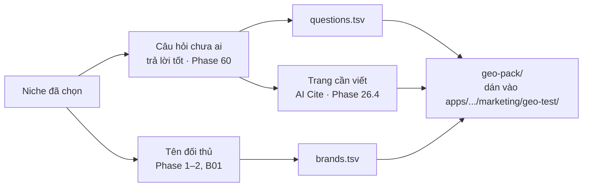

# Phase 61 · Gói GEO + trang cần viết

> Niche đã chọn → xuất **gói GEO**: bộ câu hỏi + regex tên đối thủ đúng định dạng `scripts/geo.py` của App-AI-Skills,
> kèm **danh sách trang cần viết** để được Google và AI nhắc. Đây là cầu nối từ "chọn niche" sang "ra mắt".

Chưa làm · sau Phase 60

## Chạy thế nào

## Làm gì

| | |
|---|---|
| :material-file-delimited: **`questions.tsv`** | `id · nhóm · câu hỏi`, 10–40 câu, đúng định dạng `geo.py run` |
| :material-regex: **`brands.tsv`** | `nhóm · regex tên app`, mỗi đối thủ một dòng + dòng `*` để trống cho domain của mình (điền khi có) |
| :material-file-document-edit: **Trang cần viết** | mỗi câu hỏi: loại trang nên viết (bài so sánh "X vs Y", "best app for…", hướng dẫn "how to…", trang alternative) · trang AI đang trích cho câu đó · 1 dòng lý do. Lý do viết qua lớp AI Cite Phase 26.4, có trích dẫn |
| :material-folder-zip: **Xuất** | thư mục `geo-pack/` + `README.md` ngắn ghi lệnh chạy `geo.py run` / `analyze` làm mốc trước ra mắt |

**Luật**

- Định dạng file theo đúng `geo.py` hiện tại. `geo.py` đổi định dạng → sửa phase này, không sửa `geo.py` cho hợp
- Chỉ xuất gói. Không viết bài, không đăng, không tạo file trong repo App-AI-Skills thay người dùng

**Xong khi**

- 1 niche thật xuất gói → `python3 scripts/geo.py run <dir>` + `analyze` chạy được, không sửa tay
- Danh sách trang cần viết có ≥ 5 dòng, mỗi lý do có trích dẫn qua kiểm Phase 26.4
- Gói mở bằng `/app-geo` (Pha 1 — Bộ câu hỏi) dùng được luôn

**Không làm ở phase này**

- Viết nháp bài (việc của `/oneclicktool-blog`)
- Đo lại sau ra mắt, so mốc (việc của `/app-geo` + `geo.py compare`)

Plan code chi tiết: [Phase 61](../superpowers/plans/2026-10-25-niche-radar-phase44-geo-pack.md)
