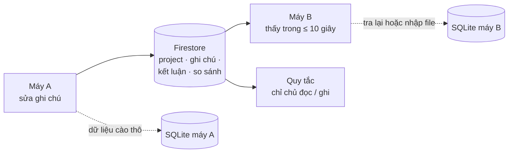

# Phase 63 · Sync project

> Đăng nhập máy khác là **thấy project, ghi chú, kết luận của mình**. Chỉ đưa lên cloud thứ nhỏ do người dùng viết;
> dữ liệu cào thô ở lại máy.

Chưa làm · sau Phase 62

## Chạy thế nào

**Firestore** (cơ sở dữ liệu trên mạng của Firebase) giữ phần người dùng tự viết. **SQLite** (file dữ liệu trên máy,
đang dùng qua `web/src/db/`) vẫn giữ keyword, review, top 10…

## Cái gì lên cloud, cái gì ở lại

| Lên Firestore | Ở lại SQLite trên máy |
|---|---|
| project, ghi chú, kết luận | keyword, review, top 10 đã cào |
| bộ so sánh | dữ liệu thô của từng lần tra |
| lịch sử hỏi | cache nguồn |

## Làm gì

| | |
|---|---|
| :material-cloud-upload: **Đồng bộ** | project, ghi chú, kết luận, bộ so sánh, lịch sử hỏi lên Firestore khi đã đăng nhập |
| :material-harddisk: **Dữ liệu thô ở lại** | máy khác muốn có thì tra lại hoặc nhập file |
| :material-history: **Sửa cùng lúc** | 2 máy sửa cùng lúc: bản sửa sau thắng, có ghi lại bản cũ |
| :material-shield-lock: **Quy tắc Firestore** | chỉ chủ tài khoản đọc / ghi tài liệu của mình, có test quy tắc |
| :material-file-code: **File** | mới: lớp sync trong `web/src/lib/` cạnh `projects.ts` / `projects-client.ts`, file quy tắc Firestore (tên chốt ở plan) |

**Xong khi**

- Sửa ghi chú máy A → máy B thấy trong ≤ 10 giây
- Người B không đọc được dữ liệu người A (test quy tắc)
- 2 máy sửa cùng ghi chú → giữ bản sau, bản cũ còn trong lịch sử
- Tắt mạng sửa ghi chú → bật mạng lại đồng bộ, không mất chữ
- Không đăng nhập: app chạy như cũ, không gọi Firestore

**Không làm ở phase này**

- Đưa dữ liệu cào thô lên cloud, chạy collector trên server
- Chia sẻ project giữa nhiều người / team: ứng viên [Version 12](version-12.md)
- Gộp sửa từng chữ kiểu Google Docs

[Tổng quan Version 9](version-9.md)
