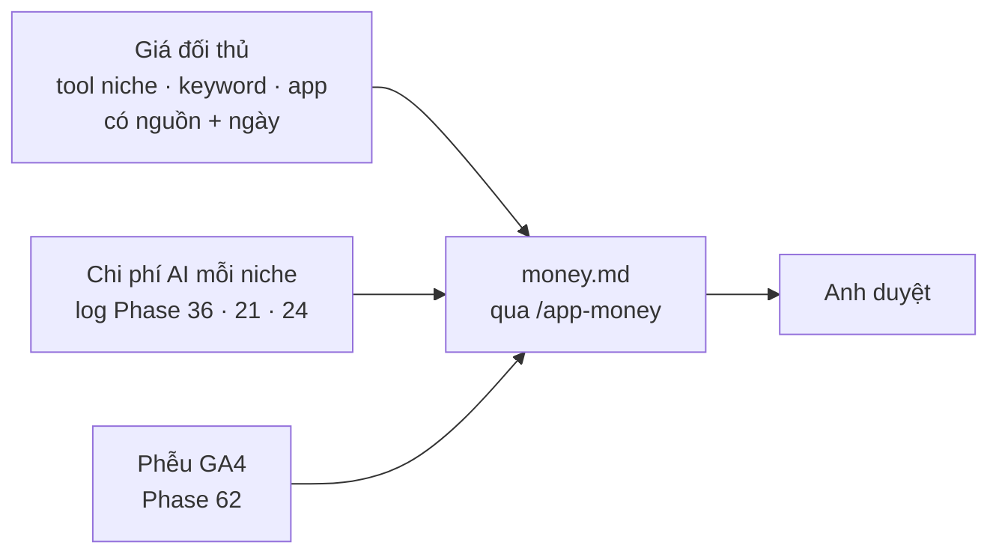

# Phase 64 · Mô hình tiền

> Chốt **Free gồm gì, Pro gồm gì**, bán **mua đứt (lifetime)** hay **gói tháng / năm** hay cả hai, và giá bao nhiêu.
> Mọi con số dựa trên đo thật, không đoán. Kết quả là file `money.md` để anh duyệt.

Chưa làm · sau Phase 63

## Chạy thế nào

**Lifetime** = trả một lần, dùng mãi. **Subscription** = trả theo tháng / năm, tự gia hạn tới khi huỷ.

## Ứng viên chia gói

Chốt ở phase này, chưa phải quyết định:

| Gói | Ứng viên |
|---|---|
| **Free** | Play + App Store + Trends, vài niche mỗi tháng |
| **Pro** | mọi nguồn, so sánh, AI Cite, kệ AI, gói GEO |

Giá: **chưa đo**. Chỉ ghi số sau khi đo giá đối thủ và chi phí AI.

## Làm gì

| | |
|---|---|
| :material-tag-search: **Giá đối thủ** | đo giá tool nghiên cứu niche / keyword / app, mỗi dòng ghi nguồn + ngày |
| :material-robot: **Chi phí AI** | đo chi phí AI thật mỗi niche từ log Phase 40, 36, 37 |
| :material-filter-variant: **Phễu GA4** | đọc phễu [Version 9](version-9.md): người dùng dừng ở tính năng nào |
| :material-scale-balance: **Chọn mô hình** | Free / Pro, lifetime và / hoặc subscription, độ dài dùng thử cho Phase 66 |
| :material-file-document-edit: **money.md** | viết theo `/app-money` của App-AI-Skills: bảng gói, giá, lý do từng con số kèm nguồn |

**Xong khi**

- `money.md` có bảng gói, giá, lý do từng con số kèm nguồn
- Mỗi giá đối thủ có link + ngày đo
- Có số chi phí AI trung bình mỗi niche, lấy từ log thật
- Ghi sẵn % doanh thu tối đa cho chi phí AI (Phase 67 dùng)
- Anh duyệt

**Không làm ở phase này**

- Tạo sản phẩm trên Lemon Squeezy, viết code thanh toán (Phase 65)
- Hứa doanh thu, bịa số người mua
- Khoá lại thành Pro tính năng đã Free với người đang dùng
- Gói team / nhiều chỗ ngồi, mã giảm giá, affiliate

[Tổng quan Version 10](version-10.md)
