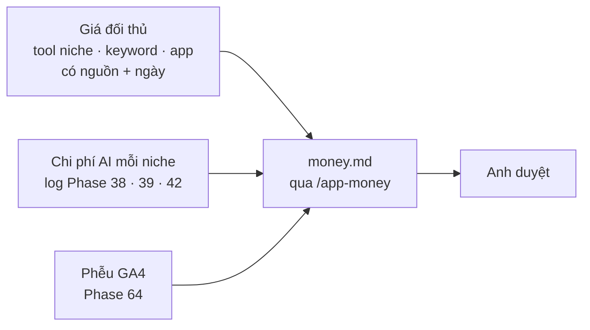

# Phase 66 · Mô hình tiền

> Chốt **Free gồm gì, Pro gồm gì**, bán **mua đứt (lifetime)** hay **gói tháng / năm** hay cả hai, và giá bao nhiêu.
> Mọi con số dựa trên đo thật, không đoán. Kết quả là file `money.md` để anh duyệt.
>
> **Đổi 2026-10-26:** bán **app tải về + dùng thử + license key**, không tài khoản ([Version 10](version-10.md)).
> Phase này chốt thêm: dùng thử bao nhiêu ngày, có làm giá bậc thang như Wow Keywords không.

Chưa làm · sau Phase 65

## Chạy thế nào

**Lifetime** = trả một lần, dùng mãi. **Subscription** = trả theo tháng / năm, tự gia hạn tới khi huỷ.

## Ứng viên chia gói

Chốt ở phase này, chưa phải quyết định:

| Gói | Ứng viên |
|---|---|
| **Dùng thử** | đủ tính năng N ngày (ứng viên 7 hoặc 14), không cần thẻ |
| **Pro (mua đứt)** | license key, 2 máy, cập nhật mãi. Ứng viên giá bậc thang: tăng sau mỗi 20 license, số còn lại đọc từ đơn thật |
| **Hết dùng thử, chưa mua** | ứng viên: chỉ xem + xuất dữ liệu cũ, không tra mới — hoặc giữ Play + App Store + Trends miễn phí. Chốt bằng số fake-door |

Giá: **chưa đo**. Chỉ ghi số sau khi đo giá đối thủ và chi phí AI.

## Làm gì

| | |
|---|---|
| :material-tag-search: **Giá đối thủ** | đo giá tool nghiên cứu niche / keyword / app, mỗi dòng ghi nguồn + ngày. Mốc đầu: [Wow Keywords](../doi-thu-tham-khao.md#wow-keywords) $79 mua đứt (2026-10-26) |
| :material-robot: **Chi phí AI** | AI chạy trên thứ người dùng đã trả ([Phase 69](phase-69-ai-cost-plans.md)) nên mình không tốn; chỉ đo để ghi trên landing "1 niche tốn khoảng bao nhiêu" |
| :material-lock-open-variant: **Số fake-door** | đọc bảng kết quả [Phase 16b](phase-16b-decision-board.md#ket-qua-fake-door): tính năng nào được bấm, bao nhiêu email, mức giá người chọn — tín hiệu giá đầu tiên có nguồn |
| :material-filter-variant: **Phễu GA4** | đọc phễu [Version 9](version-9.md): người dùng dừng ở tính năng nào |
| :material-scale-balance: **Chọn mô hình** | mua đứt (mặc định, như Wow Keywords) hay thêm gói năm cho cập nhật · số ngày dùng thử · hết hạn còn dùng được gì · giá bậc thang có / không |
| :material-file-document-edit: **money.md** | viết theo `/app-money` của App-AI-Skills: bảng gói, giá, lý do từng con số kèm nguồn |

**Xong khi**

- `money.md` có bảng gói, giá, lý do từng con số kèm nguồn
- Mỗi giá đối thủ có link + ngày đo
- Có số chi phí AI trung bình mỗi niche, lấy từ log thật
- Có số ngày dùng thử + hết hạn còn dùng được gì
- Anh duyệt

**Không làm ở phase này**

- Tạo sản phẩm trên Lemon Squeezy, viết code license (Phase 67)
- Hứa doanh thu, bịa số người mua
- Khoá lại thành Pro tính năng đã Free với người đang dùng
- Gói team / nhiều chỗ ngồi, mã giảm giá, affiliate

[Tổng quan Version 10](version-10.md)

Plan code chi tiết: [Phase 66](../superpowers/plans/2026-10-25-niche-radar-phase66-money-model.md)
