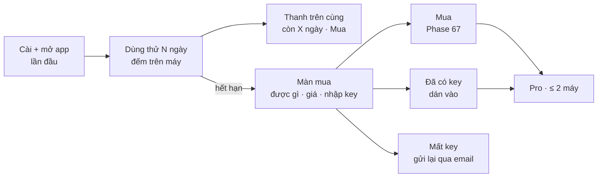

# Phase 68 · Dùng thử + paywall

> Tải về là **dùng thử đủ tính năng N ngày**, không đăng ký, không thẻ. Hết hạn → màn mua nói rõ được gì, giá, nhập key.
> Mất key → nhập email để gửi lại. Đây là chỗ mình **khác Wow Keywords** (họ bắt nhập key ngay khi mở).

Chưa làm · sau Phase 67

## Chạy thế nào

**Paywall** = màn chặn khi hết dùng thử, mời mua.

## Làm gì

- **Đếm dùng thử:** ngày bắt đầu lưu trên máy (app Mac: Keychain · Windows: Credential Manager · Web local: file cấu hình),
  xoá DB không reset được dùng thử
- **Thanh dùng thử:** "Còn X ngày dùng thử · Mua" ở đầu app, không che nội dung
- **Màn mua:** được gì, giá trả một lần, 2 máy, cập nhật mãi · nút Mua · ô dán key · link "Mất key?"
- **Hết hạn:** không tra mới; vẫn mở project cũ + xuất CSV / JSON (chốt chi tiết ở `money.md`)
- **Mất key:** link tới trang tra đơn của Lemon Squeezy (gửi lại key bằng email mua hàng)
- **Khớp landing:** giá + số ngày dùng thử trên landing ([Version 11](version-11.md)) khớp trong app
- **File:** màn dùng thử + màn mua ở `web/src/client/` dùng chung cho app Mac + Windows (phần lưu riêng từng hệ điều hành ở Phase 79)

**Xong khi**

- Cài mới → dùng được ngay, thanh hiện đúng số ngày
- Chỉnh ngày máy qua hạn → màn mua hiện, project cũ vẫn mở + xuất được (đếm project trước / sau)
- Dán key test → Pro ngay, thanh dùng thử biến mất
- Xoá DB, cài lại → không có thêm ngày dùng thử
- Link "Mất key?" mở đúng trang gửi lại key

**Không làm ở phase này**

- Tài khoản, đăng nhập
- Mã giảm giá phức tạp, affiliate: xét sau đơn thứ 10
- Gói team / nhiều chỗ ngồi
- Ép mua bằng đếm ngược giả, giấu nút đóng, khoá dữ liệu cũ

[Tổng quan Version 10](version-10.md)

Plan code chi tiết: [Phase 68](../superpowers/plans/2026-10-25-niche-radar-phase68-paywall-trial.md) (bản cũ gắn tài khoản — viết lại theo trang này khi code)
