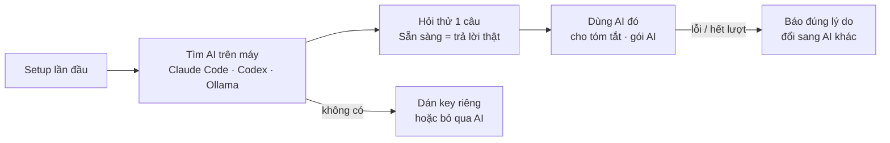

# Phase 69 · AI theo gói — chạy trên AI người dùng đã có

> Mình **không bán lượt AI, không trả tiền AI** cho người dùng. App gọi AI họ đã có: **Claude Code**, **Codex**,
> **Ollama** (chạy trên máy) hoặc **key riêng** (BYOK). Học Wow Keywords ("runs on the AI you already pay for").
>
> **Đổi 2026-10-26:** bỏ "gói lượt AI kèm Pro" và bộ đếm lượt — không cần nữa.

Chưa làm · sau Phase 66

**Gộp vào [Phase A2](../app/phase-a2-ai-cua-ban.md) (2026-10-26)** — làm theo trang đó; trang này giữ để tra chi tiết.

## Chạy thế nào

**BYOK** (bring your own key — tự mang key) = người dùng dán API key AI của họ, tiền AI tính vào tài khoản của họ.

## Làm gì

- **Tìm AI trên máy:** Claude Code, Codex (kể cả bản trong app desktop), Ollama · hiện cái nào có, cái nào thiếu
- **Nút Kiểm tra:** hỏi thử 1 câu ngắn, "Sẵn sàng" chỉ khi trả lời thật
- **Lỗi nói rõ:** chưa đăng nhập, hết lượt, key hết hạn — gọi đúng tên, kèm nút sửa
- **BYOK:** ô dán key, key giữ trên máy (Keychain / Credential Manager ở app, `.env.local` ở Web local)
- **Không AI vẫn chạy:** mọi phần không AI (Play, App Store, Trends, Reddit, Q&A…) chạy đủ khi không nối AI nào
- **File:** sửa lớp AI chung hiện có (Phase 6) — thêm tuyến Claude Code / Codex CLI / Ollama (tên chốt ở plan)

**Xong khi**

- Máy có Claude Code đã đăng nhập → Sẵn sàng sau 1 câu hỏi thử
- Claude Code chưa đăng nhập → báo "chưa đăng nhập", không quay vòng mãi
- Không có AI nào → app vẫn tra niche được, nút AI ghi rõ cần nối AI
- Kiểm log: không có lần gọi AI nào tính tiền vào tài khoản của mình

**Không làm ở phase này**

- Bán lượt AI, gói AI kèm Pro, tự trả tiền AI cho người dùng
- Thêm model AI mới ngoài danh sách trên
- Gói team dùng chung AI

[Tổng quan Version 10](version-10.md)

Plan code chi tiết: [Phase 69](../superpowers/plans/2026-10-25-niche-radar-phase69-ai-cost-plans.md) (bản cũ có gói lượt AI — bỏ phần đó khi code)
