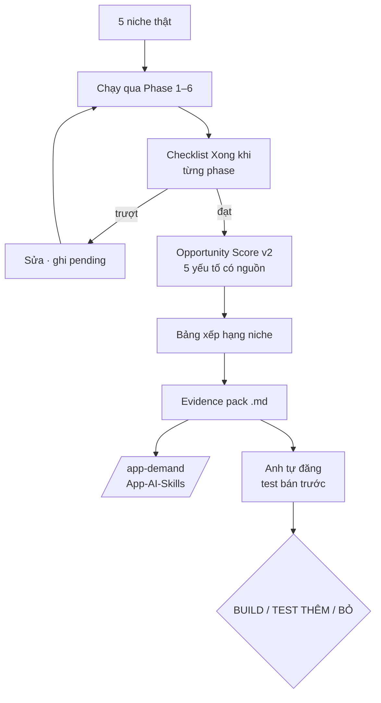

# Phase 7 · Review + Validate

> **Soát lại Phase 1–6** trên niche thật — từng phase có đạt "Xong khi" không, số có nguồn không — rồi kiểm
> cả hệ thống bằng một vòng thật: **chấm điểm niche → evidence pack → test bán trước**.

Code xong 2026-10-24 · vòng test bán trước chờ anh chạy + nhập số thật

## Kết quả soát (2026-10-24)

| Phase | Soát | Kết quả |
|---|---|---|
| 1 · Google Play | 5 niche thật (budget, habit, pomodoro, color by number, bubble shooter) | chạy đủ; nhóm keyword sửa (92/100 dồn "Tính năng" → có nhóm Khác) |
| 2 · App Store | cột tiền iOS top 5 | đọc đủ 5/5 app iOS ở 3 niche |
| 3 · Google Trends | chạy 5 niche liền | **chưa soát lại** — Google chặn tạm khi gọi dồn (đã gặp ở Phase 3); bubble shooter thiếu Trends |
| 4 · Feature Gap | 10 ô ngẫu nhiên | 10/10 có nguồn thật; câu luật lấy từ mô tả 35/36 khớp nguyên văn (1 câu = tiêu đề mục + dòng, ghép có chủ đích) |
| 5 · Verified Sites | — | tạm tắt, dời sang job Claude in Chrome (Phase 6) |
| 6 · AI | trích dẫn | 5 niche: 47 chủ đề, mọi câu kiểm khớp nguyên văn bằng code; tóm tắt 15/15 câu có dữ kiện. Lỗi tìm ra + sửa: job/import lệch id khi review tải thêm sau → lưu ảnh chụp lúc tạo job |

## Điểm v2 — back-test (2026-10-24, trọng số mặc định)

| Niche | v2 | Đo | Gợi ý |
|---|---|---|---|
| color by number | 5.4 | 100% | cân nhắc |
| pomodoro timer | 5.4 | 100% | cân nhắc |
| habit tracker | 5.3 | 100% | cân nhắc |
| bubble shooter | 4.7 | 70% (thiếu Trends) | cân nhắc |
| budget tracker | 4.5 | 100% | cân nhắc |

Chưa niche nào ≥ 6 ("đáng test bán trước") — đúng kỳ vọng: cả 5 đều đông (tổng rating top 10 hàng trăm nghìn – triệu).

## Còn lại (cần anh)

- Chọn 1 niche → tải evidence pack → chạy `/app-demand` điền phần nhận định → đăng nháp test bán trước → nhập số thật vào bảng.
- Vòng này làm kỹ + chạy thật ở [Phase 24 · Evidence pack + test bán trước](phase-24-evidence-presell.md).

## Chạy thế nào

## Phần 1 — Review từng phase

| Phase | Soát gì |
|---|---|
| 1 · Google Play | cây keyword, điểm cơ hội, câu than — có lỗi / chậm / sai ở niche nào |
| 2 · App Store | cột iOS, cột tiền đủ ≥ 4/5 app, câu than iOS |
| 3 · Google Trends | có bị chặn không khi chạy 5 niche liền |
| 4 · Feature Gap Matrix | ô `?` ≤ 20%, mọi ô có câu nguồn — mở link kiểm tay 10 ô ngẫu nhiên |
| 5 · Verified Sites | dòng `verified` đúng nguồn, ngày sync, nhãn "khớp gần đúng" |
| 6 · AI | trích dẫn bấm được có đúng câu không — kiểm tay 10 trích dẫn |

Lỗi tìm ra → sửa ngay nếu nhỏ, lớn thì ghi Master Plan §4 "Đang pending".

## Phần 2 — Opportunity Score v2

| Yếu tố (0–10) | Lấy từ | Độ tin |
|---|---|---|
| Nhu cầu | phổ biến (Phase 1) + xu hướng (Phase 3) | `proxy` |
| Cạnh tranh | độ đông + cờ đối thủ yếu | `proxy` |
| Đau | chủ đề than (Phase 6) | trích dẫn |
| Xu hướng | Google Trends (Phase 3) | `proxy` |
| **Tiền** | cột tiền (Phase 2) + verified (Phase 5) | `verified` khi có |

- Trọng số sửa được; mặc định **Tiền nặng hơn**, không để Nhu cầu ước lượng chiếm 30%.
- Điểm v1 `phổ biến × (1 − độ đông)` hiện cạnh bên để so. Back-test trọng số với niche đã tra trước khi tin.

## Phần 3 — Validate before build

| | |
|---|---|
| :material-file-document-check: **Evidence pack `.md`** | đối thủ · tiền · nhu cầu · câu than · matrix · nguồn + ngày — khung `templates/demand.md`, `/app-demand` đọc thẳng |
| :material-pencil: **Nháp test bán trước** | hook · landing fake door · 3 bài X/Reddit — tool **không tự đăng** |
| :material-counter: **Bảng kết quả test** | ngưỡng ghi **trước** khi chạy → nhập số thật → gợi ý BUILD / TEST THÊM / BỎ |

**Xong khi**

- 5 niche thật chạy qua Phase 1–6, checklist từng phase đạt (hoặc lỗi còn lại ghi rõ ở §4)
- ≥ 5 niche có điểm v2, mỗi yếu tố có nguồn
- 1 niche đi hết vòng evidence pack → test bán trước → số thật + gợi ý quyết định

**Không làm**

- Thêm tính năng tra cứu mới trong phase này — chỉ soát + sửa
- Tự đăng bài, chạy quảng cáo, thu tiền thật
- Tự quyết BUILD — quyết định cuối là của anh (CỔNG 1 ở pipeline)

