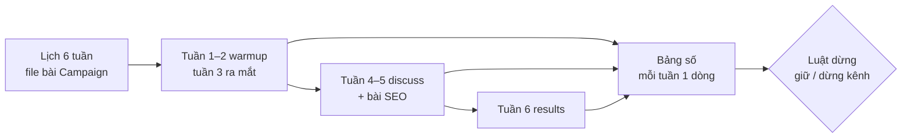

# Phase 73 · Lịch 6 tuần + ra mắt

> Biến kế hoạch thành **6 tuần đăng bài thật** trên 2 kênh đã chọn, có ngày ra mắt. Mỗi tuần nhìn số, và **luật dừng**
> viết trước để tuần 6 không tự lừa mình.

Chưa làm · sau Phase 71 + 72

## Chạy thế nào

## Lịch theo chặng

| Tuần | Chặng | Làm gì |
|---|---|---|
| 1–2 | **warmup** | có mặt ở 2 kênh chính, giúp người, chưa đặt link |
| 3 | **share** · ra mắt | bài "tôi làm cái này vì…" mỗi kênh chính, cách nhau ≥ 1 ngày. Product Hunt / Indie Hackers nếu kênh được chọn |
| 4–5 | **discuss** + dài hạn | góc khác (cách làm, số liệu, báo cáo niche Phase 72) · bài SEO từ khoảng trống GEO |
| 6 | **results** | số thật, bài kể lại, quyết định giữ / dừng |

## Làm gì

| | |
|---|---|
| :material-calendar-month: **File bài** | `/app-gtm` ghi lịch vào `marketing/gtm.md` + mỗi bài một file `marketing/<kênh>/NN-*.md` theo khuôn Campaign của Promo Desk. `check_gtm.py` tới 0 FAIL |
| :material-rocket-launch: **Ngày ra mắt** | chốt 1 ngày ở tuần 3, bài ra mắt có link đo nguồn. Tuần ra mắt dùng `/app-marketing` nếu cần |
| :material-table: **Bảng số mỗi tuần** | lượt vào landing · email · tải · dùng thử · đơn — mỗi số có nguồn + ngày, không có thì `chưa đo` |
| :material-hand-back-right-off: **Luật dừng** | viết trước tuần 1: kênh nào 3 tuần không đạt ngưỡng đặt trước → dừng, dồn sức kênh kia |
| :material-robot-outline: **Đo lại GEO** | cuối tuần 6 chạy lại `/app-geo` (`geo.py compare`) so với mốc Phase 72 |
| :material-account-edit: **Ai đăng** | Claude soạn nháp, **anh đăng**, đánh dấu `status: posted` trong file bài |

**Xong khi**

- 6 tuần chạy xong, bảng số đủ 6 dòng
- Mỗi kênh có quyết định giữ / dừng theo luật dừng đã viết trước
- Đo lại GEO so với mốc Phase 72
- Thước đo Version 11: landing có số lượt bấm tải / mua · ≥ 100 email (số thật ghi ngày, chưa đạt thì ghi đúng số)

**Không làm ở phase này**

- Quảng cáo trả tiền trước khi có 10 đơn tự nhiên
- Mua review, mua follow, đổi review lấy quà
- Thêm kênh thứ 3 giữa chừng — ghi vào backlog
- Đổi giá giữa 6 tuần (trừ khi số rõ ràng sai, ghi lý do)
- Claude đăng bài, gửi email hàng loạt

[Tổng quan Version 11](version-11.md)

Plan code chi tiết: [Phase 73](../superpowers/plans/2026-10-25-niche-radar-phase73-six-week-launch.md)
