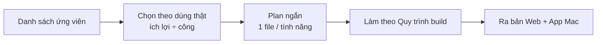

# Phase 9 · Small Features Update

> Gom các **tính năng nhỏ** lượm được khi dùng thật, mỗi cái một plan ngắn, làm theo thứ tự ích lợi.

Chưa làm

## Cách chạy

Mỗi tính năng: mục tiêu · làm · không làm · xong khi — **1 file plan**, đi đúng [Quy trình build](../quy-trinh-build.md).
Tính năng to hơn ~1 tuần → tách thành phase riêng, sửa Master Plan trước.

## Ứng viên (từ Appendix cũ — chưa chốt)

| Tính năng | Ích gì |
|---|---|
| **Cờ đối thủ yếu** trên UI | `bỏ bê` (update > 12 tháng) · `bị chê` (★ < 4 mà đông người dùng) · `một store` · `thu tiền` |
| **MCP có sẵn** | dùng Trends / Search Console / GA MCP trong Claude cùng dữ liệu tool — chỉ viết quy trình |
| **MCP của app** (`niche-radar-mcp`) | Claude tự đọc DB, so nhiều niche, viết báo cáo |
| Nguồn **Chrome Web Store** | cho portfolio extension |
| **Giá IAP nhiều nước** | so giá theo thị trường |
| **Theo dõi định kỳ** | tự tra lại niche hằng tuần, lịch sử đối thủ |
| Search volume trả phí (DataForSEO, Keyword Planner) | số lượt tìm thật — chỉ khi Phase 7 cho thấy cần số chắc |

**Xong khi**

- Có danh sách ưu tiên đã chốt (anh duyệt)
- Mỗi tính năng làm xong có trong cả bản Web và App Mac, test xanh, screenshot đã Read

**Không làm**

- Làm tính năng không có trong danh sách đã chốt
- Thay đổi UI tổng thể — [Phase 10](phase-10-ui-ux.md)

