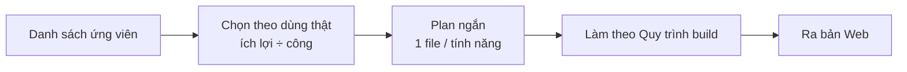

# Phase 9 · Small Features Update

> Gom các **tính năng nhỏ** lượm được khi dùng thật, mỗi cái một plan ngắn, làm theo thứ tự ích lợi.

4 mục ưu tiên xong 2026-10-25 · ứng viên khác chưa chốt

## Cách chạy

Mỗi tính năng: mục tiêu · làm · không làm · xong khi — **1 file plan**, đi đúng [Quy trình build](../quy-trinh-build.md).
Tính năng to hơn ~1 tuần → tách thành phase riêng, sửa Master Plan trước. Các tính năng chính đã tách thành
[Phase 18–25 · Làm kỹ tính năng chính](index.md#version-1-lam-ky-tinh-nang-chinh-phase-1025) (2026-10-25).

## Ứng viên ưu tiên (review 2026-10-25)

Từ bài review "tool có nhiều dữ liệu nhưng chưa trả lời được *nên build gì tuần này*". Plan cũ để 4 mục sau vòng test
bán trước của [Phase 7](phase-7-review-validate.md); anh chốt làm luôn 2026-10-25 — cả 4 đã có ở bản Web.

| Tính năng | Ích gì | Nối vào |
|---|---|---|
| **Điểm v2 thêm 2 trục** | **Tiếp cận khách** (có kênh nào gom người dùng: cộng đồng, video, trang đang lên top) và **Hợp sức mình** (làm một mình ≤ 4 tuần được không, cần backend không) · **trọng số mẫu** cho Mac / iOS / Android / SaaS · mỗi điểm có **1 dòng lý do** kèm nguồn | Điểm v2 [Phase 7](phase-7-review-validate.md) |
| **Mức nặng chủ đề than** | không chỉ đếm số lần: mất dữ liệu · trả tiền mà không dùng được nặng hơn quảng cáo · giao diện. Xếp chủ đề theo số lần × mức nặng | Chủ đề than [Phase 6](phase-6-ai-web.md) |
| **Nhãn mô hình tiền** | mỗi đối thủ gắn subscription · lifetime · IAP lẻ · quảng cáo · **chưa biết**; niche hiện tỷ lệ từng loại. Không lấy lượt tải thay cho doanh thu | Cột Tiền [Phase 2](phase-2-app-store.md) |
| **Theo dõi định kỳ** (kéo lên từ danh sách dưới) | chụp lại số của project sau 7 / 30 / 90 ngày: đối thủ mới, rating, giá, keyword, Trends — so với lần trước, ghi cạnh kết luận đang xem / ứng viên / loại | Project ([Phase 8](phase-8-project-data.md)) |

### Đã làm (2026-10-25)

**Nhãn mô hình tiền** — khối Đối thủ trong trang Research

- Mỗi đối thủ có thêm nhãn mô hình: Subscription · Mua đứt · IAP lẻ · Quảng cáo · Free · Chưa biết.
- Mua đứt = trả tiền khi tải, hoặc gói đắt nhất là gói một lần (Lifetime, Unlock all…). Quảng cáo = nhãn "Contains ads"
  của Google Play (đọc từ trang app khi dựng Feature Gap), App Store không có nhãn này.
- Trên bảng đối thủ có dòng "Mô hình tiền — top 10 đối thủ" kèm số app và % từng loại; evidence pack `.md` có cùng dòng đó.

**Mức nặng chủ đề than** — khối Chủ đề than (AI)

- Luật từ khoá trên tên chủ đề rồi tới câu trích, không gọi AI nên chạy được cả với kết quả đã lưu.
- Mức ×3: mất dữ liệu, trả tiền mà không dùng được. ×2: ép trả phí, hỏng / không chạy. ×1: quảng cáo, giao diện, khác.
- Chủ đề xếp theo số review × mức nặng. Yếu tố **Đau** của điểm v2 lấy 3 chủ đề nặng nhất, +1 khi chủ đề đầu mức ×3.

**Điểm v2 thêm 2 trục** — khối Sức khoẻ niche

- Thêm **Tiếp cận khách** và **Hợp sức mình** (7 yếu tố). Tool chưa đo được 2 trục này, nên anh tự chấm 0–10 và bắt buộc
  ghi 1 dòng lý do (kèm link nếu có). Chưa chấm thì không tính vào điểm, ghi "chưa đo".
- Điểm tự chấm lưu theo từng lượt Research và đi theo gói xuất project.
- Trọng số mặc định mới: Tiền 25 · Đau 15 · Cạnh tranh 15 · Nhu cầu 10 · Xu hướng 10 · Tiếp cận 15 · Hợp sức 10.
- **Trọng số mẫu** bấm 1 lần: App Mac · iOS · Android · SaaS / web, mỗi mẫu ghi vì sao, rồi sửa tiếp được.
  Mẫu là điểm xuất phát do mình đặt, chưa phải số đo.

**Theo dõi định kỳ** — trang một Project

- **Chụp số ngay**: lấy lượt Research xong mới nhất của từng keyword. **Tra lại tất cả + chụp số**: tra lại lần lượt
  từng keyword (không song song cho đỡ bị store chặn), xong tự chụp.
- Mỗi lần chụp so với lần trước: đối thủ mới vào / rời top 10, rating đổi ≥ 0,1★, nhãn tiền đổi, số keyword, Google
  Trends trung bình, điểm v2. Cùng lượt tra với lần trước thì báo "số chưa đổi".
- Mốc 7 / 30 / 90 ngày tính từ lần chụp đầu, quá hạn thì hiện "đến hạn". Ảnh chụp lưu ở bảng mới `project_snapshots`
  (migration 0013, tự backup trước khi nâng DB) và đi theo gói `.niche.json`.

Không thêm lại Reddit làm nguồn than theo keyword (đã bỏ 2026-10-24) — Reddit quay lại theo cách khác ở [Phase 11 · Reddit Gap](phase-11-reddit-gap.md). Comment YouTube ở [Phase 51](phase-51-youtube-ai.md).

## Ứng viên khác (từ Appendix cũ — chưa chốt)

| Tính năng | Ích gì |
|---|---|
| **Cờ đối thủ yếu** trên UI → **thành [Phase 40](phase-40-competitor-profile.md)** | `bỏ bê` (update > 12 tháng) · `bị chê` (★ < 4 mà đông người dùng) · `một store` · `thu tiền` |
| **MCP có sẵn** | dùng Trends / Search Console / GA MCP trong Claude cùng dữ liệu tool — chỉ viết quy trình |
| **MCP của app** (`niche-radar-mcp`) → **thành [Phase 26.3](phase-26-3-mcp.md)** | Claude tự đọc DB, so nhiều niche, viết báo cáo |
| Nguồn **Chrome Web Store** | cho portfolio extension |
| **Giá IAP nhiều nước** | so giá theo thị trường |
| Search volume trả phí (DataForSEO, Keyword Planner) | số lượt tìm thật — chỉ khi Phase 7 cho thấy cần số chắc |

**Xong khi**

- Có danh sách ưu tiên đã chốt (anh duyệt); 4 mục ưu tiên ở trên có quyết định làm / bỏ kèm lý do — **đã làm cả 4, 2026-10-25**
- Mỗi tính năng làm xong có trong bản Web, test xanh, screenshot đã Read

**Không làm**

- Làm tính năng không có trong danh sách đã chốt
- Thay đổi UI tổng thể — [Phase 24](phase-24-ui-ux.md)

