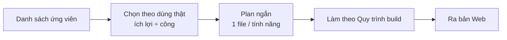

# Phase 9 · Small Features Update

> Gom các **tính năng nhỏ** lượm được khi dùng thật, mỗi cái một plan ngắn, làm theo thứ tự ích lợi.

Chưa làm

## Cách chạy

Mỗi tính năng: mục tiêu · làm · không làm · xong khi — **1 file plan**, đi đúng [Quy trình build](../quy-trinh-build.md).
Tính năng to hơn ~1 tuần → tách thành phase riêng, sửa Master Plan trước.

## Ứng viên ưu tiên (review 2026-10-25)

Từ bài review "tool có nhiều dữ liệu nhưng chưa trả lời được *nên build gì tuần này*". Cả 4 mục làm **sau** vòng test
bán trước của [Phase 7](phase-7-review-validate.md) — số thật của vòng đó quyết mục nào làm trước.

| Tính năng | Ích gì | Nối vào |
|---|---|---|
| **Điểm v2 thêm 2 trục** | **Tiếp cận khách** (có kênh nào gom người dùng: cộng đồng, video, trang đang lên top) và **Hợp sức mình** (làm một mình ≤ 4 tuần được không, cần backend không) · **trọng số mẫu** cho Mac / iOS / Android / SaaS · mỗi điểm có **1 dòng lý do** kèm nguồn | Điểm v2 [Phase 7](phase-7-review-validate.md) |
| **Mức nặng chủ đề than** | không chỉ đếm số lần: mất dữ liệu · trả tiền mà không dùng được nặng hơn quảng cáo · giao diện. Xếp chủ đề theo số lần × mức nặng | Chủ đề than [Phase 6](phase-6-ai-web.md) |
| **Nhãn mô hình tiền** | mỗi đối thủ gắn subscription · lifetime · IAP lẻ · quảng cáo · **chưa biết**; niche hiện tỷ lệ từng loại. Không lấy lượt tải thay cho doanh thu | Cột Tiền [Phase 2](phase-2-app-store.md) |
| **Theo dõi định kỳ** (kéo lên từ danh sách dưới) | chụp lại số của project sau 7 / 30 / 90 ngày: đối thủ mới, rating, giá, keyword, Trends — so với lần trước, ghi cạnh kết luận đang xem / ứng viên / loại | Project ([Phase 8](phase-8-project-data.md)) |

Không thêm lại **Reddit** làm nguồn than (đã bỏ 2026-10-24). Comment YouTube ở [Phase 13](phase-13-youtube-ai.md).

## Ứng viên khác (từ Appendix cũ — chưa chốt)

| Tính năng | Ích gì |
|---|---|
| **Cờ đối thủ yếu** trên UI | `bỏ bê` (update > 12 tháng) · `bị chê` (★ < 4 mà đông người dùng) · `một store` · `thu tiền` |
| **MCP có sẵn** | dùng Trends / Search Console / GA MCP trong Claude cùng dữ liệu tool — chỉ viết quy trình |
| **MCP của app** (`niche-radar-mcp`) | Claude tự đọc DB, so nhiều niche, viết báo cáo |
| Nguồn **Chrome Web Store** | cho portfolio extension |
| **Giá IAP nhiều nước** | so giá theo thị trường |
| Search volume trả phí (DataForSEO, Keyword Planner) | số lượt tìm thật — chỉ khi Phase 7 cho thấy cần số chắc |

**Xong khi**

- Có danh sách ưu tiên đã chốt (anh duyệt); 4 mục ưu tiên ở trên có quyết định làm / bỏ kèm lý do
- Mỗi tính năng làm xong có trong bản Web, test xanh, screenshot đã Read (app Mac nhận ở [mục App](../app/index.md), sau khi hết phase Web)

**Không làm**

- Làm tính năng không có trong danh sách đã chốt
- Thay đổi UI tổng thể — [Phase 10](phase-10-ui-ux.md)

