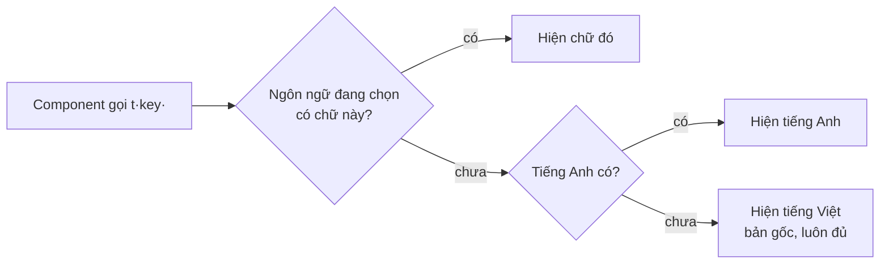

# Phase 9c · Đa ngôn ngữ (i18n)

> Dựng sẵn **khung dịch**: chữ giao diện tách ra file theo ngôn ngữ, có ô chọn ngôn ngữ. Khi cần bán cho người
> nước ngoài thì chỉ việc dịch thêm, không phải sửa lại code.

Khung xong 2026-10-25 · mới dịch header, menu, trang Cài đặt

## Chạy thế nào

- Ngôn ngữ có sẵn: **Tiếng Việt** (mặc định, bản gốc) · **English** · **Español**.
- Chọn ở ô góc phải header hoặc **Cài đặt → Ngôn ngữ giao diện**. Lưu trên trình duyệt (`localStorage`), đổi luôn
  `<html lang>` để trình đọc màn hình và Google đọc đúng.
- Chưa tự đoán theo ngôn ngữ trình duyệt: phần lớn trang chưa dịch, bật tự đoán bây giờ sẽ ra trang nửa Anh nửa Việt.

## File nằm ở đâu

| File | Có gì |
|---|---|
| `web/src/locales/vi.ts` | bản gốc — mọi chữ đã tách ra, đủ hết. Kiểu `MessageKey` lấy từ file này |
| `web/src/locales/en.ts` · `es.ts` | bản dịch theo đúng key của `vi.ts`, được phép thiếu |
| `web/src/lib/i18n.ts` | danh sách ngôn ngữ (`LANGS`), hàm `translate`, thứ tự lấy chữ khi thiếu, `intlLocale` cho ngày / số |
| `web/src/components/I18n.tsx` | `I18nProvider` (bọc app trong `main.tsx`), `useT()`, `useI18n()`, ô chọn `LangSelect` |
| `web/tests/i18n.test.ts` | chặn key lạ, chặn chuỗi rỗng, chặn bản dịch sai biến `{n}` so với tiếng Việt |

## Dịch thêm một chỗ

1. Thêm key vào `vi.ts`, đặt tên `<chỗ>.<ý>` — ví dụ `'research.title': 'Research 1 keyword'`. Biến viết `{tên}`.
2. Trong component: `const t = useT();` rồi thay chữ cứng bằng `t('research.title')` (có biến: `t('shell.running', { n })`).
3. Thêm cùng key vào `en.ts`, `es.ts` (chưa kịp thì bỏ qua — trang tự hiện tiếng Anh / tiếng Việt).
4. `npm run check` ở gốc repo phải xanh.

## Thêm một ngôn ngữ

1. Chép `en.ts` thành `<mã>.ts` (ví dụ `ja.ts`), dịch các chuỗi.
2. Thêm 1 dòng vào `LANGS` trong `web/src/lib/i18n.ts`: `{ code: 'ja', label: '日本語', intl: 'ja-JP', messages: ja }`.
3. Sửa dòng `toEqual(['vi', 'en', 'es'])` trong `web/tests/i18n.test.ts`, chạy `npm run check`.

**Xong khi**

- Đổi ngôn ngữ ở header hoặc Cài đặt → header, menu, trang Cài đặt đổi chữ ngay, tải lại trang vẫn giữ
- Chuỗi chưa dịch tự hiện tiếng Anh, chưa có tiếng Anh thì tiếng Việt — không hiện key trần
- Test chặn key lạ / sai biến · `npm run check` xanh

**Không làm ở phase này**

- Dịch hết các trang Research, Explore, Projects, Hướng dẫn, About (dịch dần khi cần bán ra nước ngoài)
- Dịch lỗi trả về từ API, evidence pack `.md`, chữ AI viết ra
- Đường dẫn theo ngôn ngữ (`/en/...`), tự đoán theo trình duyệt, chữ phải-sang-trái
- Thư viện i18n ngoài (react-i18next…) — khung tự viết ~60 dòng là đủ; khi cần số nhiều phức tạp thì thêm `Intl.PluralRules`

[Tổng quan Web](index.md)
