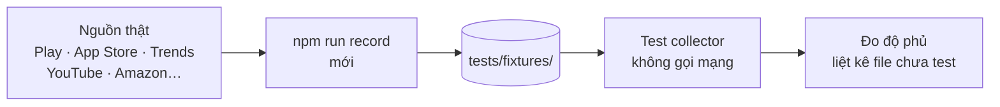

# Backlog 08 · Test collector bằng fixture

> Ghi lại **phản hồi thật** của từng nguồn một lần, rồi cho test chạy trên bản ghi đó. Test nhanh, không cần mạng,
> và sửa code collector không sợ hỏng âm thầm.

Không làm · 2026-10-26

**Không làm (chốt 2026-10-26):** test tự động — không ra tiền, không thêm người dùng. Vẫn chạy test hiện có trước khi merge. Trang giữ lại để tra, không code.

## Chạy thế nào

## Làm gì

| | |
|---|---|
| :material-record-rec: **Ghi fixture** | `npm run record` (mới) lưu phản hồi thật của Play, App Store, Trends, YouTube, Amazon… vào `web/tests/fixtures/` (fixture — bản ghi dữ liệu mẫu). Hiện đã có thư mục `appstore`, `playstore`, `trends`, `trustmrr` |
| :material-test-tube: **Test collector** | mỗi file trong `web/src/collectors/` có test đọc fixture, không gọi mạng |
| :material-chart-donut: **Độ phủ** | đo coverage (bao nhiêu % code được test chạy qua), liệt kê file chưa có test |
| :material-format-quote-close: **Kiểm trích dẫn** | test cho lớp kiểm trích dẫn của Phase 27.4 |
| :material-calculator: **Công thức điểm** | test cho công thức điểm của Phase 1 và Phase 61 |

**Xong khi**

- `npm test` xanh khi tắt mạng
- Mỗi collector có ≥ 1 test trên fixture thật
- Độ phủ `web/src/lib` + `web/src/collectors` có số, ghi vào trang này
- Có danh sách file chưa có test

**Không làm ở phase này**

- Đặt mục tiêu độ phủ 100% (chỉ phủ chỗ có logic)
- Chạy test trên CI (để Version 7)
- Sửa test cho xanh khi code sai

[Tổng quan Version 6](version-6.md)

Plan code chi tiết: [Backlog 08](../superpowers/plans/2026-10-25-niche-radar-phase50-fixture-tests.md)
