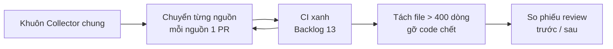

# Backlog 16 · Refactor

> **Refactor** = dọn lại code mà không đổi cách tool chạy. Mọi nguồn dữ liệu theo một khuôn chung, file to tách nhỏ,
> code chết gỡ đi. Mục đích: lần sau thêm nguồn hay sửa lỗi nhanh hơn.

Không làm · 2026-10-26

**Không làm (chốt 2026-10-26):** security / refactor — không ra tiền, không thêm người dùng. Phần bảo mật tối thiểu cho app bán (CSP, quyền Tauri, key trong Keychain) đã nằm ở [Phase 34](../app/phase-34-app-only.md). Trang giữ lại để tra, không code.

## Chạy thế nào

## Làm gì

| | |
|---|---|
| :material-puzzle: **Khuôn `Collector`** | tên · giới hạn gọi · cache · `fetch` · `parse`. Mọi nguồn trong `web/src/collectors/` (Play, App Store, Trends, TrustMRR…) theo khuôn này |
| :material-file-tree: **Tách file to** | file > 400 dòng tách nhỏ (hiện có `web/src/server/app.ts`) |
| :material-broom: **Gỡ code chết** | code / export không ai dùng |
| :material-shape: **Kiểu dữ liệu chung** | gom kiểu dùng chung về một chỗ |
| :material-lock: **Giữ nguyên** | không đổi API, không đổi giao diện |

**Xong khi**

- Test + E2E xanh
- Phiếu review kết quả ([Backlog 11](version-6.md)) giữ nguyên điểm trước và sau refactor
- Thêm thử 1 nguồn giả chỉ cần 2 file: 1 file collector + 1 file test
- Không còn file nào > 400 dòng

**Không làm ở phase này**

- Đổi framework (React, Hono, Drizzle)
- Viết lại collector bằng ngôn ngữ khác
- Tính năng mới, đổi giao diện
- Refactor nhiều nguồn trong một PR

[Tổng quan Version 8](version-8.md)

Plan code chi tiết: [Backlog 16](../superpowers/plans/2026-10-25-niche-radar-phase60-refactor.md)
