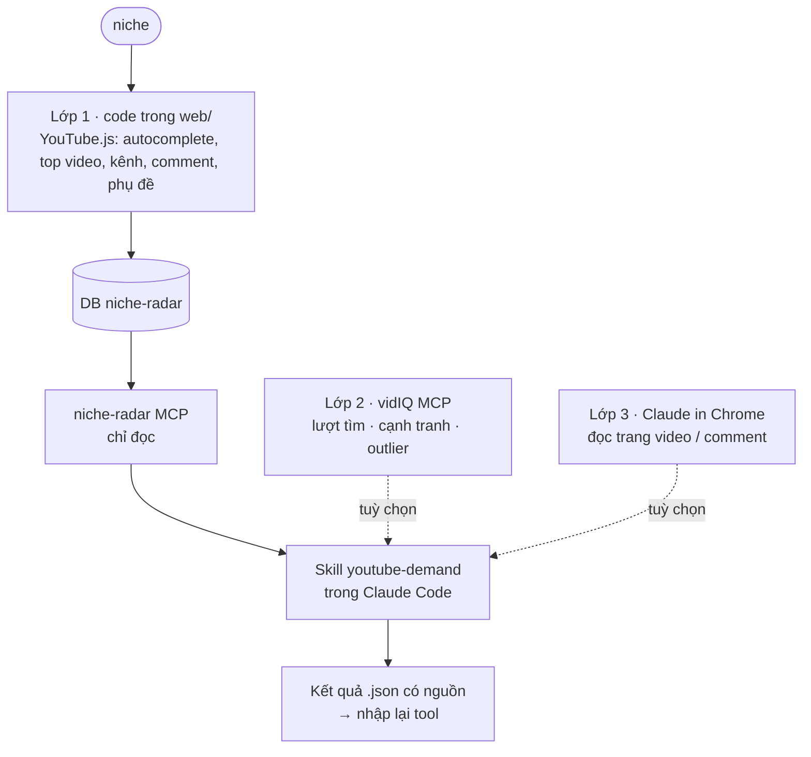

# Backlog 27 · YouTube + skill lái Chrome + repo có sẵn

> Trả lời 3 câu: Claude Code lái Chrome bằng skill được không (cho YouTube và cho trang Play / App Store)?
> vidIQ đã nằm trong plan rồi, kết hợp MCP thế nào? Có repo nào làm sẵn để gắn vào tool cho nhanh?

Plan mới 2026-11-02 · Bước 0 đo xong phần làm được (YouTube.js, trình duyệt) · còn vidIQ + Claude in Chrome thật

## 1. Claude Code + Chrome có chạy skill được không? → Được

- **Skill chỉ là chữ hướng dẫn.** Khi Claude Code mở với `claude --chrome` (hoặc `/chrome` → Enabled by default),
  phiên có sẵn bộ tool `claude-in-chrome` (mở tab, đọc trang, bấm, cuộn, chụp). Skill nào ghi "mở trang X, đọc Y"
  thì Claude dùng chính các tool đó. Không cần API riêng.
- **Khác với Backlog 26:** Backlog 26 nói *extension của mình không cắm vào Claude in Chrome được* — vẫn đúng.
  Ở đây chiều ngược lại: **Claude Code điều khiển Chrome**, skill nằm phía Claude Code.
- **Dùng cho YouTube:** mở trang video → đọc tiêu đề, view, mô tả, comment đã tải (cuộn thêm), bật phụ đề.
- **Dùng cho Play / App Store ("phần trên"):** mở trang app hoặc trang tìm kiếm → đọc tên, rating, review hiển thị,
  rồi gọi niche-radar MCP lấy số đã cào. Đây là bản "Claude tự soi đối thủ" bên cạnh extension ShotMatic Lite.

**Điều kiện (tài liệu chính thức, đọc 2026-11-02):**

- Extension Claude in Chrome ≥ 1.0.36, Claude Code đăng nhập bằng `/login` với gói trả phí (Pro / Max / Team…).
  Đăng nhập bằng API key thì **tắt** Chrome — tuyến này không chạy được qua Claude API.
- Gặp trang đăng nhập hoặc captcha → Claude **dừng, chờ người dùng tự làm**. Mỗi domain mới phải cho phép một lần.
- Chạy trên Chrome thật của người dùng, có cửa sổ hiện lên → chậm, hợp **10–20 trang / lượt**, không hợp cào hàng loạt.
- Project không tự bật được Chrome (`CLAUDE_CODE_ENABLE_CFC` trong `.claude/settings.json` bị bỏ qua) →
  người dùng phải tự chạy `claude --chrome`. Skill phải báo rõ khi phiên không có tool Chrome.

**Kết luận:** Chrome là **tuyến phụ để đọc** (comment, trang store, video không có phụ đề). Số liệu chính vẫn do
code trong `web/` cào (Phase 51), vì cào bằng code nhanh, lặp lại được, không cần người ngồi cạnh.

## 2. vidIQ đã có trong Phase 51 — ghép MCP thế nào

[Phase 51](phase-51-youtube-search.md) đã chọn vidIQ làm MCP thử trước. Đọc lại trang vidIQ ngày 2026-11-02:

- Endpoint `https://mcp.vidiq.com/mcp`. Claude thêm làm connector (đăng nhập), app gọi thẳng thì dùng **API key**
  gửi kiểu `Authorization: Bearer`, tạo / thu hồi ở trang cài đặt MCP của vidIQ.
- Có `keyword_research` (lượt tìm + cạnh tranh), `outliers`, `trending_videos`, `video_transcript`. Mỗi lần gọi trừ credit của gói.
- **Gói nào được dùng MCP: chưa chắc.** Một trang staging của vidIQ ghi "gói Max", trang chính ghi "Free for a limited time".
  Lúc làm phải mở trang giá thật ghi lại kèm ngày.
- Không dùng quota YouTube Data API của mình. Chỉ đọc kênh.

**Ghép 3 lớp, mỗi lớp tắt được:**

- **Lớp 1** chạy một mình được (đúng luật Phase 51: tắt hết MCP vẫn đủ).
- **Lớp 2 + 3** chỉ có trong phiên Claude Code của người dùng. App không giữ key vidIQ ở bản đầu (tuyến job của Phase 51).
- Số của vidIQ để **cột riêng, ghi nguồn + ngày**, không trộn vào điểm cơ hội.

## 3. Repo có sẵn (đếm sao bằng GitHub API ngày 2026-11-02)

**Thư viện để gắn vào code `web/` (Lớp 1):**

| Repo | Sao | Ngôn ngữ · license | Dùng cho |
|---|---:|---|---|
| [LuanRT/YouTube.js](https://github.com/LuanRT/YouTube.js) (gói `youtubei.js`) | 5.403 | TypeScript · MIT | **chọn chính** — tìm, video, kênh, comment, phụ đề, không key. Đã là lựa chọn của Phase 51 |
| [yt-dlp/yt-dlp](https://github.com/yt-dlp/yt-dlp) | 204.512 | Python · Unlicense | dự phòng khi YouTube.js gãy — phải cài Python, chỉ gọi dạng lệnh |
| [jdepoix/youtube-transcript-api](https://github.com/jdepoix/youtube-transcript-api) | 8.547 | Python · MIT | tham khảo cách lấy phụ đề (Python, không gắn thẳng) |
| [egbertbouman/youtube-comment-downloader](https://github.com/egbertbouman/youtube-comment-downloader) | 1.274 | Python · MIT | tham khảo cách lấy comment không key |

**MCP YouTube cộng đồng (Lớp 2 thay vidIQ, cho phía Claude):**

| Repo | Sao | Ngôn ngữ | Có gì · lưu ý |
|---|---:|---|---|
| [kimtaeyoon83/mcp-server-youtube-transcript](https://github.com/kimtaeyoon83/mcp-server-youtube-transcript) | 603 | TypeScript | chỉ phụ đề, không key |
| [ZubeidHendricks/youtube-mcp-server](https://github.com/ZubeidHendricks/youtube-mcp-server) | 592 | TypeScript | Data API v3 (cần key, chung quota 10.000/ngày); có cả tool quản lý video → **chỉ bật tool đọc** |
| [anaisbetts/mcp-youtube](https://github.com/anaisbetts/mcp-youtube) | 552 | TypeScript | phụ đề qua yt-dlp |
| [jkawamoto/mcp-youtube-transcript](https://github.com/jkawamoto/mcp-youtube-transcript) | 494 | Python | phụ đề, cập nhật đều |
| [kirbah/mcp-youtube](https://github.com/kirbah/mcp-youtube) | 33 | TypeScript | trả dữ liệu gọn ít token; ít sao, xem kỹ trước |
| [coyaSONG/youtube-mcp-server](https://github.com/coyaSONG/youtube-mcp-server) | 27 | — | phụ đề kèm mốc giây để trích dẫn; ít sao |

- **Không có repo nào làm sẵn đúng việc "niche này có nhu cầu trên YouTube không"**. Repo chỉ lo lấy dữ liệu;
  phần chấm điểm (độ đông, độ mới, video vượt kênh) vẫn là của mình — đã thiết kế ở Phase 51.
- **Nhanh nhất:** thêm `youtubei.js` vào `web/` làm collector như các nguồn khác. Không nhúng MCP cộng đồng vào app
  (thêm 1 tiến trình, thêm chỗ gãy); MCP cộng đồng chỉ để gợi ý người dùng cắm vào Claude của họ.
- Tất cả là MIT / Unlicense → dùng làm thư viện được; chép code thì giữ thông báo license.

## Làm gì (theo thứ tự)

1. **Bước 0 · đo thử (½ ngày):** YouTube.js còn tìm / lấy comment / phụ đề được không trên 1 niche × 10 keyword;
   vidIQ: gói nào mở MCP, 10 keyword tốn bao nhiêu credit; Chrome: skill đọc 10 trang video mất bao lâu.
   Ghi số + ngày vào bảng thử ở cuối trang này. Chưa đo → ghi `chưa đo`. **Đã đo 2026-11-02** — phụ đề không lấy được, xem bảng thử.
2. **Phase 51 như plan cũ** (YouTube.js) — không đổi gì, chỉ ghi thêm link về trang này.
3. **Skill `youtube-demand`** (tiếng Anh, chữ trong `web/src/lib/ai/ai-dir.ts`, theo luật [Phase 28.3](phase-28-3-skills.md)):
   đọc dữ liệu YouTube qua niche-radar MCP → nếu phiên có vidIQ thì thêm lượt tìm → nếu phiên có tool Chrome thì mở
   tối đa 10 video đọc comment → trả kết luận có link + mốc giây. Thiếu lớp nào thì nói rõ đã bỏ lớp đó.
4. **Skill `store-page-check`** (cho trang Play / App Store): Claude mở trang app đang soi trong Chrome, đọc review
   hiển thị, gọi niche-radar MCP lấy số → kết luận như nút Niche check của extension. Chép 1 dòng vào Backlog 26.
5. **Nhập lại kết quả:** skill ghi `.json` theo khuôn có sẵn trong code (tuyến job Phase 51) → tool nhập, hiện cột riêng.

**Luật**

- Chrome chỉ **đọc**: không comment, không like, không đăng ký kênh, không đăng nhập thay người dùng
- Gặp captcha / chặn → dừng lớp đó, báo, không vượt
- Mỗi số ghi nguồn (YouTube.js / vidIQ / trang đã mở) + ngày; số vidIQ là ước tính bên thứ 3
- Trần mỗi lượt: ≤ 10 trang Chrome, trần credit vidIQ đặt sẵn
- Skill phải chạy được khi **không có** Chrome và **không có** vidIQ (chỉ dùng Lớp 1)

**Xong khi**

- Bảng thử Bước 0 điền đủ 3 dòng (YouTube.js · vidIQ · Chrome)
- `/youtube-demand` chạy được ở 3 kiểu phiên: chỉ MCP niche-radar · + vidIQ · + Chrome; mỗi kiểu 1 niche thật
- `/store-page-check` chạy trên 1 trang Play + 1 trang App Store thật
- Test của chữ skill xanh, `npm run check` xanh

**Không làm ở đây**

- Cào YouTube hàng loạt bằng Chrome (đó là việc của code Lớp 1)
- Giữ key vidIQ trong app, mua gói vidIQ thay người dùng
- Dùng tool tạo nội dung của MCP (tiêu đề, thumbnail, clip)
- Tải video về máy

## Bảng thử (Bước 0, đo 2026-11-02)

Niche thử: `habit tracker`. 10 keyword lấy từ gợi ý YouTube (`suggestqueries … ds=yt`, trả đủ 10 gợi ý):
habit tracker · google sheet · google sheets · excel · journal · template · bullet journal · sheet · in notion · notion template.

**YouTube.js 18.3.0** (Node 22, không key, mạng nhà ở VN, gọi `lang=en` `location=US`)

- **Tìm video:** 10 / 10 keyword ra đủ 20 video mỗi keyword (tiêu đề, view, ngày đăng dạng "8mo ago", độ dài, kênh).
  Mỗi lần tìm 0,7–1,1 giây. Cả lượt 10 keyword + 3 video chi tiết, nghỉ 2 giây giữa các lần gọi: **54 giây**. Không bị chặn.
- **Kênh:** chạy — trả số sub dạng chữ ("37.4K subscribers | 213 videos"), 0,3–0,7 giây mỗi kênh. Phải tự đổi chữ sang số.
- **Comment:** chạy — trang đầu 13–20 comment, 0,3 giây. Lấy **200 comment** của 1 video: 10 trang, 16 giây (nghỉ 1,5 giây / trang).
- **Phụ đề: KHÔNG chạy.** `getTranscript()` trả lỗi 400 (3 / 3 video). Danh sách phụ đề có (18–20 thứ tiếng), nhưng tải link
  phụ đề trả về rỗng. `yt-dlp 2026.08.19` cũng lỗi 429 (2 / 2 video). Lý do có vẻ là YouTube đòi token chống bot cho
  phụ đề — **chưa kiểm**, chỉ là đoán.

**vidIQ MCP** (chỉ đọc trang giá + trang Claude, chưa gọi thật)

- Trang giá ngày 2026-11-02: MCP **có ở mọi gói, kể cả Free**. Free 150 credit / tháng · Boost 19 USD/tháng, 2.000 credit ·
  MAX 49 USD/tháng, 6.000 credit (giá Mỹ, 1 kênh).
- "Most research tools cost 5 credits per call" → 10 keyword × 1 lần `keyword_research` ≈ 50 credit, tức 1/3 gói Free.
  Đây là **tính từ chữ trên trang**, số credit thật của `keyword_research`: `chưa đo`.
- Chưa gọi thật vì cần tài khoản vidIQ. Claude không tạo tài khoản thay anh → anh tạo tài khoản Free + nối connector
  `https://mcp.vidiq.com/mcp` vào Claude, rồi chạy lại dòng này.

**Claude in Chrome:** `chưa đo` — extension chưa nối với phiên này (danh sách trình duyệt kết nối trống).
Đo thay bằng **trình duyệt có sẵn trong app Claude** (Chromium), 10 video đầu của "habit tracker app":

- 10 / 10 trang mở được, không hỏi cookie, không captcha, không bị chặn.
- Trang hiện trên màn hình: đọc tiêu đề, view, số comment ("412 Comments") + **20 comment đầu**, mất ~10 giây / trang (gồm cuộn chờ tải).
- Khung trình duyệt bị ẩn: YouTube **không vẽ trang** → không đọc được comment. Vẫn đọc được dữ liệu nhúng sẵn trong trang
  (tiêu đề, view chính xác, kênh, mô tả, số thứ tiếng phụ đề): ~2 giây / trang.
- Nút "Show transcript" bấm không mở được bảng phụ đề; video đang phát thì chữ phụ đề vẫn hiện trên hình.

**Rút ra cho plan**

1. Lớp 1 (YouTube.js) đủ cho Phase 51: tìm, top video, kênh, comment. Giữ nguyên lựa chọn.
2. **Phụ đề là chỗ hỏng.** Phase 52 đang lấy "phụ đề + comment" làm tuyến chính → đổi thành **comment làm chính**,
   phụ đề lấy qua tuyến khác: `video_transcript` của vidIQ, Gemini đọc link YouTube, hoặc đo lại sau khi YouTube.js / yt-dlp ra bản sửa.
3. Tuyến Chrome chậm (~10 giây / trang) và cần cửa sổ hiện trên màn hình mới đọc được comment → chỉ để soi ≤ 10 video, đúng như luật ở trên.
4. Còn phải đo: vidIQ gọi thật (cần tài khoản của anh) · Claude in Chrome thật (cần `claude --chrome` + extension đăng nhập).

Nguồn: [Claude Code · dùng với Chrome](https://code.claude.com/docs/en/chrome) ·
[vidIQ cho Claude](https://vidiq.com/claude/) · số sao lấy từ GitHub API ngày 2026-11-02.

[← Phase 51 · YouTube Search](phase-51-youtube-search.md) · [Backlog 26 · Extension Chrome Lite](phase-backlog-26-chrome-extension-lite.md)
