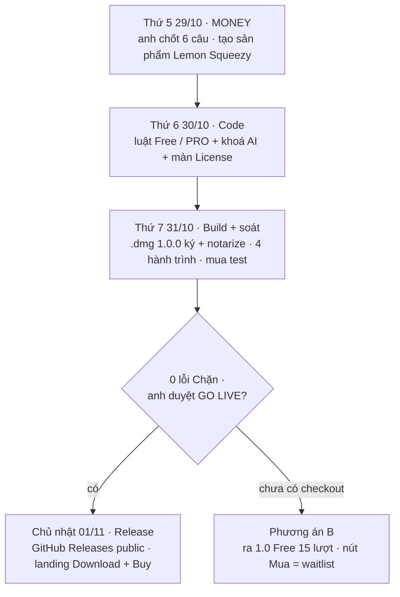

# ⭐ Phase đặc biệt · Build App + Money

> Một phase gom, chạy **4 ngày (Thứ 5 29/10 → Chủ nhật 01/11/2026)**: **MONEY** — chốt bán gói gì (Free bao nhiêu lượt,
> PRO Lifetime có gì) — rồi **build app Mac** đúng luật đó và **release** cho người lạ tải + mua được. Gom phần cần cho
> bản bán đầu từ [Phase 33.1](phase-33-1-go-live-review.md) (Free / PRO + soát UI) và [Phase 34](../app/phase-34-local-app-2.md)
> (gói bản bán); phần còn lại để sau.

Plan 2026-10-29 · mục tiêu release trước Chủ nhật 01/11/2026 · MONEY chốt đủ 6 câu 2026-10-29 · chờ sản phẩm Lemon Squeezy

## Mục tiêu · cần làm · KHÔNG làm

- **Mục tiêu:** Chủ nhật 01/11, người lạ vào [shotmatic.app](https://shotmatic.app) → tải **ShotMatic for Mac 1.0**
  (`.dmg` đã ký + notarize) → tra được niche đầu tiên trong 10 phút ở bản Free → hết lượt thì mua **PRO $39.99 trả một lần**
  qua Lemon Squeezy → dán key → PRO ngay, kết quả cũ còn nguyên.
- **Cần làm:**
    - MONEY: anh chốt 6 câu B1–B6 của Phase 33.1 (Claude đề xuất sẵn ở dưới)
    - anh tạo sản phẩm "ShotMatic Pro" trên Lemon Squeezy
    - code luật Free / PRO
    - build `.dmg` 1.0.0
    - soát 4 hành trình chính trên tài khoản macOS mới
    - mở landing cho tải + mua
- **KHÔNG làm:** bản Windows ([Phase 36](../app/phase-36-windows-app.md)) · tự cập nhật ([Phase 37](../app/phase-37-release-auto-update.md) —
  bản 1.0 cập nhật bằng tải lại `.dmg`) · Keychain + phiếu bảo mật ([Phase 35](../app/phase-35-app-only.md)) · tính năng mới ·
  đổi giá $39.99 · gói tháng / năm · tài khoản · mã giảm giá · sửa mức "Đẹp hơn" → ghi [Appendix](../appendix.md).

## Chạy thế nào

## MONEY · bán gói gì

Bảng đầy đủ + lý do ở [Phase 33.1 phần B](phase-33-1-go-live-review.md#phan-b-free-pro-lifetime). Anh chốt đủ 6 câu theo đề xuất (2026-10-29):

- **Free mãi mãi, 15 lượt tra tổng** (B2 đã chốt) (Research hoặc Explore, mỗi lần 1 lượt; lượt lỗi nguồn không trừ). Mở lại kết quả cũ,
  Lịch sử, tải CSV, Sức khoẻ niche: không tính lượt.
- **PRO Lifetime $39.99**, 2 máy, cập nhật 1.x miễn phí, hoàn tiền 14 ngày — tra không giới hạn + **toàn bộ AI**.
- **AI ở Free:** AI Agent chạy 2 bước đầu (Tìm niche + AI Suggest, AI tra tối đa 3 keyword mỗi lần) · AI lẻ (tóm tắt,
  Điền bằng AI, ✦) cho 3 lần dùng thử · chặng 2 Brief / Spec / Plan là PRO.
- **Bỏ dùng thử 14 ngày** — thay bằng 15 lượt Free, landing chỉ nói một luật.

### 6 câu anh chốt · ✅ đủ 6/6 (2026-10-29)

1. **B1 · Bản bán có gì:** ✅ mở AI Agent + Projects; Find Gaps + So sánh niche xám "Coming soon".
2. **B2 · Số lượt Free:** ✅ **đã chốt 2026-10-29: 15 lượt tra tổng**, không làm mới theo ngày / tuần / tháng.
3. **B3 · Explore:** ✅ **1 lượt** như Research.
4. **B4 · AI lẻ ở Free:** ✅ **3 lần dùng thử**.
5. **B5 · AI Agent ở Free:** ✅ **2 bước đầu**, AI tra ≤ 3 keyword mỗi lần.
6. **B6 · Dùng thử 14 ngày:** ✅ **bỏ**.

Đã ghi vào [Phase 33.1 phần B](phase-33-1-go-live-review.md#phan-b-free-pro-lifetime).

## Lịch 4 ngày

### Thứ 5 29/10 · MONEY

- ✅ **Anh:** chốt 6 câu (2026-10-29).
- **Anh:** tạo store + sản phẩm **"ShotMatic Pro" $39.99 một lần** trên Lemon Squeezy, bật license key (2 lần kích hoạt),
  gửi Claude `checkoutUrl` + `productId`. Claude không đăng nhập, không nhập thuế / ngân hàng thay anh.
- **Claude:** điền `web/src/lib/license/config.ts` (giá, số lượt, `checkoutUrl`, `productId`) — landing + app đọc cùng số.

### Thứ 6 30/10 · Code luật Free / PRO

Làm đúng mục "Code sau khi chốt" của [Phase 33.1](phase-33-1-go-live-review.md#code-sau-khi-chot):

- trạng thái `free` (còn N lượt) · `free_used_up` · `pro` thay `trial` / `expired`; đếm lượt khi `POST /api/research` /
  `POST /api/explore` thành công
- khoá AI ở server (route AI trả `402` + lý do), không chỉ xám nút
- `edition.ts`: trang của bản bán theo B1 · AI Agent bước PRO hiện ổ khoá + mở `/license`
- thanh trên cùng "12 free searches left · Get PRO $39.99" · `/license`: bảng Free vs PRO, nút Mua, ô dán key
- test: hết lượt → `402` · lượt lỗi không trừ · AI Agent Free dừng đúng bước · PRO không bị chặn · xoá `license.json`
  không ra lượt mới · `npm run check` xanh

### Thứ 7 31/10 · Build + soát

- Version app **1.0.0** (đang 0.10.0) · `npm run mac` (ký + notarize, không dùng `mac:quick`) → `ShotMatic-1.0.0-mac-arm64.dmg`.
- Soát trên **tài khoản macOS mới**, DB trống, cửa sổ mặc định + thu nhỏ hết cỡ, sáng + tối — 4 hành trình của
  [Phase 33.1](phase-33-1-go-live-review.md#6-hanh-trinh-phai-i-het):
    1. Lần đầu mở app (Gatekeeper không chặn, màn đầu nói app làm gì, thanh Free đúng số)
    2. Tra 1 niche tới trang kết quả
    3. Hết lượt Free → mua (Lemon Squeezy **test mode**) → dán key → PRO · key sai · máy thứ 3
    4. AI: Free dừng đúng giới hạn · PRO chạy đủ 7 bước ra bộ Brief / Spec / Plan .md
- Bảng vướng có ảnh ở `docs/images/build-app-money/` · sửa hết mức **Chặn**, mức **Khó chịu** sửa nếu đúng chỗ.
- Bản Mac 0 chữ tiếng Việt (tìm ký tự có dấu ngoài file dịch `vi`).
- Soát lần cuối số khớp nhau: giá · số lượt · số máy · hoàn tiền ở app, landing, `/terms`, checkout.

### Chủ nhật 01/11 · Release

- **Claude:** tạo release `v1.0.0` (draft) trên GitHub Releases public kèm `.dmg` + What's New bằng lời thường.
- **Claude:** landing shotmatic.app — waitlist → **Download for Mac** + **Get PRO $39.99**; FAQ + `/terms` đổi "14-day trial"
  thành "15 free searches"; GA4 `download` + `checkout_click`. Soát 1280 + 375, `check_landing.py` qua.
- **Anh:** duyệt GO LIVE → tự bấm **Publish** release + merge / deploy landing. Gửi email cho danh sách waitlist (anh gửi).
- **Anh (tuỳ chọn):** mua thật 1 đơn rồi tự hoàn tiền, để chắc luồng mua thật chạy (test mode không thử được phần này).
- CHANGELOG + kết quả ghi vào trang này, Phase 33.1, Phase 34, Version 10; Master Plan đổi chip.

## Phương án B — nếu tới Thứ 7 chưa có checkout

Lemon Squeezy có thể mất vài ngày duyệt store. Khi đó **vẫn ra 1.0 trước Chủ nhật**: bản Free 15 lượt đủ luật, nút
"Get PRO" mở form waitlist / báo giá Founding $39.99 — mở bán bằng bản **1.0.1** ngay khi có `checkoutUrl`. Không đổi
gì khác trong plan.

## Rủi ro đã biết

- **Notarize:** cần Apple ID app-specific password / keychain profile còn hạn trên máy — kiểm ngay Thứ 5, đừng để Thứ 7 mới biết.
- **Claude Code trên máy bị đăng xuất** (ghi ở Phase 28.4) → soát hành trình AI bằng Codex, hoặc anh đăng nhập lại.
- **AI Agent tra nhiều keyword một lần** ăn hết lượt Free → đã chặn bằng B5 (≤ 3 keyword).
- Bản `.dmg` 0.8 / 0.9 / 0.10 cũ vẫn để draft — không mở lại, 1.0.0 là bản public đầu tiên.

**Xong khi**

- ✅ 6 câu B1–B6 đã chốt, ghi ngày (2026-10-29)
- `ShotMatic-1.0.0-mac-arm64.dmg` ký + notarize, cài trên tài khoản macOS mới mở không bị chặn
- 4 hành trình đi hết, **0 lỗi mức Chặn**, ảnh trước / sau có trong bảng vướng
- Hết 15 lượt → `402` + màn mua · mua test → key → PRO · AI Free dừng đúng giới hạn · `npm run check` xanh
- Giá · số lượt · số máy · hoàn tiền giống nhau ở app, landing, `/terms`, checkout
- Release `v1.0.0` public + landing có nút Download + Get PRO (hoặc phương án B) — **trước hết Chủ nhật 01/11/2026**

**Không làm ở phase này**

- Windows, tự cập nhật, Keychain, phiếu bảo mật — để Phase 35–37
- Tính năng mới, nguồn mới, sửa mức "Đẹp hơn"
- Đổi giá, gói tháng / năm, mã giảm giá, tài khoản
- Claude đăng nhập Lemon Squeezy, nhập thuế / ngân hàng, bấm Publish release, gửi email hàng loạt
- Đếm ngược giả, khoá dữ liệu cũ của người dùng

Gom từ: [Phase 33.1 · Review trước GO LIVE](phase-33-1-go-live-review.md) · [Phase 34 · Local App 2.0](../app/phase-34-local-app-2.md) ·
[Phase 31 · Mô hình tiền](phase-31-money-model.md) · [Phase 32 · Thanh toán + license key](phase-32-payments.md)
