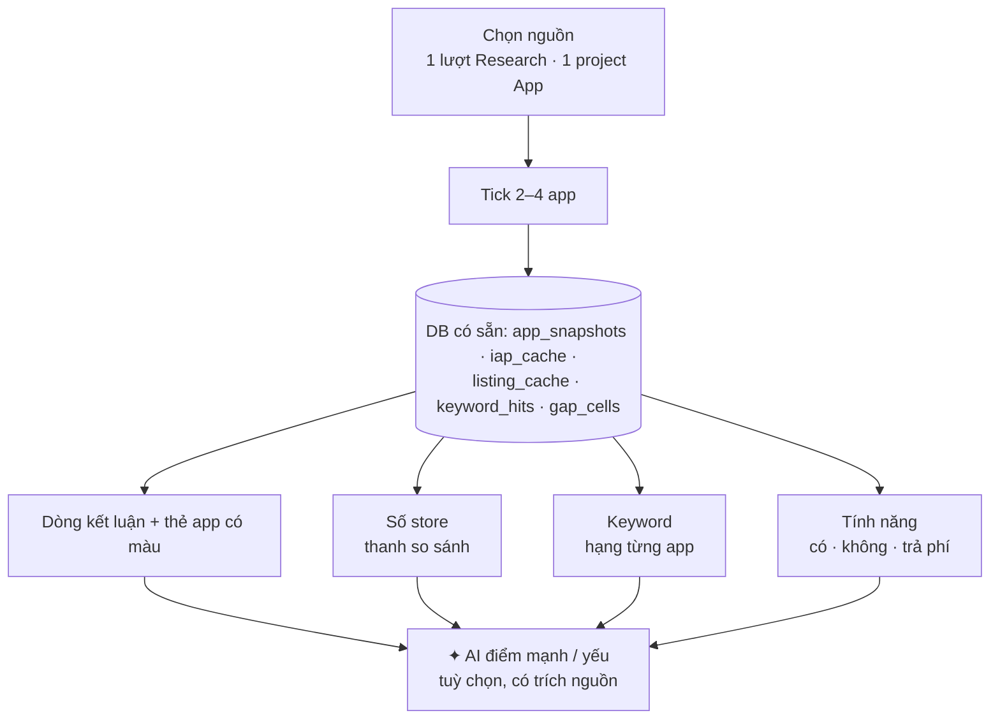

# 20 · So sánh đối thủ app

> Plan 2 · mục 20. Tab **Compare competitors** ở trang Compare: đặt **2–4 app** Google Play / App Store cạnh nhau,
> so số store, hạng keyword, tính năng có / không. Có thêm nút **✦ AI** viết điểm mạnh / yếu, câu nào cũng trỏ về số
> đã hiện. Chỉ dành cho **app**, không dùng cho YouTube hay sách. Bản gọn của spec cũ
> [Phase 56](phase-56-compare-competitor.md).

Xong 2026-11-15

## Vì sao làm

Sidebar và trang Compare đã có mục **Compare competitors**, nhưng đang xám với chip "coming soon". Muốn biết app mình
đánh vào ai và hơn ở đâu, hiện phải mở từng app ở bảng Đối thủ của trang Research rồi tự so.

Anh chốt 2026-11-15:

- Chọn app từ **1 lượt Research** hoặc **1 project loại App**. Không dán link store.
- So **2–4 app** một lần.
- So **số store · keyword · tính năng**. Không có khối lời chê.
- Có **nút ✦ AI tuỳ chọn**. Trang vẫn đầy đủ khi không bật AI.

## Đã đo (2026-11-15 · DB máy dev, chỉ đọc)

- **293 lượt Research.** Trung bình **94,6 app** mỗi lượt, nhiều nhất 298, nên luôn đủ app để chọn.
- **Keyword mỗi lượt Research:** trung bình **2,6**, nhiều nhất **6**. Bảng keyword sẽ ngắn, đúng như spec cũ đã ghi.
- **Đối thủ đã gom vào project:** 21 app ở 3 project. Chỉ chọn từ project thì gần như rỗng, nên lượt Research là nguồn chính.
- **Feature Gap đã lưu ô:** 3 lượt Research. **Mô tả store đã cache:** 186 app. Phần lớn app sẽ có ô tính năng "chưa đo".
- **Snapshot app:** 27.149. Mọi snapshot có ngày cập nhật. Lượt cài chỉ có ở Play (9.045 snapshot), App Store không công bố.

## Chạy thế nào

Trang chỉ đọc DB, **không tải thêm request nào**. Chỉ nút ✦ AI mới gọi AI.

## Làm gì

### 20.1 · Chọn app

- Route `/compare/competitors`. Đầu trang có 2 nút chọn nguồn: **Lượt Research** · **Project**.
- **Lượt Research:** danh sách lượt gần nhất (seed · nước · ngày), có ô tìm. Chọn 1 lượt thì hiện app của lượt đó, xếp theo
  số rating giảm dần. Mỗi dòng có icon, tên (`truncate`), chip store, sao, số rating.
- **Project:** chỉ hiện project loại **App** (cột `projects.type`, icon `ProjectType`). Chọn 1 project thì hiện các đối thủ đã
  gom vào project đó.
- Tick từ 2 đến 4 app. Khi đã đủ 4 app, ô tick của các app còn lại xám đi. Chưa đủ 2 app thì chưa hiện bảng.
- Lựa chọn lưu trên URL (`?run=123&apps=1,2,3` hoặc `?project=5&apps=…`), mở lại link là thấy lại đúng bảng.

### 20.2 · Thẻ app + dòng kết luận

- Mỗi app một thẻ, màu cố định theo thứ tự (4 màu, đọc rõ cả sáng lẫn tối). Thẻ có icon, tên, dev, chip store, link mở
  trang store. Nút ✕ bỏ app khỏi bảng.
- **Dòng kết luận** tính bằng luật, không dùng AI. Ví dụ: "⭐ cao nhất: A (4,8) · 💬 nhiều rating nhất: B (3,0 tr) ·
  ⏳ lâu chưa cập nhật: C (412 ngày)". Có hơn 180 ngày chưa cập nhật mới hiện mục ⏳.

### 20.3 · Số store (bảng mỗi app 1 cột)

Bảng: **mỗi app 1 cột**, mỗi chỉ số 1 hàng (anh chốt 2026-11-15, không xếp thanh chồng nhiều hàng). Trong ô có số và
1 thanh mảnh cùng màu app. Ô tốt nhất ở mỗi hàng tô xanh kèm cúp (sao, rating, lượt cài cao hơn thắng; cập nhật ít ngày hơn thắng),
cần ít nhất 2 ô có số mới chọn.

| Chỉ số | Nguồn | Khi không có số |
|---|---|---|
| Sao | `app_snapshots.rating` | chưa đo |
| Số rating | `app_snapshots.ratings_count` | chưa đo |
| Lượt cài | `installs_min`, chỉ Play | App Store: "store không công bố" |
| Cập nhật cuối | `updated_at` → số ngày trước (thanh ngắn = mới) | chưa đo |
| Ra mắt | `apps.released_at` → tuổi app | chưa đo |
| Giá | `price` + `currency` | — |
| Mua trong app | Play: `offers_iap` + `iap_range` · App Store: gói trong `iap_cache` | chưa đo |
| Quảng cáo | `listing_cache.ad_supported`, chỉ Play | chưa đo |

- Snapshot lấy từ đúng lượt Research đã chọn. Ở nguồn project thì lấy snapshot mới nhất của app.
- Mỗi số có ⓘ ghi nguồn: "Research #id · ngày đo" + link store. Không ước lượt tải hay doanh thu.

### 20.4 · Keyword

- Bảng: mỗi keyword một hàng, mỗi app một cột hạng. Đầu cột ghi app đó có hạng ở bao nhiêu keyword.
- **Nguồn:** `keyword_hits` của lượt Research đã chọn. Ở nguồn project thì lấy keyword của mọi lượt Research gắn với các đối
  thủ trong project, keyword trùng thì giữ lượt mới nhất.
- **Ô "—"** nghĩa là "không có trong top N đã lưu" (N = số app đã lưu cho keyword đó). Tooltip ghi đúng câu này.
- Hạng 1–10 tô đậm. Nếu chưa có keyword nào thì ghi "chưa đo".

### 20.5 · Tính năng

- Các hàng lấy từ Feature Gap của lượt Research: 5 hàng mặc định + hàng anh tự thêm. Ô là **có · không · trả phí ·
  không nói**, rê chuột thấy câu trích từ trang store.
- Ô tính bằng luật từ mô tả đã cache (`listing_cache`). Ô AI / Chrome đã lưu (`gap_cells`) thì ưu tiên ô đã lưu.
- App chưa có mô tả trong cache thì cả cột ghi "chưa đo", kèm link "Mở Feature Gap" về trang Research để đọc trang store.
  Trang này không tự tải mô tả.

### 20.6 · ✦ AI điểm mạnh / yếu (tuỳ chọn)

- Dùng lại nút ✦ có sẵn (`AiMagic`, như So kênh YouTube): Cài đặt AI, sổ `ai_calls`, luồng Dùng · Bỏ · Hỏi lại. Chưa nối AI thì nút
  dẫn tới Setup AI.
- **Câu hỏi** chỉ gồm số và ô tính năng đang hiện, mỗi app kèm Research #id + ngày đo. Số thiếu ghi "not measured". AI được dặn
  không bịa số, không ước lượt tải / doanh thu, mỗi điểm mạnh / yếu phải nêu đúng số nó dựa vào.

### 20.7 · Bật tính năng

- Bỏ chip "coming soon" ở tab Compare competitors (`CompareTabs`) và ở mục con trong sidebar (`SideNav`), cho bấm được.
- `features.ts`: đổi mục "So sánh đối thủ" thành `done`, ghi lại mô tả: 2–4 app, số store, keyword, tính năng.
- Chữ có đủ English + tiếng Việt (+ es theo khung locale đang có).

## Code ở đâu

| File | Việc |
|---|---|
| `web/src/lib/competitor-compare.ts` | đọc DB → `CompareView` (app, số, keyword, tính năng) + hàm thuần: dòng kết luận, chuẩn hoá thanh, bộ lọc câu AI |
| `web/src/server/…` | `GET /api/compare/competitors/sources` (lượt Research + project App) · `GET /api/compare/competitors?run=|project=&apps=` · `POST …/ai` |
| `web/src/client/CompareCompetitorsPage.tsx` | trang + route `/compare/competitors`; khối vẽ theo skill `tool-chart` |
| `web/tests/competitor-compare.test.ts` | DB tạm: chọn app, ô thiếu ra "chưa đo", ô "—", kết luận, bộ lọc câu AI |

**Luật**

- Không bịa số. Không đo được thì ghi "chưa đo". Lượt cài App Store ghi "store không công bố"
- Mỗi số có nguồn: Research #id + ngày đo + link store
- Ô "—" ở bảng keyword nghĩa là "không có trong top N đã lưu", không phải "không có hạng"
- Trang không tải thêm request nào, chỉ nút ✦ gọi AI
- Không hiện số phase / số mục trên UI

**Xong khi**

- Chọn được 2–4 app từ 1 lượt Research thật và từ 1 project App thật, thấy thanh so sánh với số thật có nguồn
- App App Store ở hàng Lượt cài ghi "store không công bố". Ô không có số ghi "chưa đo", không có ô trống
- Bảng keyword khớp hạng ở trang Research của cùng lượt (kiểm tay 5 ô)
- Bấm ✦ ra điểm mạnh / yếu, câu nào cũng có chip nguồn bấm được
- Đọc được ở 960px và 1340px, cả trang không cuộn ngang (chỉ bảng cuộn), sáng + tối, English + tiếng Việt
- `npm run check` và `npm run docs:build` xanh

**Không làm ở mục này**

- Dán link store để thêm app lạ
- Khối lời chê (anh không chọn ở bản đầu)
- So 5 app trở lên
- Theo dõi theo ngày, biểu đồ theo thời gian
- Ước lượt tải / doanh thu
- Tab Keyword cỡ ~100 hàng (cần bảng `node_hits` của spec cũ)
- Xuất CSV / Markdown

