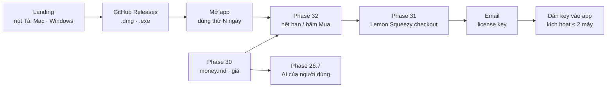

# Version 10 · Sell Pro — bán app tải về + dùng thử + license

> Niche Radar bắt đầu **thu tiền** bằng **app Mac + Windows tải về**: tải miễn phí, **dùng thử** đủ tính năng N ngày,
> hết hạn thì nhập **license key** mua đứt. Không tài khoản, dữ liệu ở máy. Mô hình học từ
> [Wow Keywords](../doi-thu-tham-khao.md#wow-keywords) (chốt 2026-10-26), khác ở chỗ **mình có dùng thử**.

Chưa làm · sau Version 9

## Mục tiêu

- **Tải → dùng được trong ≤ 2 phút:** bấm tải trên landing → cài → mở → dùng thử ngay, không đăng ký.
- **Mua được trong ≤ 2 phút:** bấm Mua → checkout → nhận key qua email → dán vào app → Pro mở, không khởi động lại.
- **Không lỗ tiền AI:** app gọi AI người dùng đã có (Claude Code, Codex, Ollama, key riêng), mình không bán lượt AI.
- **Đơn đầu tiên có nguồn:** 1 đơn thật từ người không quen.

**Thước đo Version 10 xong:** mua bằng chế độ test → key kích hoạt trên 2 máy, máy thứ 3 bị báo · hoàn tiền → key tắt ·
hết dùng thử → app báo rõ, dữ liệu còn đủ · **1 đơn thật** (ghi ngày + nguồn, không bịa).

## Mô hình phân phối (học từ Wow Keywords)

Họ làm gì → mình làm gì. Chi tiết + số đo ở [sổ đối thủ](../doi-thu-tham-khao.md#mo-hinh-phan-phoi-thu-ang-hoc).

- **Tải miễn phí từ GitHub Releases public, code giữ kín** → mình dùng repo `niche-radar-docs` (đã có Release v0.8.0)
  hoặc một repo chỉ chứa Release. Host 0 đồng, số tải đọc được bằng GitHub API
- **Mở app phải có license, không dùng thử** → mình **có dùng thử** N ngày đủ tính năng (N chốt ở Phase 30), hết hạn mới
  đòi key. Lý do: tool chọn niche phải chạy thử trên niche của chính họ mới thấy giá trị
- **Mua đứt, giá bậc thang công khai** ($79, +$10 mỗi 20 license, đếm số còn lại) → ứng viên cho mình, chốt ở Phase 30
- **1 license = 2 máy, chuyển máy trong Cài đặt, tìm lại key bằng email** → làm y vậy (Phase 31, 32)
- **Stripe trực tiếp** → mình dùng **Lemon Squeezy** (lo thuế VAT các nước thay mình, có sẵn API license key, đã dùng cho
  RAM Rescue) — không cần server riêng, không webhook
- **Ra bản dày, ghi chú bằng lời thường, app tự cập nhật** → [Phase 36](../app/phase-36-release-auto-update.md)
- **Windows ra cùng lúc dạng Beta chưa ký** → [Phase 35](../app/phase-35-windows-app.md)
- **AI chạy trên thứ người dùng đã trả, không bán credit** → [Phase 26.7](phase-26-7-ai-cost-plans.md)
- **MCP là điểm bán trên landing** → [Phase 26.3](phase-26-3-mcp.md) + [Version 11](version-11.md)

## Chạy thế nào

## Các phase

- [Phase 30 · Mô hình tiền](phase-30-money-model.md) — mua đứt / bậc thang / dùng thử bao lâu, giá đo từ đối thủ + số fake-door, viết `money.md`
- [Phase 31 · Thanh toán + license key](phase-31-payments.md) — Lemon Squeezy checkout, API license key: kích hoạt / kiểm / gỡ máy
- [Phase 32 · Dùng thử + paywall](phase-32-paywall-trial.md) — đếm ngày dùng thử trên máy, màn nhập key, 2 máy, tìm lại key
- [Phase 26.7 · AI theo gói](phase-26-7-ai-cost-plans.md) — chạy trên Claude Code / Codex / Ollama / key riêng, không bán lượt AI

Phần UI chung (màn dùng thử, nhập key) làm ở bản Web; phần chỉ app mới có (lưu key trong Keychain / Windows Credential
Manager, mở checkout bằng trình duyệt ngoài) gắn ở [Phase 34](../app/phase-34-app-only.md).

**Luật**

- Claude không tạo tài khoản Lemon Squeezy, không nhập ngân hàng / thuế, không bấm bán thật. Anh làm, Claude nối code
- Không bịa doanh thu, số người mua, số license còn lại: số từ dashboard Lemon Squeezy, ghi ngày
- Đếm ngược "còn N license" chỉ khi là số thật đọc từ đơn hàng
- Giá hiển thị ghi rõ trả một lần hay theo chu kỳ. Không gọi gói trả phí là "quyên góp"
- Hết dùng thử: dữ liệu vẫn xuất được (CSV / JSON), không khoá dữ liệu của người dùng

## Không làm ở Version 10

- **Tài khoản, đăng nhập** — bỏ 2026-10-26, license key là đủ
- **Mac App Store / Microsoft Store**, thanh toán trong app của Apple
- **Bán lượt AI, tự trả tiền AI cho người dùng**
- **Tự xử lý thẻ**, server webhook riêng
- **Gói team / nhiều chỗ ngồi**: ứng viên [Version 12](version-12.md)
- **Mã giảm giá phức tạp, affiliate**: xét sau đơn thứ 10
- **Crypto, chuyển khoản tay**

