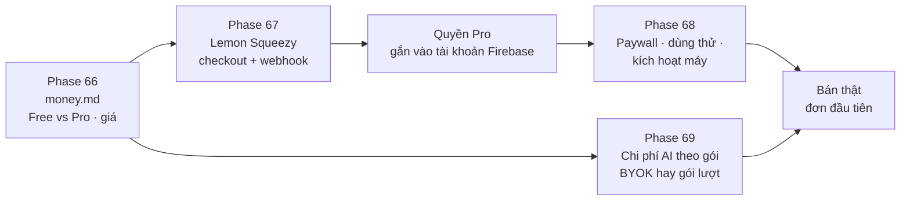

# Version 10 · Sell Pro — Lifetime / Subscriptions

> niche-radar bắt đầu **thu tiền**: bản Free đủ để thử thật, bản **Pro** mở phần tốn công / tốn tiền (AI, nhiều nguồn,
> so sánh, gói GEO). Bán **mua đứt (lifetime)** và / hoặc **gói tháng / năm**: chọn bằng số đo, không đoán.

Chưa làm · sau Version 9 (cần tài khoản + analytics)

## Mục tiêu

- **Chốt mô hình bằng số:** Free gồm gì, Pro gồm gì, lifetime hay subscription hay cả hai, giá bao nhiêu. Dựa trên giá
  đối thủ đo được và chi phí AI thật mỗi lần tra (đo ở Phase 66).
- **Mua được trong ≤ 2 phút:** bấm nâng cấp → trả tiền → Pro mở ngay trên bản Web.
- **Không lỗ tiền AI:** người dùng Pro không làm chi phí AI vượt tiền họ trả.
- **Đơn đầu tiên có nguồn:** 1 đơn thật từ người không quen.

**Thước đo Version 10 xong:** mua thử bằng thẻ test → Pro mở trên 2 máy · huỷ / hoàn tiền → Pro tắt · **1 đơn thật**
(ghi ngày + nguồn, không bịa).

## Chạy thế nào

## Các phase

| Phase | Làm gì |
|---|---|
| [64 · Mô hình tiền](phase-66-money-model.md) | Free vs Pro, lifetime vs subscription, giá: đo đối thủ + chi phí AI, viết `money.md` qua `/app-money` |
| [65 · Thanh toán](phase-67-payments.md) | Lemon Squeezy (lo thuế VAT thay mình), checkout, webhook → quyền Pro trên tài khoản |
| [66 · Paywall + dùng thử](phase-68-paywall-trial.md) | màn nâng cấp, dùng thử, khôi phục mua, giới hạn số máy |
| [67 · Chi phí AI theo gói](phase-69-ai-cost-plans.md) | tự mang key (BYOK) hay gói lượt AI kèm Pro, trần chi phí mỗi người |

## Phase 66 · Mô hình tiền

- **Làm:** đo giá tool nghiên cứu niche / keyword / app (ghi nguồn + ngày) · đo chi phí AI thật mỗi niche từ log Phase 42,
  36, 37 · đọc phễu GA4 ([Version 9](version-9.md)): người dùng dừng ở tính năng nào · chọn Free / Pro, lifetime và / hoặc
  subscription · ghi `money.md` theo `/app-money` của App-AI-Skills.
- **Ứng viên chia gói** (chốt ở phase này): Free = Play + App Store + Trends, vài niche mỗi tháng · Pro = mọi nguồn,
  so sánh, AI Cite, kệ AI, gói GEO.
- **Xong khi:** `money.md` có bảng gói, giá, lý do từng con số kèm nguồn · anh duyệt.

## Phase 67 · Thanh toán

- **Làm:** sản phẩm trên Lemon Squeezy (anh tạo cửa hàng, nhập ngân hàng, thuế) · checkout mở từ bản Web · webhook
  (Firebase Cloud Functions) nhận đơn / gia hạn / huỷ / hoàn tiền → cập nhật quyền Pro trên tài khoản ·
- **Xong khi:** mua bằng chế độ test → quyền Pro ≤ 30 giây · huỷ / hoàn tiền → quyền tắt · webhook giả mạo bị từ chối (kiểm chữ ký).

## Phase 68 · Paywall + dùng thử

- **Làm:** khoá Pro hiện đúng chỗ (bấm tính năng Pro → màn nâng cấp, nói rõ được gì) · dùng thử N ngày (chốt ở Phase 66) ·
  "Khôi phục mua" · giới hạn số máy một license · trang giá trên landing ([Version 11](version-11.md)) khớp trong app.
- **Xong khi:** Free → bấm Pro → mua → dùng ngay, không khởi động lại · hết hạn dùng thử → quay về Free, dữ liệu còn đủ.

## Phase 69 · Chi phí AI theo gói

- **Làm:** chọn 1 trong 2 (hoặc cả hai) bằng số Phase 66: **BYOK** (người dùng tự dán key AI, mình không tốn) hay
  **gói lượt AI** kèm Pro (mình trả, có trần mỗi tháng) · hiện số lượt còn lại · hết lượt → báo, không tự trừ tiền thêm.
- **Xong khi:** 1 người Pro dùng hết trần → AI dừng, phần không AI vẫn chạy · chi phí AI tháng ≤ % doanh thu đã đặt ở `money.md`.

**Luật**

- Claude không tạo tài khoản Lemon Squeezy, không nhập ngân hàng / thuế, không bấm bán thật. Anh làm, Claude nối code
- Không bịa doanh thu, số người mua: số từ dashboard Lemon Squeezy, ghi ngày
- Giá hiển thị phải ghi rõ chu kỳ, tự gia hạn, cách huỷ. Không gọi gói trả phí là "quyên góp"
- Tính năng đã Free ở bản trước không khoá lại thành Pro với người đang dùng

## Không làm ở Version 10

- **Thanh toán trong app của Apple**
- **Tự xử lý thẻ**, Stripe tự làm phần thuế
- **Gói team / nhiều chỗ ngồi**: ứng viên [Version 12](version-12.md)
- **Mã giảm giá phức tạp, affiliate**: xét sau đơn thứ 10
- **Crypto, chuyển khoản tay**

