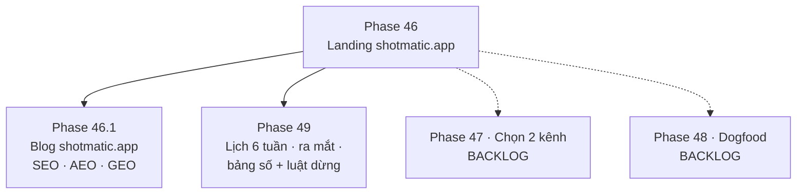

# Version 11 · Marketing Plan

> Có thứ để bán ([Version 10](version-10.md)), giờ **đưa tới đúng người**: indie dev / người làm app nhỏ đang đi tìm
> niche. Kế hoạch theo `/app-gtm` của App-AI-Skills: định vị → nền tảng sở hữu → 2 kênh → lịch 6 tuần → bảng số +
> luật dừng. **Dùng chính niche-radar làm marketing** (báo cáo niche công khai, gói GEO cho chính nó).

Chưa làm · sau Version 10 (đã mua được)

## Mục tiêu

- **Một câu định vị rõ:** cho ai, giải quyết gì, khác tool khác ở đâu (nhiều nguồn + AI có trích dẫn + chạy trên máy).
- **Có chỗ của mình:** landing riêng + danh sách email, không phụ thuộc một mạng xã hội.
- **2 kênh, đo được:** anh chốt ở tuần 1 của Phase 49, chạy 6 tuần, mỗi tuần nhìn số.
- **Ra đơn có nguồn:** biết đơn đến từ kênh nào.

**Thước đo Version 11 xong:** landing có số lượt bấm tải / mua · ≥ 100 email · lịch 6 tuần chạy hết · bảng số mỗi kênh
có quyết định giữ / dừng. Số thật ghi ngày, chưa đo thì ghi `chưa đo`.

## Chạy thế nào

## Các phase

| Phase | Làm gì | Skill App-AI-Skills |
|---|---|---|
| [46 · Landing shotmatic.app — định vị + email](phase-46-positioning-landing.md) ✅ | 1 câu định vị, landing [shotmatic.app](https://shotmatic.app) live, form email EmailOctopus, GA4 `generate_lead` | `/app-gtm`, `/oneclicktool-landing` |
| [46.1 · Landing shotmatic.app — Blog](phase-46-1-landing-blog.md) ✅ | blog riêng trên landing: phân trang, chuyên mục SEO · AEO · GEO, bản .md + llms.txt cho AI search | `/oneclicktool-blog`, `/app-geo` |
| [47 · Chọn 2 kênh](phase-47-two-channels.md) ⏸️ **Backlog** | chấm ICE các kênh (X build in public, Reddit, Indie Hackers, Product Hunt, YouTube, SEO blog) | `/app-gtm`, `/app-reddit` |
| [48 · Dogfood làm nội dung](phase-48-dogfood-content.md) ⏸️ **Backlog** | báo cáo niche công khai làm mồi email, chạy Version 4 cho chính niche-radar | `/app-geo`, `/oneclicktool-blog` |
| [71 · Lịch 6 tuần + ra mắt](phase-49-six-week-launch.md) | lịch bài, ngày ra mắt, bảng số mỗi tuần, luật dừng kênh | `/app-gtm`, `/app-marketing` |

## Phase 46 · Landing shotmatic.app — định vị + email ✅

- **Kết quả 2026-10-27:** [shotmatic.app](https://shotmatic.app) live — hook, nỗi đau, Compare, giá $39 mua đứt, form email EmailOctopus, GA4 `generate_lead`, FAQ, blog ([46.1](phase-46-1-landing-blog.md)). Còn treo: `checkout_click` (chờ mở bán Version 10), video demo.

- **Làm:** 1 câu định vị + 3 nỗi đau (lấy từ chính dữ liệu Reddit / review mà tool đọc được về "app idea", "niche") ·
  landing riêng trên shotmatic.app (video demo quay từ app thật, giá khớp Version 10, FAQ) · form email ·
  sự kiện GA4 `download`, `checkout_click`, `generate_lead`.
- **Xong khi:** landing live, `check_landing.py` qua, xem ở 1280 + 375 · email test vào đúng danh sách.

## Phase 47 · Chọn 2 kênh · Backlog

- **Backlog · làm sau** (anh chốt 2026-10-29).

- **Làm:** liệt kê kênh, chấm ICE (Impact · Confidence · Ease) có lý do · chọn 2 · mỗi kênh: tần suất, dạng bài, ai làm.
- **Xong khi:** bảng ICE + 2 kênh được chọn, anh duyệt.

## Phase 48 · Dogfood làm nội dung · Backlog

- **Backlog · làm sau** (anh chốt 2026-10-29).

- **Làm:** mỗi tuần 1 **báo cáo niche công khai** (chạy tool thật, có trích dẫn) làm bài blog / thread / mồi email ·
  chạy Phase 59–62 cho chính từ khoá của niche-radar ("niche research tool", "app idea finder"…) → gói GEO → `/app-geo`
  đo mốc trước ra mắt.
- **Xong khi:** 3 báo cáo niche đăng được · đo mốc GEO của niche-radar có `README-RESULT.md`.

## Phase 49 · Lịch 6 tuần + ra mắt

- **Làm:** đầu tuần 1 anh chốt 2 kênh chính + đo mốc GEO (`/app-geo`) · lịch 6 tuần thành file bài (theo khuôn Campaign của Promo Desk) · ngày ra mắt (Product Hunt / Indie Hackers
  nếu kênh được chọn) · bảng số mỗi tuần: lượt vào landing, email, tải, dùng thử, đơn · **luật dừng**: kênh nào 3 tuần
  không đạt ngưỡng đặt trước → dừng, dồn sức kênh kia.
- **Xong khi:** 6 tuần chạy xong, bảng số đủ 6 dòng · mỗi kênh có quyết định giữ / dừng · đo lại GEO so với mốc tuần 1.

**Luật**

- Claude soạn nháp, **anh đăng**. Claude không đăng bài, không gửi email hàng loạt, không chạy quảng cáo
- Bài Reddit đúng luật từng subreddit, không spam link, không giả làm người dùng khác
- Không bịa số (lượt tải, doanh thu, số người dùng) trong bài
- Báo cáo niche công khai không lộ niche đang làm cho app riêng của mình

## Không làm ở Version 11

- **Quảng cáo trả tiền** trước khi có 10 đơn tự nhiên
- **Mua review, mua follow**, đổi review lấy quà
- **Chạy hơn 2 kênh cùng lúc**
- **Agency / thuê ngoài marketing**
- **Đổi giá giữa chừng 6 tuần** (trừ khi số rõ ràng sai, ghi lý do)

