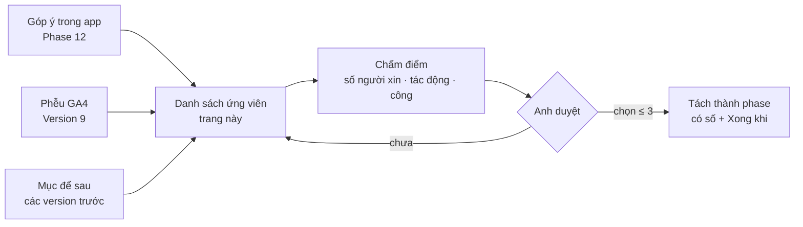

# Version 12 · New Features — Just Planned

> **Chỉ là kế hoạch, chưa hứa làm.** Đây là chỗ gom tính năng mới sau khi đã có người dùng, đã bán, đã chạy marketing.
> Mục nào được chọn mới tách thành phase có số, có "Xong khi". Chọn bằng **góp ý thật + số analytics**, không chọn vì thích.

Chỉ lên plan · chưa xếp phase

## Mục tiêu

- **Một danh sách ứng viên duy nhất:** gom từ Appendix, Phase 9, các mục "để Version 12" ở Version 9–10, góp ý người dùng.
- **Chọn có lý do:** mỗi ứng viên có nguồn (ai xin, bao nhiêu lần, số analytics), chấm điểm, anh duyệt mới làm.
- **Không phình:** mỗi đợt chọn tối đa 3 tính năng.

## Cách chọn

Chấm mỗi ứng viên: **số người xin** (đếm từ góp ý) · **tác động** lên phễu hoặc đơn Pro · **công** (ngày làm) ·
**rủi ro nguồn** (có bị chặn / tốn tiền không).

## Ứng viên (chưa chốt)

| Ứng viên | Từ đâu | Ghi chú |
|---|---|---|
| ~~Theo dõi định kỳ~~ | Phase 9 | **kéo lên ứng viên ưu tiên [Phase 9](phase-9-small-features.md) (2026-10-25)** |
| **Product Brief Export** | review 2026-10-25 | từ Feature Gap + evidence pack ra brief: khách · vấn đề · giải pháp khác · MVP · giá thử · cách tìm 10 người đầu, xuất `.md` làm PRD. **Chỉ khi bán cho người ngoài** — dùng nội bộ thì pipeline `/app-research` → `/app-money` → `/app-spec` đã làm ([Appendix](../appendix.md) · Không làm) |
| **Search volume trả phí** (DataForSEO, Keyword Planner) | Phase 9, Version 4 | chỉ khi review kết quả cho thấy cần số lượt tìm thật |
| **Nguồn Chrome Web Store** | Phase 9 | cho người làm extension |
| **Giá IAP nhiều nước** | Phase 9 | so giá theo thị trường |
| **MCP của app** (`niche-radar-mcp`) | Phase 9 | Claude đọc DB, so niche, viết báo cáo từ Claude Desktop |
| **Chia sẻ project / team** | Version 9, 10 | nhiều người cùng project, gói team |
| **Engine AI thêm**: Perplexity, Copilot | Version 4 | khi có đường đo tự động ổn định |
| **Bản Windows** | Version 3–7 | khi có người dùng thật xin |
| **Nguồn TikTok / X** | Appendix | hiện không lấy miễn phí ổn định, xét lại khi có API hợp lệ |
| **Báo cáo niche công khai tự động** (trang SEO) | Version 11 | nếu báo cáo tay ở Phase 54 kéo được người dùng |
| **Góp ý từ người dùng** | Phase 12 | thêm dòng khi có, ghi số người xin |

**Luật**

- Không làm mục nào khi chưa có dòng trong bảng trên + điểm + anh duyệt
- Mục được chọn → sửa Master Plan, tạo trang phase có số (số kế tiếp sau phase cao nhất đang có), đi đúng [Quy trình build](../quy-trinh-build.md)
- Mục bị loại → chuyển sang [Appendix · Không làm](../appendix.md) kèm lý do

## Không làm ở Version 12

- **Làm tính năng chỉ vì đối thủ có**
- **Chọn hơn 3 tính năng một đợt**
- **Đổi lại thứ đã có trong "Không làm" của Appendix** khi chưa có lý do mới (nguồn mới, người xin, số đo)

