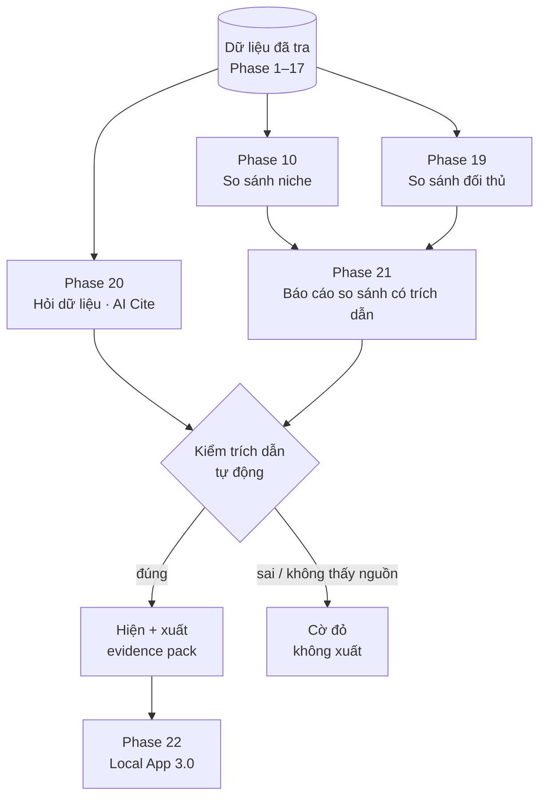

# Version 3 · New Features — So Sánh + AI Cite

> Tới Version 2, mỗi lần tra chỉ cho ra **một niche**. Version 3 trả lời câu hỏi lúc phải chọn:
> **"niche A hay niche B?"**, **"app mình đánh vào đối thủ nào?"**. Mọi câu AI viết ra phải **dẫn nguồn**
> (cite) và được **kiểm tự động**.

Chưa làm · sau Version 2

## Mục tiêu

- **Chọn niche nhanh hơn:** đặt 2–4 niche đã tra **cạnh nhau** trên một màn, thấy ngay niche nào thắng ở mặt nào.
- **Biết đánh vào ai:** đặt 2–5 đối thủ **cạnh nhau** (giá, sao, tính năng, bị chê gì) để biết app mình hơn ở đâu.
- **Hỏi được dữ liệu:** gõ câu hỏi bằng lời thường ("niche nào ít đối thủ mà người dùng than nhiều?"), AI trả lời
  **chỉ từ dữ liệu đã cào**, câu nào cũng có trích dẫn bấm được.
- **Tin được AI:** máy tự kiểm từng trích dẫn: câu trích có đúng nguyên văn trong nguồn không, con số có khớp DB không.
  Sai thì gắn cờ đỏ, không im lặng cho qua.

**Thước đo Version 3 xong:** chọn được 1 niche cho app thật trong **≤ 30 phút** (từ lúc mở tool tới lúc có báo cáo so sánh
xuất ra `/app-research`), thay vì mở từng niche rồi so tay.

## Chạy thế nào

## Các phase

| Phase | Làm gì | AI? |
|---|---|---|
| [10 · So sánh niche](phase-10-compare-niche.md) | **đã dời lên Version 1, ngay sau Phase 9** — Version 3 dùng lại bảng của nó | không |
| [19 · So sánh đối thủ](phase-19-compare-competitor.md) | 2–5 app / sản phẩm cạnh nhau: giá, sao, tính năng, bị chê gì | không |
| [20 · Hỏi dữ liệu (AI Cite)](phase-20-ai-cite-ask.md) | hỏi bằng lời, trả lời chỉ từ DB, mọi câu có trích dẫn + máy kiểm trích dẫn | có |
| [21 · Báo cáo so sánh (AI Cite)](phase-21-ai-cite-report.md) | AI viết kết luận cho bảng so sánh Phase 10 + 19, xuất evidence pack | có |
| [22 · Review + Local App 3.0](phase-22-review-3.md) | chạy 3 lần chọn niche thật, sửa lỗi | không |

Thứ tự: 18 đã có từ Version 1 → 19 làm **không AI** trước (tắt AI vẫn so được). 20 dựng **lớp kiểm trích dẫn** dùng chung, 21 dùng lại nó.

## Luật chung của Version 3

**AI Cite**

- AI **không đưa ra con số mới**: số nào cũng phải là một dòng trong DB, kèm đường dẫn tới dòng đó
- Mọi câu nhận định có ≥ 1 trích dẫn: link review / video / listing / keyword, hoặc ô trong bảng so sánh
- Câu trích nguyên văn phải tìm thấy **đúng chữ** trong nguồn đã lưu. Máy kiểm, không tin lời AI
- Không đủ dữ liệu → AI nói "chưa có dữ liệu cho X", không đoán
- Tắt AI → Phase 10 + 19 vẫn chạy đủ, chỉ mất phần lời kết luận

## Không làm ở Version 3

- **Nguồn dữ liệu mới.** Version 3 chỉ so và hỏi trên dữ liệu Phase 1–17 đã có
- **Đo AI có nhắc app không (AEO / GEO), SEO.** Để [Version 4](version-4.md)
- **AI tự lên web tìm thêm khi trả lời.** Chỉ đọc DB, nếu không thì không kiểm được nguồn
- **So theo thời gian / theo dõi định kỳ** (lần tra tuần trước vs tuần này). Vẫn là ứng viên [Phase 9](phase-9-small-features.md)
- **Chấm điểm "niche tốt nhất" bằng AI.** Điểm cơ hội vẫn là công thức Phase 1, AI chỉ giải thích
- **Chia sẻ / gửi báo cáo cho người khác**, bản nhiều người. Tool nội bộ
- **Chat nhiều lượt có trí nhớ dài.** Mỗi câu hỏi là một lần tra độc lập, lưu lại lịch sử để xem

[Master Plan §Version 3](../superpowers/specs/2026-10-24-niche-radar-master-plan.md)
