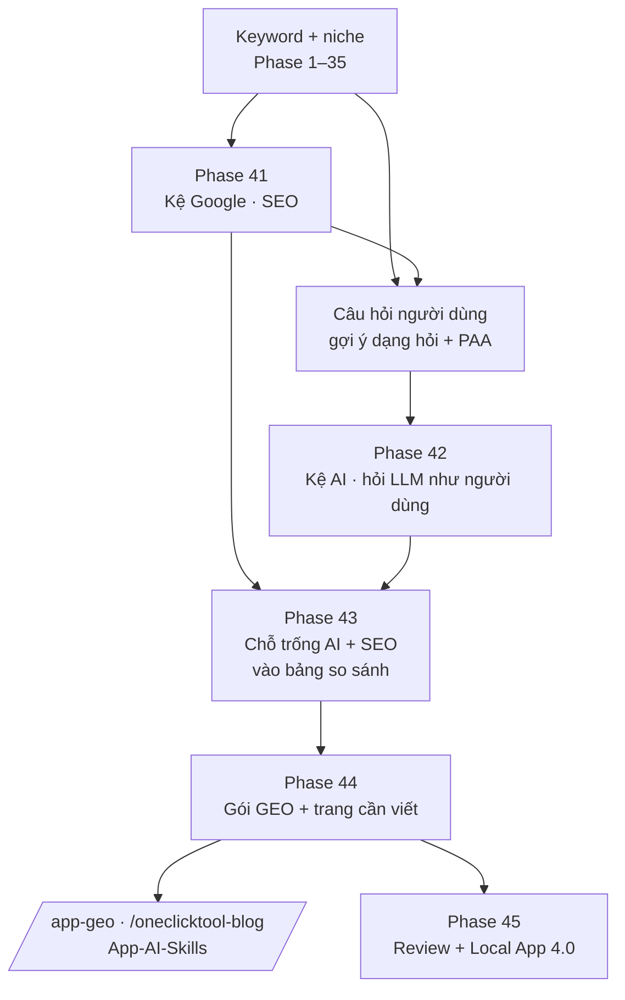

# Version 4 · LLM + AEO, GEO, SEO

> Ngày càng nhiều người không lên store tìm app nữa mà **hỏi Google hoặc hỏi AI** ("best app to track X?").
> Version 4 thêm **hai kệ mới** vào lúc chọn niche: **kệ Google** (SEO, ai đứng top 10) và **kệ AI**
> (ChatGPT / Gemini / Claude đang gợi ý app nào, trích trang nào). Niche mà cả hai kệ còn yếu là niche dễ chen vào.

Chưa làm · sau Phase 40 (Local App 3.0)

**Thuật ngữ:** **SEO** = lên top Google · **AEO** (Answer Engine Optimization) = được chọn làm câu trả lời
(ô trả lời, People Also Ask, AI Overviews) · **GEO** (Generative Engine Optimization) = được ChatGPT / Gemini / Claude
nhắc tên hoặc trích link · **LLM** = model AI lớn, ở đây dùng **làm nguồn dữ liệu** (hỏi nó như một người dùng thật).

## Mục tiêu

- **Biết kệ Google của niche:** keyword chính có top 10 là ai: site lớn, hay Reddit / forum / blog nhỏ (= dễ chen).
- **Biết kệ AI của niche:** hỏi AI như người dùng, đếm app nào được nhắc, trang nào được trích. AI trả lời chung chung
  hoặc gợi ý app bị chê = **chỗ trống**.
- **Có bộ câu hỏi thật** (AEO): người dùng hỏi gì về niche (câu dạng "how / why / can / best…") để sau này viết trang trả lời.
- **Nối thẳng sang ra mắt:** niche đã chọn xuất ra **gói GEO** (bộ câu hỏi + regex tên đối thủ + trang cần viết)
  để `/app-geo` đo mốc trước ra mắt, `/oneclicktool-blog` viết bài.

**Thước đo Version 4 xong:** với 3 niche thật, bảng so sánh Phase 28 có thêm cột **Kệ Google** và **Kệ AI**, và ≥ 1 niche
xuất được gói GEO mà `scripts/geo.py run` của App-AI-Skills chạy luôn, không sửa tay.

## Chạy thế nào

## Các phase

| Phase | Làm gì | AI? |
|---|---|---|
| [39 · Kệ Google (SEO)](phase-41-seo-shelf.md) | top 10 Google của keyword chính, loại trang đứng top, câu hỏi người dùng | không |
| [40 · Kệ AI (GEO / AEO)](phase-42-ai-shelf.md) | hỏi Gemini / ChatGPT / Claude như người dùng, đếm app được nhắc + trang được trích | có (là nguồn) |
| [41 · Chỗ trống AI + SEO](phase-43-ai-seo-gap.md) | điểm "kệ yếu" theo công thức, thêm cột vào so sánh niche Phase 28 | không |
| [42 · Gói GEO + trang cần viết](phase-44-geo-pack.md) | xuất bộ câu hỏi + regex đối thủ cho `geo.py`, danh sách trang cần viết | AI Cite (Phase 38) |
| [43 · Review + Local App 4.0](phase-45-review-4.md) | chọn niche thật 3 lần có kệ Google + kệ AI | không |

Thứ tự: 23 (không AI, rẻ) → 24 (tốn tiền theo lượt, có trần) → 25 chấm điểm → 26 nối sang App-AI-Skills → 27 gói app.
Vẫn **bản Web trước**.

## Luật chung của Version 4

- **Không cào Google bằng script.** Top 10 lấy qua API tìm kiếm có tầng miễn phí, gọi thưa, có cache. Hết quota → dừng nguồn, báo trên UI
- **Câu trả lời của AI là dữ liệu, không phải sự thật.** Lưu nguyên văn + ngày + engine + model. Đếm nhắc tên bằng regex, không nhờ AI tự đếm
- **Một câu hỏi, một lần hỏi mỗi engine** trong một lần đo, có trần chi phí. Cache 7 ngày
- **AI không bịa số** (giống Version 3). Lượt tìm, thứ hạng chỉ từ nguồn đo được, ghi nguồn + ngày
- Tắt AI → Phase 41 + 43 (phần SEO) vẫn chạy

## Không làm ở Version 4

- **Tool SEO trả phí hằng tháng** (Ahrefs, Semrush, Moz) và search volume trả phí. Search volume vẫn là ứng viên [Phase 9](phase-9-small-features.md)
- **Cào trang kết quả Google / AI Overviews bằng script**, vượt captcha, proxy xoay
- **Đo app của mình sau ra mắt, theo dõi hằng tuần.** Việc của `/app-geo` (`scripts/geo.py`), niche-radar chỉ xuất gói để nó chạy
- **Viết bài, đăng bài, sửa site.** Việc của `/oneclicktool-blog`, `/oneclicktool-landing`
- **Audit kỹ thuật trang** (robots, schema, tốc độ). Đã có `geo.py audit`
- **Huấn luyện / fine-tune model, chạy LLM riêng cho Version 4.** Dùng lại lớp AI Phase 6
- **Mẹo lừa AI** (spam trang, tự viết review giả để được nhắc)
- **Hứa thứ hạng / hứa được AI nhắc**

[Master Plan §Version 4](../superpowers/specs/2026-10-24-niche-radar-master-plan.md)
