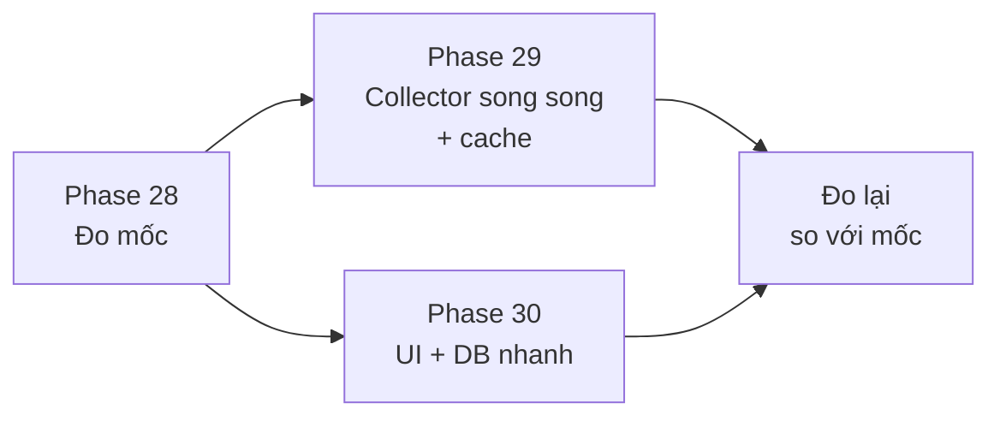

# Version 5 · Performance

> Tới Version 4, tool đã tra được nhiều nguồn: store, Trends, YouTube, Amazon, Maps, Google, AI. Version 5 làm cho nó
> **nhanh và nhẹ**: thấy kết quả đầu tiên sớm, bảng lớn không giật, không ngốn RAM.
> **Không thêm tính năng.**

Chưa làm · sau Version 4

## Mục tiêu

- **Đo trước, sửa sau:** có bảng mốc thời gian / RAM / dung lượng cho từng luồng chính, đo lại sau mỗi phase.
- **Thấy kết quả sớm:** tra niche ra dòng kết quả đầu tiên trong **≤ 30 giây**, phần còn lại đổ dần vào.
- **Không chờ vô ích:** tổng thời gian explore chỉ dài bằng **nguồn chậm nhất** (App Store giới hạn 1 request / 3 giây),
  không phải cộng dồn các nguồn.

**Thước đo Version 5 xong:** cùng một bộ 3 niche chuẩn, mọi chỉ số trong bảng mốc bằng hoặc tốt hơn, và không chỉ số nào
tệ đi quá 10%. Explore 100 keyword hiện mất ~6 phút: mục tiêu ghi sau khi đo ở Phase 28, không đặt trước.

## Chạy thế nào

## Các phase

| Phase | Làm gì |
|---|---|
| [28 · Đo mốc](phase-28-benchmark.md) | script đo thời gian từng luồng, RAM, dung lượng; bảng mốc lưu trong repo |
| [29 · Collector nhanh hơn](phase-29-fast-collector.md) | chạy các nguồn song song (mỗi nguồn giữ giới hạn riêng), đẩy kết quả dần, cache dùng chung giữa niche, chạy tiếp khi lỗi giữa chừng |
| [30 · UI + DB nhanh](phase-30-fast-ui-db.md) | bảng lớn chỉ vẽ phần đang thấy, tách code theo trang, index SQLite, API trả từng trang |

## Phase 28 · Đo mốc

- **Làm:** `npm run bench` chạy 3 niche chuẩn, ghi: thời gian tới kết quả đầu tiên · tổng thời gian explore · thời gian
  mở từng trang · thời gian query chậm nhất · RAM server · dung lượng bundle web. Lưu `bench/baseline.json` + bảng trong trang này.
- **Xong khi:** chạy 3 lần liên tiếp, chênh lệch mỗi số ≤ 15% (đo ổn định mới tin được).

## Phase 29 · Collector nhanh hơn

- **Làm:** hàng đợi theo nguồn: Play, App Store, Trends… chạy song song, mỗi nguồn giữ giới hạn gọi của nó ·
  kết quả đổ dần lên UI (stream) · cache theo keyword dùng chung giữa các niche (niche B dùng lại keyword niche A đã tra
  trong 24 giờ) · lỗi giữa chừng → chạy tiếp từ chỗ dừng, không tra lại từ đầu.
- **Xong khi:** kết quả đầu tiên ≤ 30 giây · tổng thời gian ≈ nguồn chậm nhất + ≤ 10% · không nguồn nào bị chặn nhiều hơn
  mốc · ngắt mạng giữa chừng rồi bật lại → chạy tiếp được.

## Phase 30 · UI + DB nhanh

- **Làm:** bảng > 200 dòng chỉ vẽ phần đang thấy (virtualize) · tách code theo trang (lazy load) · index SQLite cho
  các query chậm nhất ở Phase 28 · bật WAL · API danh sách trả từng trang.
- **Xong khi:** bảng 1.000 keyword cuộn mượt · mở trang niche ≤ 1 giây với DB có 50 niche · bundle trang chủ nhỏ hơn mốc.

**Luật**

- Không sửa gì khi chưa có số đo chỗ đó chậm
- Nhanh hơn **không được** đổi kết quả: cùng niche, cùng ngày → cùng bảng keyword, cùng điểm (so bằng script)
- Giới hạn gọi của từng nguồn giữ nguyên hoặc chặt hơn

## Không làm ở Version 5

- **Tính năng mới**
- **Gọi nguồn nhanh hơn giới hạn**, proxy xoay, nhiều IP
- **Viết lại collector bằng Rust** (chỉ xét khi số đo cho thấy Node là nút cổ chai)
- **Server cloud / hàng đợi trên mạng** để chạy nhanh hơn
- **Tối ưu chỗ không đo được** chậm

