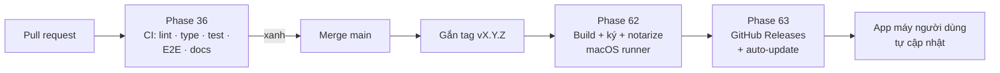

# Version 7 · CI/CD

> **CI** (Continuous Integration) = mỗi lần đẩy code, máy chủ GitHub tự chạy kiểm. **CD** (Continuous Delivery) =
> gắn tag là tự ra bản app mới. Version 7 bỏ các bước làm tay dễ quên: chạy test, build, ký, đóng gói, viết What's New.

Chưa làm · sau Version 6

## Mục tiêu

- **Không merge code đỏ:** mỗi pull request tự chạy lint, typecheck, test, test giao diện, build docs.
- **Ra bản bằng một lệnh:** gắn tag `v5.0.0` → CI build app Mac, ký, notarize, đưa `.dmg` lên GitHub Releases kèm What's New.
- **Người dùng được cập nhật:** app tự báo có bản mới và cập nhật (trước đây các version đều để "không làm auto-update").

**Thước đo Version 7 xong:** từ lúc gắn tag tới lúc `.dmg` đã ký có trên Releases **không cần thao tác tay**, và app bản
trước tự nhận bản mới.

## Chạy thế nào

## Các phase

> Phase 62–38 nằm ở mục **App** — chỉ làm khi hết phase Web. Version 7 bản Web gồm Phase 36 và 39.

| Phase | Làm gì |
|---|---|
| [36 · CI cho pull request](phase-36-ci-pull-request.md) | GitHub Actions: lint, typecheck, test, E2E (fixture), `docs:build --strict`, chặn merge khi đỏ |
| [37 · Build app Mac trên CI](../app/phase-62-mac-build-ci.md) | runner macOS build Tauri + sidecar, ký Developer ID, notarize bằng secret |
| [38 · Release + auto-update](../app/phase-63-release-auto-update.md) | tag → `.dmg` lên Releases, What's New từ commit, Tauri updater |
| [39 · Quy trình nhánh](phase-39-branch-flow.md) | `main` có bảo vệ, mỗi phase một nhánh + PR, ghi cách làm vào Quy trình build |

## Phase 36 · CI cho pull request

- **Làm:** `.github/workflows/ci.yml`: cài Node, cache `node_modules`, chạy `lint` · `typecheck` · `test` · Playwright
  trên fixture · `docs:build --strict` · ảnh chụp E2E lỗi đính kèm vào kết quả.
- **Xong khi:** PR cố tình làm đỏ 1 test → CI đỏ, không merge được · PR xanh chạy ≤ 10 phút.

## Phase 62 · Build app Mac trên CI

- **Làm:** workflow build trên runner macOS · chứng chỉ Developer ID + mật khẩu notarize lưu ở **GitHub Secrets**
  (anh tự nhập, Claude không đụng) · ký + notarize + staple.
- **Xong khi:** `.dmg` tải từ CI mở trên máy sạch không bị Gatekeeper chặn.

## Phase 63 · Release + auto-update

- **Làm:** gắn tag `v*` → build → tạo GitHub Release, đính `.dmg` + What's New sinh từ commit `feat` / `fix` ·
  Tauri updater: app kiểm bản mới lúc mở, hỏi trước khi cập nhật, file cập nhật có chữ ký.
- **Xong khi:** cài bản `x.y.0` → ra tag `x.y.1` → app báo và cập nhật được, dữ liệu còn đủ.

## Phase 39 · Quy trình nhánh

- **Làm:** bảo vệ `main` (phải qua PR + CI xanh) · mỗi phase một nhánh · cập nhật [Quy trình build](../quy-trinh-build.md):
  nhánh, PR, tag, release.
- **Xong khi:** 1 phase thật đi đủ vòng nhánh → PR → CI → merge → tag → bản mới.

**Luật**

- Secret (chứng chỉ, mật khẩu notarize, key AI) chỉ ở GitHub Secrets, không nằm trong code hay log
- CI **không gọi nguồn thật** (IP của GitHub dễ bị chặn). Canary vẫn chạy trên máy ([Version 6](version-6.md))
- Claude không tự gắn tag ra bản, không bấm phát hành khi anh chưa đồng ý

## Không làm ở Version 7

- **Bản Windows / Linux trên CI**: chỉ khi có người dùng thật cần
- **Mac App Store**: sidecar Node + sandbox khó, phân phối trực tiếp `.dmg` đủ
- **Deploy bản Web lên mạng**: bản Web vẫn chạy trên máy. Host chỉ xét ở [Version 9](version-9.md)
- **Chạy canary trên CI**
- **Tự động merge PR**

