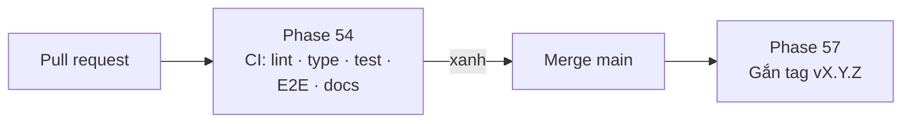

# Version 7 · CI cho pull request

> **CI** (Continuous Integration) = mỗi lần đẩy code, máy chủ GitHub tự chạy kiểm. Version 7 bỏ các bước làm tay
> dễ quên: chạy test, build docs, chặn code đỏ, đi nhánh + PR đúng quy trình.

Chưa làm · sau Version 6

## Mục tiêu

- **Không merge code đỏ:** mỗi pull request tự chạy lint, typecheck, test, test giao diện, build docs.
- **Đi đúng quy trình:** mỗi phase một nhánh + PR, `main` có bảo vệ, gắn tag sau khi CI xanh.

**Thước đo Version 7 xong:** PR cố tình làm đỏ không merge được, và 1 phase thật đi đủ vòng nhánh → PR → CI → merge → tag.

## Chạy thế nào

## Các phase

| Phase | Làm gì |
|---|---|
| [52 · CI cho pull request](phase-54-ci-pull-request.md) | GitHub Actions: lint, typecheck, test, E2E (fixture), `docs:build --strict`, chặn merge khi đỏ |
| [55 · Quy trình nhánh](phase-57-branch-flow.md) | `main` có bảo vệ, mỗi phase một nhánh + PR, ghi cách làm vào Quy trình build |

## Phase 54 · CI cho pull request

- **Làm:** `.github/workflows/ci.yml`: cài Node, cache `node_modules`, chạy `lint` · `typecheck` · `test` · Playwright
  trên fixture · `docs:build --strict` · ảnh chụp E2E lỗi đính kèm vào kết quả.
- **Xong khi:** PR cố tình làm đỏ 1 test → CI đỏ, không merge được · PR xanh chạy ≤ 10 phút.

## Phase 57 · Quy trình nhánh

- **Làm:** bảo vệ `main` (phải qua PR + CI xanh) · mỗi phase một nhánh · cập nhật [Quy trình build](../quy-trinh-build.md):
  nhánh, PR, tag, release.
- **Xong khi:** 1 phase thật đi đủ vòng nhánh → PR → CI → merge → tag → bản mới.

**Luật**

- Secret (key AI, token) chỉ ở GitHub Secrets, không nằm trong code hay log
- CI **không gọi nguồn thật** (IP của GitHub dễ bị chặn). Canary vẫn chạy trên máy ([Version 6](version-6.md))
- Claude không tự gắn tag ra bản, không bấm phát hành khi anh chưa đồng ý

## Không làm ở Version 7

- **Build / ký / phát hành app**: thuộc mục [App Mac](../app/index.md)
- **Deploy bản Web lên mạng**: bản Web vẫn chạy trên máy. Host chỉ xét ở [Version 9](version-9.md)
- **Chạy canary trên CI**
- **Tự động merge PR**

