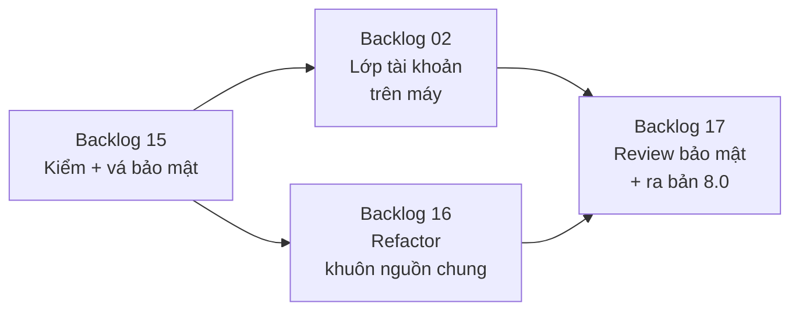

# Version 8 · Security & Account & Refactor Code

> Trước khi có người ngoài đăng nhập ([Version 9](version-9.md)) và trả tiền ([Version 10](version-10.md)):
> **khoá chặt** những gì đang mở, dựng **lớp tài khoản** trong code, và **dọn code** để sửa nhanh về sau.
> Người dùng không thấy gì mới, nhưng tool an toàn hơn và dễ sửa hơn.

Không làm · 2026-10-26

**Không làm (chốt 2026-10-26):** security / refactor — không ra tiền, không thêm người dùng. Phần bảo mật tối thiểu cho app bán (CSP, quyền Tauri, key trong Keychain) đã nằm ở [Phase 35](../app/phase-35-app-only.md). Trang giữ lại để tra, không code.

## Mục tiêu

- **An toàn:** không trang web nào khác gọi được API trên máy · key (AI, API tìm kiếm) không nằm trong code hay log · chữ cào về
  (review, comment) không chạy được thành code trên giao diện · thư viện không còn lỗ hổng mức cao.
- **Sẵn tài khoản:** mọi dữ liệu thuộc về một `user_id`, xuất / xoá được toàn bộ dữ liệu của một người. Vẫn chạy trên
  máy, chưa đăng nhập mạng.
- **Code dễ sửa:** mỗi nguồn dữ liệu cùng một khuôn, không còn file quá to, không code chết. Hành vi không đổi.

**Thước đo Version 8 xong:** phiếu kiểm bảo mật (Backlog 15) hết mục đỏ · thêm một nguồn mới chỉ cần 1 file collector +
1 file test · phiếu review kết quả ([Backlog 11](version-6.md)) giữ nguyên điểm trước và sau refactor.

## Chạy thế nào

## Các phase

| Phase | Làm gì |
|---|---|
| [56 · Kiểm + vá bảo mật](phase-backlog-15-security-audit.md) | API cục bộ, key, XSS từ chữ cào, thư viện, secret trong repo |
| [57 · Lớp tài khoản trên máy](phase-backlog-02-local-account.md) | `user_id` trên mọi bảng, hồ sơ, xuất / xoá dữ liệu một người |
| [58 · Refactor](phase-backlog-16-refactor.md) | khuôn collector chung, tách file to, gỡ code chết, kiểu dữ liệu chung |
| [59 · Review bảo mật + 8.0](phase-backlog-17-security-review-8.md) | tự tấn công thử theo phiếu, sửa, ra bản qua CI |

## Backlog 15 · Kiểm + vá bảo mật

- **Làm:** phiếu kiểm `security/checklist.md`:
    - **API cục bộ:** chỉ nghe `127.0.0.1` (đã có) + token ngẫu nhiên mỗi lần mở app, chặn trang web khác gọi vào (CSRF, DNS rebinding) · kiểm `Origin`
    - **Key:** key chỉ ở `.env.local` / Cài đặt, không log key
    - **Chữ cào về:** review, comment, mô tả hiện ra dạng chữ, không render HTML; link chỉ `http(s)`
    - **Thư viện:** `npm audit` + Dependabot · quét secret trong lịch sử git
- **Xong khi:** mọi mục phiếu có kết quả, mục đỏ đã vá kèm test.

## Backlog 02 · Lớp tài khoản trên máy

- **Làm:** bảng `users` + `user_id` trên project, lần tra, lịch sử hỏi · màn hồ sơ (tên, thư mục dữ liệu) · nhiều hồ sơ
  trên một máy · **xuất toàn bộ dữ liệu** một người (`.zip`) · **xoá toàn bộ** (có xác nhận, xoá thật) ·
  migration DB cũ: gán hết cho hồ sơ mặc định.
- **Xong khi:** 2 hồ sơ trên một máy không thấy dữ liệu của nhau · xoá hồ sơ → đếm bảng còn 0 dòng của hồ sơ đó ·
  DB 7.x lên 8.0 không mất dòng.

## Backlog 16 · Refactor

- **Làm:** khuôn chung `Collector` (tên, giới hạn gọi, cache, `fetch`, `parse`), mọi nguồn theo khuôn này · tách file
  > 400 dòng · gỡ code / export không ai dùng · gom kiểu dữ liệu dùng chung · không đổi API, không đổi giao diện.
- **Xong khi:** test + E2E xanh · phiếu review kết quả giữ nguyên điểm · thêm thử 1 nguồn giả chỉ cần 2 file.

## Backlog 17 · Review bảo mật + 8.0

- **Làm:** tự tấn công thử theo phiếu Backlog 15: trang web lạ gọi API · review có `<script>` · key lọt log · sửa chỗ hỏng
  → ra bản 8.0 qua CI ([Version 7](version-7.md)).
- **Xong khi:** mọi lần thử đều bị chặn, có ảnh / log làm bằng chứng · bản 8.0 cài đè 7.x không mất dữ liệu.

**Luật**

- Refactor **không đổi hành vi**: phiếu review kết quả + E2E là thước đo
- Refactor từng nguồn một, mỗi lần một PR, CI xanh mới sang nguồn sau
- Xoá tài khoản là xoá thật, có hỏi lại trước khi xoá

## Không làm ở Version 8

- **Đăng nhập qua mạng, sync cloud**: [Version 9](version-9.md)
- **Thanh toán**: [Version 10](version-10.md)
- **Thuê bên ngoài pentest, chứng nhận bảo mật** (SOC 2…): tool nhỏ, chưa cần
- **Đổi framework** (React, Hono, Drizzle): refactor trong khung đang có
- **Viết lại collector bằng ngôn ngữ khác**
- **Tính năng mới**

