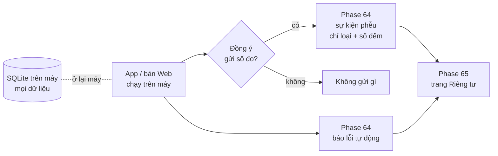

# Version 9 · Analytics + báo lỗi (bỏ Account)

> Trước khi bán, phải **đo được** người tải app đi tới đâu: mở app → dùng thử → tra niche đầu tiên → nhập license.
> Và **biết khi app lỗi** trên máy người khác mà không cần họ báo. Version 9 làm đúng 2 việc đó.
>
> **Đổi 2026-10-26:** bỏ hẳn tài khoản (Firebase Auth, sync project, xoá tài khoản). Học Wow Keywords: app chạy trên
> máy, không tài khoản, license key là đủ để bán. Phase 62, 63 chuyển xuống [Không làm](../appendix.md#khong-lam-chot-2026-10-26).

Chưa làm · làm ngay sau Version 1 (Phase 1–30.2)

## Mục tiêu

- **Đo được phễu bán app:** tải → mở app → dùng thử → tra niche đầu tiên → explore → xuất → nhập license. Biết người
  dùng rơi ở bước nào.
- **Biết khi app lỗi** trên máy người khác.
- **Trang Riêng tư** ghi đúng thứ app gửi đi — điều kiện để mở bán ở [Version 10](version-10.md).

**Thước đo Version 9 xong:** bảng phễu có số thật từ ≥ 3 người dùng ngoài · có báo lỗi tự động từ app · Privacy Policy
khớp từng sự kiện gửi đi.

## Chạy thế nào

## Các phase

- [Phase 64 · Analytics + báo lỗi](phase-64-analytics-errors.md) — sự kiện phễu (thêm `trial_start`, `license_activate`),
  báo lỗi tự động, có hỏi đồng ý
- [Phase 65 · Trang Riêng tư](phase-65-privacy-delete.md) — Privacy Policy ghi đúng thứ gửi đi; phần xoá tài khoản bỏ

**Luật**

- Không tài khoản, không đăng nhập. Mọi dữ liệu người dùng ở SQLite trên máy
- Analytics không gửi nội dung người dùng gõ, không gửi email / tên
- Không chọn dịch vụ bắt phải có server riêng; Claude không tạo tài khoản dịch vụ, anh tạo, Claude nối code

## Không làm ở Version 9

- **Tài khoản, đăng nhập, sync project lên cloud** (Phase 62, 63 cũ) — bỏ 2026-10-26
- **Xoá tài khoản** (phần đầu Phase 65 cũ) — không có tài khoản thì không cần
- **Đưa dữ liệu cào lên cloud**, chạy collector trên server
- **Thanh toán, license**: [Version 10](version-10.md)
- **Quảng cáo, bán dữ liệu người dùng**

