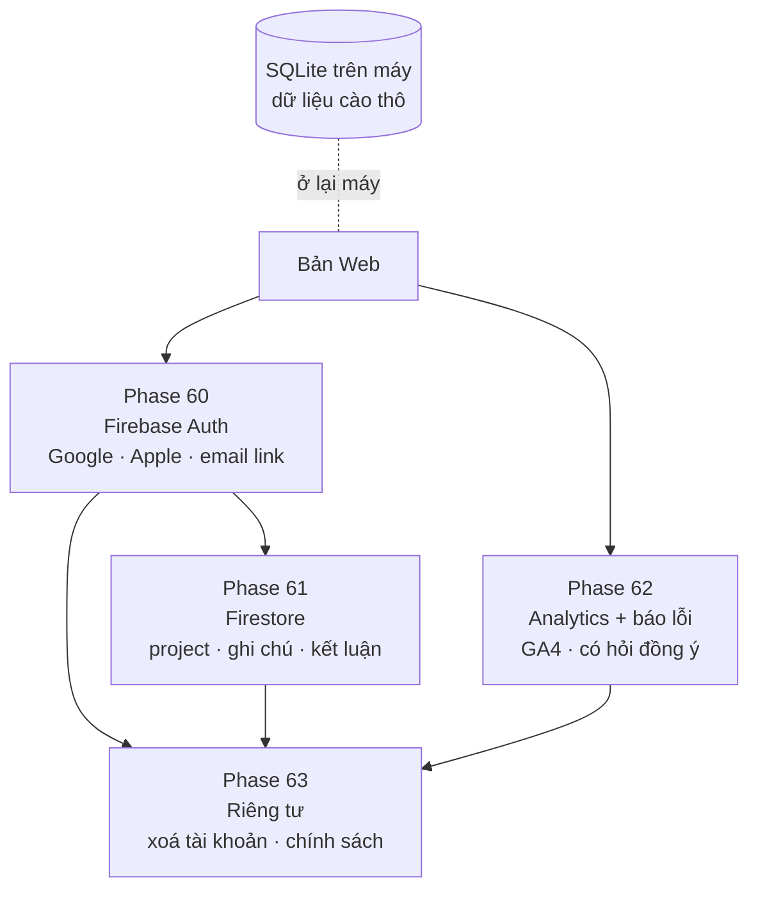

# Version 9 · Firebase, Analytics, Account

> Lớp tài khoản đã có trong code ([Version 8](version-8.md)). Version 9 nối nó lên mạng bằng **Firebase**:
> **đăng nhập thật**, **project đi theo người** sang máy khác, và **đo người dùng làm gì** (analytics) để biết
> tính năng nào đáng giữ. Đây là nền cho bán Pro ở [Version 10](version-10.md).

Chưa làm · sau Version 8

## Mục tiêu

- **Đăng nhập được** trên bản Web: Google, Apple, link email. Không đăng nhập vẫn dùng được như cũ.
- **Project theo người:** đăng nhập máy khác thấy project, ghi chú, kết luận của mình.
- **Đo được phễu:** mở app → tra niche đầu tiên → explore → so sánh → xuất / gói GEO. Biết người dùng rơi ở bước nào.
- **Biết khi app lỗi** trên máy người khác mà không cần họ báo.

**Thước đo Version 9 xong:** 1 người ngoài đăng nhập trên 2 máy thấy cùng project · bảng phễu GA4 có số thật từ ≥ 3
người dùng · có báo lỗi tự động từ app.

## Chạy thế nào

## Các phase

| Phase | Làm gì |
|---|---|
| [60 · Firebase Auth](phase-60-firebase-auth.md) | đăng nhập Google / Apple / email link, nối hồ sơ trên máy với tài khoản |
| [61 · Sync project](phase-61-project-sync.md) | project, ghi chú, kết luận, bộ so sánh lên Firestore; dữ liệu cào thô ở lại máy |
| [62 · Analytics + báo lỗi](phase-62-analytics-errors.md) | sự kiện phễu lên GA4, báo lỗi tự động, có hỏi đồng ý |
| [63 · Riêng tư + xoá tài khoản](phase-63-privacy-delete.md) | xoá tài khoản xoá cả cloud, trang Privacy, quy tắc bảo mật Firestore |

## Phase 60 · Firebase Auth

- **Làm:** Firebase Auth với Google, Apple, link email · lần đầu đăng nhập: gắn hồ sơ trên máy ([Phase 57](version-8.md)) với tài khoản ·
  đăng xuất vẫn dùng được trên máy.
- **Xong khi:** đăng nhập / đăng xuất cả 3 cách trên bản Web · tắt mạng vẫn mở được project trên máy.

## Phase 61 · Sync project

- **Làm:** Firestore chỉ giữ thứ **nhỏ và của người dùng**: project, ghi chú, kết luận, bộ so sánh, lịch sử hỏi ·
  dữ liệu cào thô (keyword, review, top 10…) **ở lại SQLite trên máy**, máy khác tra lại hoặc nhập file ·
  sửa trên 2 máy cùng lúc: bản sửa sau thắng, có ghi lại bản cũ · quy tắc Firestore: chỉ chủ đọc / ghi.
- **Xong khi:** sửa ghi chú máy A → máy B thấy trong ≤ 10 giây · người B không đọc được dữ liệu người A (test quy tắc).

## Phase 62 · Analytics + báo lỗi

- **Làm:** sự kiện GA4: `app_open`, `niche_search`, `explore_done`, `compare_open`, `ask_ai`, `export`, `geo_pack` ·
  **không gửi chữ keyword hay niche** người dùng gõ, chỉ gửi loại sự kiện + số đếm · hỏi đồng ý lần đầu mở, tắt được
  trong cài đặt · báo lỗi tự động (chọn lúc làm: dịch vụ có gói miễn phí hoặc tự ghi lên Firestore).
- **Xong khi:** bảng phễu GA4 hiện đủ bước · từ chối đồng ý → không có request nào tới GA4 (kiểm bằng network log).

## Phase 63 · Riêng tư + xoá tài khoản

- **Làm:** nút xoá tài khoản xoá Auth + Firestore + hỏi có xoá dữ liệu trên máy không · trang Privacy Policy ghi đúng
  thứ được gửi đi · xuất dữ liệu cloud của một người.
- **Xong khi:** xoá tài khoản → Firestore còn 0 tài liệu của người đó · Privacy Policy khớp danh sách sự kiện Phase 62.

**Luật**

- Không đăng nhập vẫn dùng đủ tính năng trên máy (tới khi Version 10 có gói Pro)
- Analytics không gửi nội dung người dùng gõ, không gửi email / tên
- Claude không tạo project Firebase, không nhập thông tin thanh toán Google Cloud. Anh tạo, Claude nối code

## Không làm ở Version 9

- **Đưa dữ liệu cào thô lên cloud**, chạy collector trên server
- **Chia sẻ project giữa nhiều người / team**: để ứng viên [Version 12](version-12.md)
- **Thanh toán, gói Pro**: [Version 10](version-10.md)
- **Server riêng ngoài Firebase**
- **Quảng cáo, bán dữ liệu người dùng**

